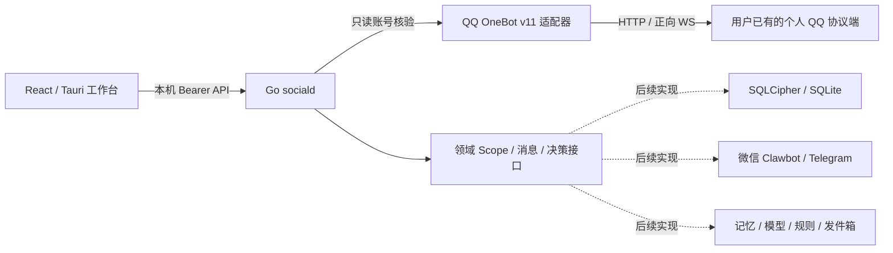

# Social Intelligence OS

多平台社交关系助手。当前实现为 **T04 工程骨架 + T02 QQ 只读适配**：独立 Go 后台、React 工作台、Tauri 外壳与 OpenAPI 初稿。

## 当前能运行的内容

- 本机 HTTP 服务、配对令牌鉴权、来源校验、健康检查和统一错误结构。
- 读取真实服务状态，优先展示 QQ 个人号 OneBot 适配；微信 Clawbot / Telegram 保留待接入声明。
- 消息、联系人、待审批等空列表界面；没有预置假消息和假连接。
- QQ 支持 HTTP/正向 WS 只读账号核验与私聊文本转换；模型、记忆、持久化与持续接收仍未实现。

自动发送始终关闭。SQLite/SQLCipher、持续收件、微信/Telegram授权、Windows服务安装和真实消息发送均未实现。QQ核验方式见[个人QQ接入说明](docs/qq-onebot-setup.md)；已有服务地址与令牌仅在后台配置，不需要安装AstrBot。

## 本地启动

需要 Node.js 24、Go 1.26+。当前开发环境可使用项目内 `.tools/go` 的便携 Go，工具本身不进入仓库。

### 1. 启动独立后台

在项目根目录打开 PowerShell：

```powershell
$env:SOCIALD_API_TOKEN = [Convert]::ToHexString([Security.Cryptography.RandomNumberGenerator]::GetBytes(32))
$env:SOCIALD_ADDR = '127.0.0.1:17890'
$env:SOCIALD_API_TOKEN | Set-Clipboard
.\scripts\dev-backend.ps1
```

保持终端运行。上述命令已将本次令牌复制到剪贴板，在工作台设置页粘贴即可。设置页只在内存保存，刷新后需重新填写；令牌不进入 URL 或仓库。

### 2. 启动前端

另开终端：

```powershell
cd apps/desktop
npm ci
npm run dev
```

打开 `http://127.0.0.1:1420`，在设置页填写后台令牌并连接。健康检查地址是 `http://127.0.0.1:17890/health/live`。

`/health/ready` 当前返回 **503 NOT_READY**，因为持久化存储尚未实现。工作台可以连接骨架 API，但不能据此认定产品已可无人值守运行。

### 3. 桌面外壳

Tauri 源码位于 `apps/desktop/src-tauri`。原生启动还需要 Rust/Cargo、Windows C++ 构建工具与 WebView2；本轮未在缺少这些环境的机器上验证原生编译。

```powershell
cd apps/desktop
npm run tauri dev
```

Go 后台需独立启动。Tauri 不以 sidecar 启停它；Windows 服务注册与自动恢复由 T19 后续实现。

## 检查

安装前端依赖后，在根目录运行：

```powershell
.\scripts\check.ps1
```

检查 Go 格式、测试、静态检查、API 引用、前端类型与构建；不自动声称桌面编译通过。已有 Rust 环境时可加 `-IncludeDesktop` 验证 Cargo 构建检查。

## 架构与文件



- [接口契约](api/openapi.yaml)：JSON 语法编码的 YAML 1.2，OpenAPI 3.1；当前仅支持读取。
- [首轮架构决定](docs/adr/0001-initial-architecture.md)：工程范围、权限与未实现边界。
- [个人账号适配决定](docs/adr/0003-personal-account-adapters.md)：自有服务与 OneBot 连接层分离，优先 QQ 个人号。
- [技术文档](技术文档.md)、[逐项任务](任务规划.md)、[feat 进度](feat.md)。
- [参考项目](参考项目/README.md)：上游源码仅用于静态参考。
- [本地交付与待办](docs/acceptance/T04-handoff.md)：源码包生成方式、GitHub 同步状态和剩余验收条件。

## 三人分工

- 吕佳航：后端、AI、数据与后台服务。
- joey：前端、UI、桌面与 Tauri。
- 谢麒麟：产品、测试验收与交付。

前后端由非作者交叉审查；辅助审查和构建通过不替代指定成员的正式审查与验收。
