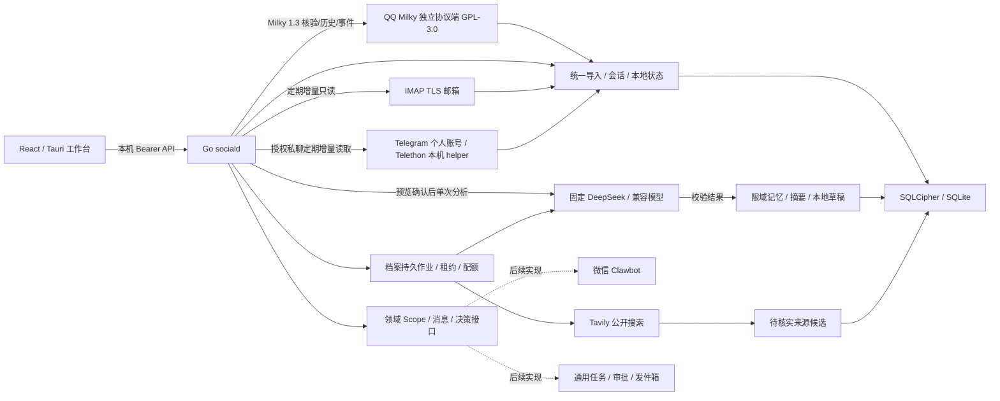

# Social Intelligence OS

多平台社交关系助手。当前实现为 **统一消息中心 + QQ Milky 账号核验与协议同步 + Telegram 个人私聊只读同步 + 微信本地库读取 + 邮箱只读同步 + AI 分类与联系人档案**：独立 Go 后台、加密本地存储、React 工作台与 Tauri 外壳。

**产品主线：一次授权后，用户不在场也能自动接收新消息、生成摘要并提醒。** 微信、QQ、邮箱与 Telegram 已有后台只读收件实现，真实离场验收待进行。购物个人号与闪聊当前办不到自动收件。见[无人值守收件任务说明](docs/无人值守收件任务说明.md)。

历史 main 整合的检查与同步记录见 [main整合记录](<docs/acceptance/main-integration.md>)。本功能分支新增的 MCP 与持久本机连接以各自验证记录为准，不因此视为已合入 main；真实服务、正式审查和产品验收状态继续单独登记。

## 当前能运行的内容

- 本机 HTTP 服务、主令牌与可撤销设备鉴权、来源校验、健康检查和统一错误结构。Windows 启动器/MCP 共用 DPAPI 受保护的稳定服务凭据；浏览器可记住设备 90 天，不持久化主令牌，见 [持久连接说明](<docs/adr/0013-persistent-local-connections.md>)。
- 读取真实服务状态，QQ 个人号仅展示 Milky 连接器；微信 Clawbot 保留待接入声明，Telegram 提供本人账号只读接入入口。
- QQ、微信、Telegram、闪聊的导入文本在同一消息中心管理：平台筛选、搜索、未读、置顶、归档、会话详情与历史分页。
- 用户确认后导入统一 JSON，支持 Telegram Desktop 单个个人私聊导出；稳定标识去重、冲突整批回滚，SQLCipher 加密保存。
- Telegram 个人账号在本机核验后可明确授权 1–10 个最近私聊，由后台定时收取新增文本。会话留在本机，不发送、不标远端已读；真实验收待进行。见[Telegram 接入说明](docs/telegram-setup.md)。
- QQ Milky 1.3 协议端可核验本人账号与版本、按联系人同步好友私聊历史、显式开启后台接收；加密入库去重、缺口显式记录并有界补查。发送保持关闭，真实账号验收待进行，见[QQ Milky 接入说明](docs/qq-milky-setup.md)。
- 当前会话可先预览确认，再调用 DeepSeek/兼容接口整理摘要、风险、草稿和待核实记忆；用户确认记忆后才进入后续上下文。真实模型与界面验收待进行。
- 联系人档案支持人工资料、AI 分类/摘要、事实候选、证据来源及 Markdown 导出。明确授权后可后台自动整理新消息、按公开姓名/公司搜索资料；公开结果待核实后确认，默认不开自动整理或联网。模型与 Tavily 密钥只在本机配置，见[档案配置](docs/ai-profiles-setup.md)。正式审查和真实模型/搜索验收待进行。
- 设置页可保存模型地址、名称、密钥和每日额度，密钥本机加密保存、不回显。导入可明确授权逐批分析全部已入库文本，显示处理进度，并把昵称、平台ID和聊天证据归入原联系人档案；同一人的会话经用户确认后可关联、解除及导出联合文档。见[使用与边界](docs/ai-profiles-setup.md)。
- “盯 + 跑”验收从关闭工作台后在平台发出的新消息开始。检查后台自动收件、授权摘要和提醒，并核对证据与缺口。流程见[不在场工作模式](docs/competition/不在场工作模式.md)。
- 每日摘要可自定义时间并启停，默认上海时区 08:00。目前只处理私聊、只在工作台提醒；微信群聊文本已能收件，但群聊相关性摘要和其他提醒渠道仍待交付。
- 邮箱使用本机 IMAP TLS 应用授权码，明确开启一个文件夹的自动增量收件；重启恢复进度，真实邮箱验收待进行。
- 微信支持授权私聊与群聊的本地后台定时只读、去重入库；默认关闭，设置加密保存，关闭工作台后后台可继续。当前只扫描最近窗口，不保证离线期间完整补齐；真实离场验收仍待进行。见[微信本地记录接入](docs/wechat-db-setup.md)。
- 微信4.1.15.56另有用户主动确认的一次性本机初始化入口 `scripts/initialize-wechat.ps1`，在重新登录时临时挂钩指定进程，密钥验证后DPAPI保存。用户已回传真实初始化成功日志；后台工作台读取另行验收，依赖准备和操作步骤见同一接入说明。

自动发送始终关闭。关闭工作台不影响已启用的后台收件；电脑、后台和平台连接须保持可用。各渠道的恢复、回填与缺口边界见[无人值守收件任务说明](docs/无人值守收件任务说明.md)。QQ 个人号统一使用 [Milky](docs/qq-milky-setup.md)，旧 OneBot 已退役。

推荐先按[统一消息中心使用说明](docs/unified-inbox.md)启动服务，再按[离场验收说明](docs/无人值守收件任务说明.md)选择已授权渠道验证后台新消息。源码不含预置消息或真人聊天数据。

## 本地启动

需要 Node.js 24、Go 1.26+、GCC（SQLCipher CGO 构建）和 PowerShell 7.2+。当前开发环境可使用项目内 `.tools/go` 的便携 Go，工具本身不进入仓库。

`initialize-wechat.ps1`、`prepare-wechat-init.ps1`、`configure-wechat.ps1` 和 `start-inbox.ps1` 可从 Windows PowerShell5.1 启动，会自动调用已有的 PowerShell7.2+ x64。实际业务仍在7运行，不自动安装或修改执行策略。

### 1. 启动独立后台

统一消息管理在项目根目录打开 PowerShell 7：

```powershell
.\scripts\start-inbox.ps1
```

普通启动复用当前 Windows 用户 DPAPI 保护的服务凭据，默认不打印令牌、不改剪贴板。首次/到期后授权浏览器时，将上述命令改为 `.\scripts\start-inbox.ps1 -CopyApiToken`；这是显式复制操作，剪贴板管理器可能保留历史。首次升级请先正常停止旧后台，再更新构建并启动，不自动接管已有实例。

如果只查看骨架与 QQ 核验，可不配置数据库，以原入口启动（仅页面内存连接，不支持设备持久授权，消息中心会提示先配置加密存储）：

```powershell
$env:SOCIALD_API_TOKEN = [Convert]::ToHexString([Security.Cryptography.RandomNumberGenerator]::GetBytes(32))
$env:SOCIALD_ADDR = '127.0.0.1:17890'
$env:SOCIALD_API_TOKEN | Set-Clipboard
.\scripts\dev-backend.ps1
```

保持终端运行。上面的开发模式示例显式复制的是本次 env token，与默认受保护凭据路径不同；每次生成新值都会让旧授权失效。推荐使用普通启动器：首次在工作台确认记住设备后，刷新/关闭重开或正常后台重启无需重复复制，授权默认 90 天，可在设置中忘记。只保存不可导出设备私钥，主令牌/短 bearer 不进入浏览器存储、URL 或日志。未勾选记住、旧后台或安全存储受限时只保留当前页面内存，刷新后重新输入；旧 sessionStorage 主令牌会清除。

临时断网/503 保留设备身份，恢复只校验状态，不重放导入/同步/分析。主动忘记会尽力撤销，离线时远端撤销未确认；主令牌轮换、真实监听地址变化、到期或站点数据清理后需重新配对。MCP 默认客户端只配可执行文件路径，不内嵌 token；见 [MCP 接入](<docs/mcp-setup.md>)。电脑和后台仍须运行，未安装开机服务。

### 2. 启动前端

另开终端：

```powershell
cd apps/desktop
npm ci
npm run dev
```

打开 `http://127.0.0.1:1420`，首次在设置页填写主令牌、确认“记住这台可信任的电脑（90 天）”并连接；之后在同一浏览器来源自动恢复，无需反复粘贴。未记住则仅当前页面有效。健康检查地址是 `http://127.0.0.1:17890/health/live`。

`/health/ready` 当前仍返回 **503 NOT_READY**，因为无人值守所需实时接收、通用任务与发送链路尚未完成；本地导入管理能力由 `/api/v1/inbox` 的 `storage_enabled` 单独声明。

### 3. 桌面外壳

Tauri 源码位于 `apps/desktop/src-tauri`。原生启动还需要 Rust/Cargo、Windows C++ 构建工具与 WebView2；本轮未在缺少这些环境的机器上验证原生编译。

```powershell
cd apps/desktop
npm run tauri dev
```

Go 后台需独立启动。Tauri 不以 sidecar 启停它；Windows 服务注册与自动恢复由 T19 后续实现。

## 检查

安装前端依赖后，在根目录运行：

```powershell
.\scripts\check.ps1
```

检查 Go 格式、测试、静态检查、API 引用、前端类型与构建；不自动声称桌面编译通过。已有 Rust 环境时可加 `-IncludeDesktop` 验证 Cargo 构建检查。

## 架构与文件



- [接口契约](api/openapi.yaml)：JSON 语法编码的 YAML 1.2，OpenAPI 3.1；本地消息管理、QQ Milky 同步与后台接收、只读邮箱同步、手动 AI 分析及联系人档案作业开放，发送/审批继续拒绝。
- [Telegram 个人账号](docs/telegram-setup.md)：申请应用、本机登录、只读同步和撤销说明。
- [QQ Milky 接入](docs/qq-milky-setup.md)：本机协议端配置、核验、历史同步、后台接收、已知限制与真实账号验收清单。
- [统一消息中心](docs/unified-inbox.md)：四平台导入格式、启动、数据保护和在线能力边界。
- [本地 MCP 服务](docs/mcp-setup.md)：通过 stdio 查询消息、导入指定微信会话，含客户端配置与数据边界说明。
- [自动获取聊天记录选型](参考项目/自动同步/README.md)：减少手工导入的QCE、Telegram个人账号及微信方案核验；目前为调研与待实施步骤。
- [邮箱接入](docs/email-setup.md)：QQ/163/企业邮箱本机配置、只读同步与限制。
- [联系人档案接入](docs/ai-profiles-setup.md)：后台自动分类、公开来源候选确认、配额及导出；[架构决定](docs/adr/0009-ai-contact-profiles.md)。
- [AI 管理接入](docs/ai-setup.md)：DeepSeek/兼容服务本机配置、预览确认、记忆核对与草稿。
- [首轮架构决定](docs/adr/0001-initial-architecture.md)：工程范围、权限与未实现边界。
- [个人账号适配决定](docs/adr/0003-personal-account-adapters.md)：QQ 个人号仅使用 Milky；保留历史决策及迁移边界。
- [技术文档](技术文档.md)、[逐项任务](任务规划.md)、[feat 进度](feat.md)。
- [参考项目](参考项目/README.md)：上游源码仅用于静态参考。
- [本地交付与待办](docs/acceptance/T04-handoff.md)：源码包生成方式、GitHub 同步状态和剩余验收条件。

## 三人分工

- angjustinl：后端、AI、数据与后台服务。
- joey：前端、UI、桌面与 Tauri。
- kirinbao：产品、测试验收与交付。

前后端由非作者交叉审查；辅助审查和构建通过不替代指定成员的正式审查与验收。

### 前端更新后仍显示旧界面

先核对 1420 服务所在目录。当前本机运行目录为 `D:\msg_manager\apps\desktop`，其他 Git 工作树的更新需先合并或经检查同步后才会生效。17890 后台重启不会同步前端文件；处理记录见[工作台 UI 同步验证](docs/acceptance/T08-ui-runtime-sync-validation.md)。
