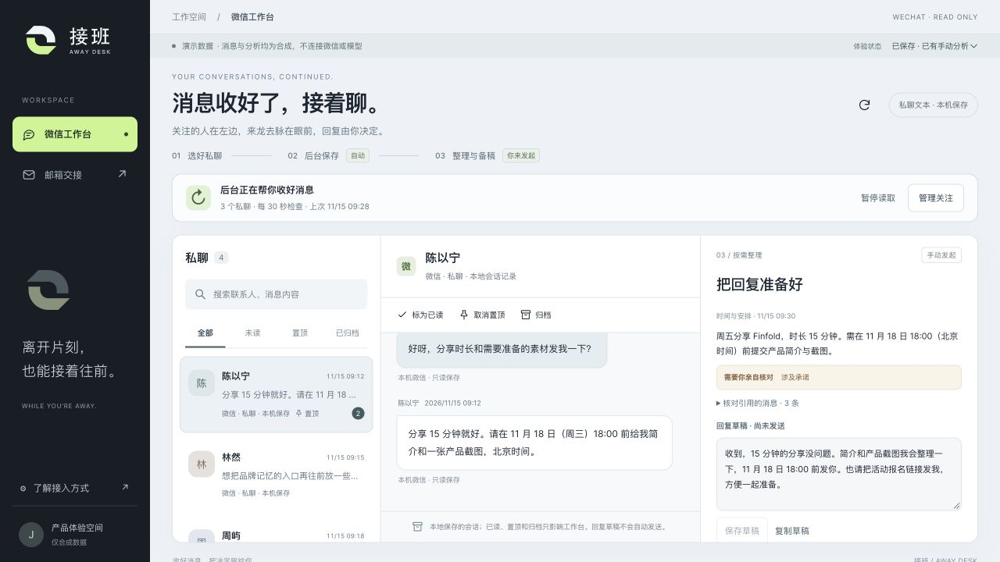
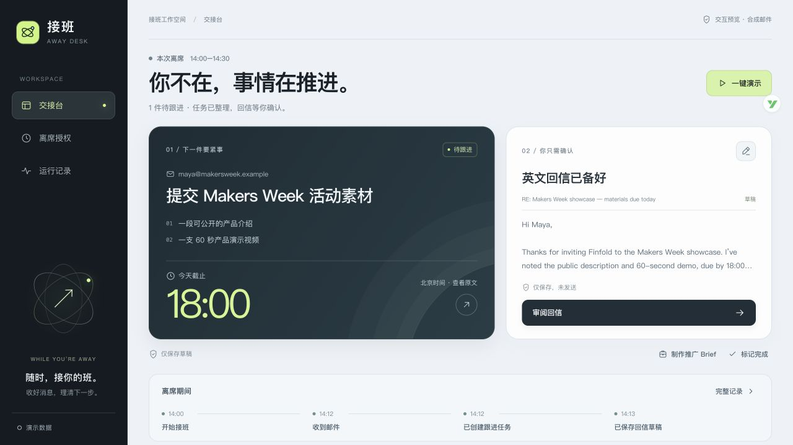

# 接班 / Away Desk

<picture>
  <source media="(prefers-color-scheme: dark)" srcset="apps/desktop/public/brand/lockup-reverse.svg" />
  
</picture>

**消息收好了，接着聊。**

[打开微信工作台 →](https://joeymilano.github.io/msg-manager/) · [体验邮箱交接](https://joeymilano.github.io/msg-manager/?demo=away) · [PR #3](https://github.com/qilinbro/msg-manager/pull/3) · [品牌与 Logo](https://joeymilano.github.io/msg-manager/brand/)

开会前，选好需要关注的人。回来后，聊天原文就在眼前；需要帮忙时，确认内容范围，让 AI 整理重点、备好回复。你核对、修改，再决定怎么回复。



公开预览无需登录，使用**合成聊天与分析**，不连接微信、不调用模型。可以体验勾选关注、暂停/恢复、分析确认和草稿编辑；刷新后演示修改重置。[关注设置](docs/media/wechat-focus.jpg) · [手机预览](docs/media/wechat-mobile.jpg) · [设计与验收](docs/wechat-workspace.md)

## 三步，把一段对话接起来

| 步骤 | 你看到的结果 | 谁来发起 |
| --- | --- | --- |
| **01 · 选好私聊** | 在「管理关注」勾选联系人，设定读取间隔，明确开启。 | 你授权 |
| **02 · 后台保存** | 后台定时只读选定私聊，保存到本机加密库。工作台显示最近检查时间、读取异常和暂停入口。 | 后台自动 |
| **03 · 整理与备稿** | 打开一段对话，核对这次交给模型的消息，确认后获得摘要、引用和回复草稿。 | 你按需发起 |

聊天、整理、草稿并排显示。AI 说了什么，可以回到原文核对；没保存完的修改，切换会话后还在。草稿不会自动发送。

真实微信流程面向 **Windows 微信 4.x 的本地数据库**。首次接入和授权在本机完成；开启后台读取后，关闭界面仍可继续，但电脑和 Go 后台需要保持运行。支持选定的 1—20 个私聊、10—300 秒检查周期；每次读取近期一批文本，尚不保证离线期间的全量补齐。[微信接入说明](docs/wechat-db-setup.md)

## 邮箱，交给离席接班

微信工作台侧栏的 **邮箱交接** 保留另一条流程：在授权时段内，指定发件人的来信可以自动变成任务和待审回信。

你去开会，活动主办方发来一封邀请，要求今天 18:00 前提交素材。回来时，交接台已经列好要交什么，备好英文回信。点击 **18:00**，核对邮件里的截止原句。含糊时间保留为「待确认」。

[](https://joeymilano.github.io/msg-manager/?demo=away)

微信的后台读取**只保存消息**，不会自动调用 AI 或建任务。邮箱离席会话是独立授权的自动处理链，两者在界面与权限上分开。

## 先体验，再接入

```sh
cd apps/desktop
npm ci
npm run dev
```

- [微信演示](http://127.0.0.1:1420/?demo=wechat)：查看原文和已有合成草稿；切换另一位联系人，点击「整理这段对话」体验范围确认。右上角可切换未接入、读取失败、模型未配置状态。
- [邮箱演示](http://127.0.0.1:1420/?demo=away)：点「一键演示」，7 秒走完交接，再点截止时间和「审阅回信」。
- [真实工作台](http://127.0.0.1:1420/)：默认进入微信工作台，从「连接与设置」连接独立后台，使用本机已有的微信与模型配置。

需要 Node.js 24 或更新版本。真实环境的启动、加密存储、微信初始化和模型配置分别见[工作台启动](docs/unified-inbox.md)、[微信接入](docs/wechat-db-setup.md)、[AI 接入](docs/ai-setup.md)、[邮箱授权](docs/email-setup.md)。

## 当前进度

| 项目 | 当前状态 |
| --- | --- |
| 微信工作台与公开预览 | 已实现三栏工作区、关注选择、状态和手动 AI 入口；浏览器与合成回归通过，待团队正式审查。 |
| 真实微信后台 | 仓库已实现本地只读和选定私聊轮询。本轮前端走查未读取真实微信；Windows 原生与真实账号验收待完成。 |
| 邮箱离席链路 | 合成邮箱 + 本机 Qwen 已通过三轮浏览器关窗检查。真实 QQ 邮箱三轮仍为 **0/3**，授权码手机验证暂缓；Tauri 原生验收待完成。 |
| Finfold 接入 | 可以预览公开 Brief；真实导入入口默认关闭，后续接测试环境。 |

合成预览、后台实现、真实账号验收分别记录。[微信 UI 验证](docs/wechat-workspace.md#验证记录) · [邮箱三轮验收](docs/away-desk.md#自动验收三轮)

## 从对话，到 Finfold 内容

活动信息、产品卖点和 CTA 经你确认后，可以整理为公开 Brief，交给 Finfold 创作台准备 LinkedIn 和 X 内容。现阶段 Brief 预览位于邮箱交接流程；微信对话的一键提炼 Brief 尚未实现。原始聊天、邮件和回信不直接带入推广素材。[赛后接入设计](docs/away-desk.md#finfold-赛后接入)

## 构建与协作

React 工作台 · Tauri 桌面外壳 · 独立 Go 后台 · SQLCipher 本地加密存储。

统一消息中心还保留 QQ、微信、Telegram、闪聊与邮箱的导入整理；QQ OneBot 当前仅核验账号。接口与实际能力以[接口契约](api/openapi.yaml)、[功能进度](feat.md)、[任务规划](任务规划.md)和[技术文档](技术文档.md)为准。

- **angjustinl** · 后端、AI、数据与后台服务
- **joey** · 前端、UI、桌面与 Tauri
- **kirinbao** · 产品、测试验收与交付

前后端由非作者成员交叉审查，产品验收由 kirinbao 组织。
