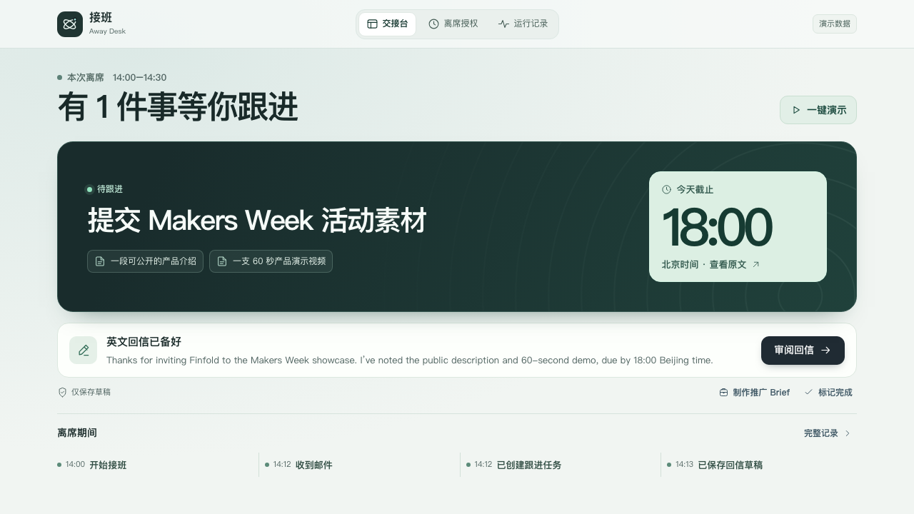

# 接班 / Away Desk

**去开个会。回来就知道哪件事要先做。**

你离开工作台后，活动主办方来信，要求今天 18:00 前提交素材。回来时，交接台已经列好要交什么，备好英文回信。点一下 **18:00**，邮件里写着截止时间的那句话就亮了。



[7 秒体验](#7-秒体验) · [真实邮箱演示](docs/away-desk.md#90-秒实机演示) · [技术文档](技术文档.md)

## 离席前选一个人，回来先看一件事

| 你在做什么 | 接班在做什么 |
| --- | --- |
| **准备去开会** | 你选发件人和离席时长，确认这段时间可以交给模型处理的内容。 |
| **窗口已经关了** | 独立后台检查授权邮箱。匹配的来信会变成带截止时间和原文的任务，另附一封待审的英文回信。 |
| **回来打开交接台** | 截止时间就在首屏。点开核对原句，再编辑、保存或复制回信。含糊的时间标为「待确认」。 |

回信由你审阅。会话到期或手动停止后，后台结束本次接班。运行记录保留收件、建任务和备稿的时间。

## 7 秒体验

有 Node.js 24 或更新版本即可启动网页演示。

```sh
cd apps/desktop
npm ci
npm run dev
```

打开 [演示交接台](http://127.0.0.1:1420/?demo=away)，点 **一键演示**。等它回到交接台，依次点 **18:00** 和 **审阅回信**。演示使用合成邮件，启动时无需邮箱或模型凭据。

## 90 秒实机演示

1. 在普通工作台打开 **接班 → 离席授权**，开始接班，关闭窗口。
2. 从授权测试邮箱投递一封虚构邀请。
3. 重开工作台，核对截止时间对应的邮件原句，打开回信和运行记录。

网页原型已走查。合成邮箱与本机 Qwen 模型已连续通过三轮浏览器关窗验收。真实邮箱三轮验收、Tauri 原生桌面验收仍待完成。测试配置和逐步操作见[实机演示与复核](docs/away-desk.md)。

## 从一封邀请到 Finfold 推广素材

收到活动邀约后，可以把公开活动信息、产品卖点和 CTA 整理成一份 Brief。你核对公开字段，再交给 Finfold 创作台，准备 LinkedIn 和 X 的推广内容。交接台可以预览 Brief，Finfold 导入入口默认关闭。[Finfold 接入说明](docs/away-desk.md#finfold-赛后接入)

## 本机工作台

接班由 React 工作台、Tauri 桌面外壳和独立 Go 后台组成。后台用 IMAP TLS 只读收件，任务与草稿存入本地 SQLCipher 加密库。项目也包含统一消息中心、QQ OneBot 账号核验和手动 AI 管理。QQ、微信、Telegram 和闪聊的导入记录可统一管理，持续同步选型见[自动获取聊天记录](参考项目/自动同步/README.md)。

- [工作台启动、统一导入与检查](docs/unified-inbox.md)
- [邮箱授权](docs/email-setup.md) · [模型接入](docs/ai-setup.md) · [接口契约](api/openapi.yaml)
- [功能进度](feat.md) · [任务与验收](任务规划.md) · [架构与实现](技术文档.md) · [工程交付](docs/acceptance/T04-handoff.md)

## 团队

- **angjustinl** · 后端、AI、数据与后台服务
- **joey** · 前端、UI、桌面与 Tauri
- **kirinbao** · 产品、测试验收与交付

前后端由团队成员交叉审查，产品验收见[任务规划](任务规划.md)。
