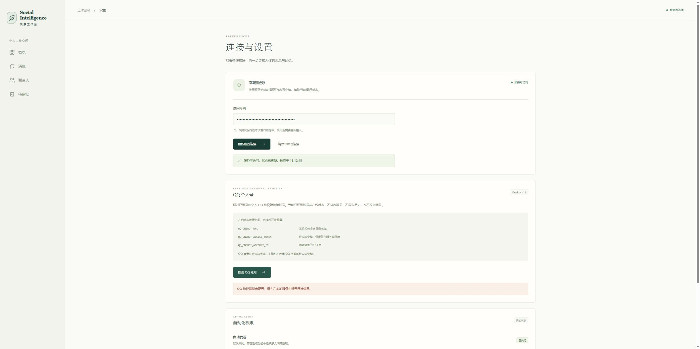

# T02 QQ OneBot 适配验证记录

- 日期：2026-11-12（Asia/Shanghai）。
- 关联：FEAT-T02 / CHG-T02-001。
- 状态：进行中；实际开始日期：2026-11-12；实际完成日期：—。
- 本记录证明本地适配实现与检查结果，不代表真实 QQ 收发或 T02 整体验收。

## 本轮交付

- `internal/connector/onebot/`：HTTP API / 正向 WebSocket 只读账号核验、严格 JSON 解析、好友私聊纯文本转换及测试。
- `internal/api/qq.go`：经本产品鉴权的核验接口、错误分类、单并发检测和最近检测状态。
- `tests/integration/qq_test.go`：本产品 API 与本机模拟协议端的集成测试。
- `apps/desktop/src/`：QQ 个人号入口、只读核验、失败提示和令牌清除处理。
- `api/openapi.yaml`、`docs/adr/0003-personal-account-adapters.md`、`docs/qq-onebot-setup.md`：契约、架构决定与本机配置说明。

这是本项目自己的适配层，未部署 AstrBot，也未运行其源码。外部协议端继续由用户管理。

## 已通过的检查

整体入口 `scripts/check.ps1` 返回成功：Go 格式、全部 Go 测试、vet、OpenAPI 契约检查，以及前端格式、类型检查和生产构建均通过。本轮构建 JS 约 247.74 KB、CSS 约 16.91 KB（压缩前）。

协议层测试覆盖：

- HTTP 与正向 WS 调用仅使用 get_login_info、get_status；预期账号、online 与 good 必须同时满足。
- 配置只允许明确端口的本机地址；禁止 URL 凭据、查询参数、代理与重定向。令牌只进入协议请求认证头。
- WS echo 正确关联，拒绝无效响应；超时、取消、响应体大小和跳过帧数受限。
- 严格拒绝重复 JSON 键、尾随内容、过深嵌套和无效 UTF-8；账号及消息 ID 不经过浮点数转换。
- 好友私聊纯文本保留账号作用域；拒绝其他账号、自发回声、群聊、临时会话、混合媒体及 CQ 控制片段。

本产品 API 集成测试覆盖：

- 未鉴权、非法来源等请求不会拨号；浏览器附带的 URL / 账号参数不能覆盖后台配置。
- 未配置、错误认证、账号不符、未登录、协议错误和不可达返回固定分类，隐藏地址、令牌和上游正文。
- 成功核验后仍明确 `receiving_enabled=false`、`sending_enabled=false`；平台收发能力不被置为可用。
- 读取连接列表不会再次核验；写操作保持 501，存储未就绪保持 503。

## 浏览器验证与证据

使用实际 Edge 浏览器连接本轮临时 Go 服务；QQ 三个环境变量刻意留空，只使用合成的本产品测试令牌：

1. 工作台设置页显示“QQ 个人号 / OneBot v11”，明确当前仅核验身份。
2. 页面不提供 QQ 密码、OneBot 令牌或目标地址输入框。
3. 点击“核验 QQ 账号”，本产品 API 返回未配置，页面正确提示本地配置缺失。
4. 清除测试令牌后，账号核验按钮禁用、服务状态重置，界面没有残留账号信息。
5. 临时后端进程已停止；未修改用户已有 QQ / NapCat 服务。

截图记录第 3 步，仅证明本产品接口与界面联调，不代表 QQ 已连接：

## 辅助复核与正式审查

辅助代理已对后端 API 与前端状态处理进行只读交叉检查，未发现必须修复的问题；该检查不替代团队成员实名审查。

- joey：后端正式代码审查待进行。
- 吕佳航：前端正式代码审查及技术复核待进行。
- 谢麒麟：真实平台与产品验收待进行。

## 未实现、未验证与下一步

- 用户已确认有既有服务，尚未提供地址、端口与 HTTP / 正向 WS 模式；没有读取本机已有凭据，也没有连接真实 QQ 服务。
- 本轮协议测试使用模拟服务，不能代替真实账号身份核验、平台授权或至少 10 次真实收发验收。
- 尚未实现持续接收、消息持久化、历史导入、群聊、多媒体、模型回复、审批执行或发送。文本规范化函数尚未挂入持续收件链路。
- 身份核验是一次性探测；不证明持续在线，不保证协议端断线后的历史完整恢复。
- 下一项可执行工作是按接入说明配置现有服务并进行真实只读核验。T03/T05/T06 完成持久化后接入收件；T16/T17 完成审批和发件箱后再实现授权发送。
- T06/T17 的 T02 前置仅指适配/真实身份核验子项通过且经非作者审查；T02 最终真实收发验收随后回补，避免依赖自锁。原日期保留为基线，修订完成日期待三人排期确认。
- Rust/Cargo/MSVC 条件和原生 Tauri 构建仍沿用 T04 的未验证记录。

T02 保持进行中，不填写最终完成日期、不增加已完成统计。后续上传记录：CHG-T04-003，代码已同步至独立分支，提交 [35ecade](https://github.com/qilinbro/msg-manager/commit/35ecadef2e52b6cbf4471d88338d8f600cf75f4f)；未创建 PR。
