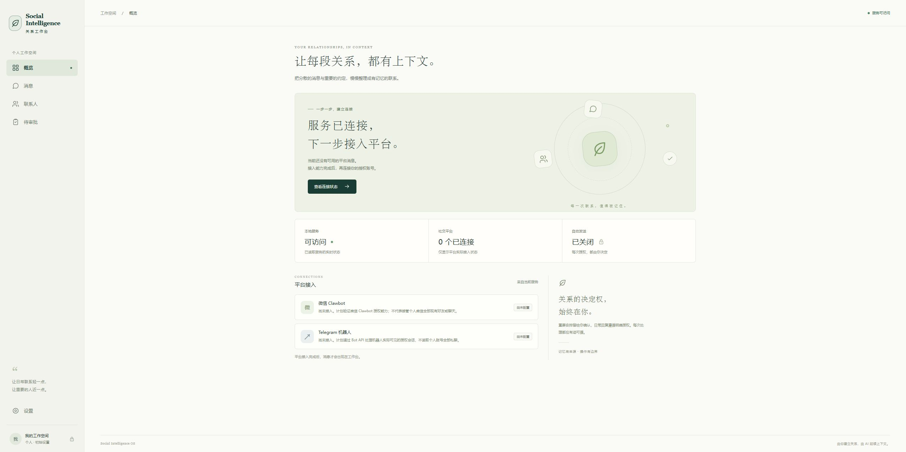

# T04 首轮工程验证

- 日期：2026-11-12（Asia/Shanghai）
- 关联：FEAT-T04 / CHG-T04-001、CHG-T04-002
- 任务状态：进行中；这是一轮工程验证记录，尚非 T04 整体验收。
- 正式审查：joey / angjustinl待审；业务与交付验收：kirinbao待验。

## 环境与版本

Windows x64；Node.js 24.12.0；npm 11.6.2；项目内 Go 1.27.4（模块最低 1.26）。前端锁定 React 19.3.1、TypeScript 7.0.2、Vite 8.3.8；Tauri JS API/CLI 2.12.4，Rust 直接依赖 tauri 2.12.5、tauri-build 2.7.4。

Go 工具从官方发布元数据获取并验证 SHA256，保留在本机 .tools，不上传仓库。前端使用 npm 官方包与 package-lock。

## 已通过

- scripts/check.ps1：Go 格式检查、go test ./...、go vet ./...。
- 独立 Go 二进制构建，127.0.0.1:17890 实际启动及 HTTP 健康检查。
- Go 集成测试覆盖错误/缺失令牌、Origin/Host、只读预检、固定工作区、空列表、凭据不泄露和存储未就绪。
- 写入请求测试覆盖 56 组方法/路由组合，均不可触发发送；唯一策略实现 DenyAll。
- OpenAPI 的内部引用、业务鉴权声明和预留写接口 501 边界检查。
- npm run format:check、npm run check、npm run build；构建 JS 约 241.6 KB、CSS 15.5 KB，均为压缩前。
- Tauri CLI 可执行，所有配置引用的 PNG / ICO / ICNS 图标已生成并存在。
- 实际 Edge 浏览器在本地前端完成：输入本次测试令牌 → 读取真实 system 状态 → 显示服务可访问、平台 0 个连接、自动发送关闭。
- 消息、联系人、待审批三页均读取真实空列表，没有演示数据或写操作。
- 无效令牌显示身份验证失败，清除操作移除令牌和已连接状态。
- 390 × 844 布局检查：页面宽度未超过窗口，无横向溢出；检查后恢复原窗口尺寸。

## 联调清理

本轮临时后台进程已停止，测试令牌已从界面清除，不记录其值。前端开发预览可继续使用；连接后台时需按根 README 重新设置自己的随机令牌。测试凭据未进入仓库。

## 未验证或未实现

- Rust/Cargo/MSVC 与 Windows SDK 未安装，未做 cargo check、Tauri 原生启动、桌面安装或 Cargo.lock 生成。CLI 的 info 命令返回诊断，不等于编译通过。
- 数据库、加密、消息持久化、模型、平台授权、消息发送、审批执行和 Windows 服务注册均未实现。
- Windows WebView2 已被 CLI 识别，但不据此声称桌面应用可构建。
- 没有性能基准、24 小时运行或比赛闭环验收；这些属于后续任务。

## 真实预览证据

以下截图来自本轮成功连接的实际浏览器页面，仅证明骨架状态读取，不代表平台接入。

## 复核入口

根目录运行 scripts/check.ps1。具备原生桌面工具链后加 -IncludeDesktop，再完成指定人员交叉审查和业务验收。所有未验证项补齐后才可填写 T04 实际完成日期。

## 续作核对（CHG-T04-002）

新增事件流接口边界测试：已授权返回 JSON 501，未授权 401，非法来源/Host 403；即使请求 Accept 为 SSE 并提供恢复游标，也不生成 SSE 帧或回显敏感值。事件流设计记录与实际不可用响应分开。

续作完整检查已通过：scripts/check.ps1 中的 Go 格式、全部测试、vet、OpenAPI 引用及前端格式、类型、构建均成功。32 项任务与 feat 的负责人、审查人、状态和实际完成日期一致，T04 保持进行中。

本地交付的复核方法：用 PowerShell 7.2+ 运行 scripts/package-handoff.ps1，读取 ZIP 内 HANDOFF-MANIFEST.json，逐条核对大小与 SHA256；再核对 ZIP 旁的整体哈希。包中排除 .tools、缓存、node_modules、真实 .env、数据库/WAL、私钥、证书、上游源码和构建产物；输出路径拒绝既有 junction/link。

GitHub 创建分支的自动审批未完成，原因是额度不足；没有本轮提交或草稿 PR。详见 T04-handoff.md，不能把本地交付误写为已同步远端。
