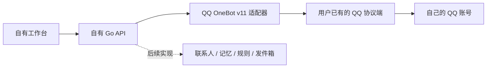

# ADR 0003：个人账号优先，Bot 适配方式服务于自有产品

- 日期：2026-11-12
- 任务：FEAT-T02 / CHG-T02-001
- 来源：用户要求 QQ 接入、参考 AstrBot 的个人账号适配，并明确以自己的产品服务为主。

> 当前决定（2026-11-17，`CHG-T02-006`）：QQ 个人号仅使用 Milky 1.3，取消 OneBot 运行时、配置、API 与界面入口。下方 2026-11-12 / 2026-11-15 内容保留为历史决策；其中“保留 OneBot”的条款已由文末决定取代。当前操作见 [Milky 接入](../qq-milky-setup.md)。

## 产品与连接层

联系人、记忆、检索、权限、任务、审计和工作台由本项目实现。外部协议端仅承担既有 QQ 账号登录与协议通信，不承担本产品的决策，不接收模型密钥，也不替代本产品。

AstrBot 的 aiocqhttp 适配器使用 OneBot v11 **反向 WebSocket**：协议端拨入 AstrBot。我们借鉴其适配层与账号/消息分离原则，当前实现 **HTTP API 或正向 WebSocket**：本产品拨入用户已运行的协议端，不需要安装或依赖 AstrBot。两个方向需要对应配置，不能互换地址。

## 本轮真实能力

1. 通过本机配置访问 OneBot，执行 get_login_info 和 get_status；校验预期 QQ 账号和在线状态。
2. 提供本产品鉴权后的账号核验接口和工作台入口；记录的是最近一次核验，不冒充持续在线连接。
3. 提供 QQ 好友私聊纯文本事件的规范化函数，校验账号、稳定消息 ID、联系人与会话作用域。
4. 消息持久化和持续监听尚未接入，所以接收、发送、历史导入能力仍显示 false。群聊、混合媒体及陌生人临时会话明确不支持，避免静默丢失上下文。

## 账号与授权

优先评估用户自己授权的个人账号连接方式，具体以各平台可用能力为准。个人 QQ 的 OneBot 协议端不等同于腾讯官方 QQ Bot API；本轮使用现有服务，不自动下载安装、不操控客户端登录、不绕过验证码或平台访问限制。

微信 Clawbot 仍属于特定 Bot 通道，不能因“个人号优先”就宣称能够读取个人微信所有原有好友/群聊。后续平台需要逐项验证。

## 边界

- OneBot 令牌仅从后台环境读取，浏览器不提交地址、令牌或预期账号；禁止把令牌放 URL。
- 当前只允许本机 HTTP/WS 目标，不跟随重定向；本产品自己的 API 令牌和 OneBot 令牌分开。
- 验证成功不是“已接管 QQ”；发送仍默认关闭，且没有对外发送接口。
- 后续接收必须先建立持久化收件，发送必须经规则、审批与发件箱；OneBot echo 是回执关联值，不是消息幂等键。
- 上游协议端断线不保证历史补齐；不得以轮询/重连声称完整恢复聊天记录。

## 一手依据

- [AstrBot 官方 OneBot 文档](https://docs.astrbot.app/platform/aiocqhttp.html)
- [固定版本适配器源码](https://github.com/AstrBotDevs/AstrBot/blob/2c3ee62b15eb0d329f608481002bed5fc45e84e7/astrbot/core/platform/sources/aiocqhttp/aiocqhttp_platform_adapter.py)
- [OneBot 正向 WS](https://github.com/botuniverse/onebot-11/blob/master/communication/ws.md)、[反向 WS](https://github.com/botuniverse/onebot-11/blob/master/communication/ws-reverse.md)、[公共 API](https://github.com/botuniverse/onebot-11/blob/master/api/public.md)
- [NapCat 接入文档](https://doc.napneko.icu/use/integration)；核验时 [NapCatQQ 仓库](https://github.com/NapNeko/NapCatQQ) 默认分支已显示 Ending，因此本项目只对用户实际部署的协议版本做兼容验证，不宣称上游当前可正常下载安装。

## 2026-11-15 补充：Milky 主线与统一 adapter

用户明确两项决策：① 新增 `qq-milky` 作为 QQ 主线；② 接受 GPL-3.0 协议端作为外部独立进程依赖。同时要求「通过基类继承把 adapter 协议端实现统一」。

**Go 无基类继承。** 现有 `onebot`、`mailbox`、`wechatdb` 均为独立包，`internal/connector/connector.go` 已用接口（`Receiver`、`Sender`）与数据结构（`Capabilities`、`Event`、`Batch`、`SendResult`）定义契约层。统一的可行形态是「共享实现底座 + 接口组合」，不新增第二套契约：

1. **契约层**：沿用 `connector` 既有接口，保持不变。
2. **共享底座**（拟新增 `internal/connector/adapter`）：只承载横切边界——本机目标校验（仅 `127.0.0.1`/`::1`/`localhost`，不做 DNS 解析）、禁重定向/代理、令牌仅放 `Authorization` 头、`POST /api/{action}` 与 `{status,retcode,data}` 信封解码、严格 JSON（拒绝重复键与超深嵌套）、响应大小上限、正向 WebSocket 拨号、脱敏错误分类。
3. **协议实现**：`qq-milky` 嵌入该底座并实现 `Probe`/历史/事件规范化/发送；`qq-onebot` 保留已交付的只读核验，待其正式审查后再迁移到同一底座，避免一次性改动已验证代码。

`qq-milky` 面向 Milky 协议规范而非绑定单一实现，仅对用户实际部署的 `Lagrange.Milky` 版本做能力核验。协议端默认 `127.0.0.1:3000`、`POST /api/{action}`、`GET /event`（WS/SSE），鉴权 `Bearer <access_token>`；`get_login_info` 与 `get_impl_info` 用于账号与版本双校验。

**合规口径（GPL-3.0）：** 协议端是用户自行安装的独立进程，本产品不分发其二进制、不动态或静态链接、不复制上游源码；只经本机 HTTP/WS 调用公开协议接口。发布说明与交付清单须声明协议端名称、许可证 GPL-3.0 及固定版本仓库链接。这是工程边界口径，不代指法律结论，最终由产品负责人确认；本产品自身许可不因此改变。`参考项目/` 的固定版本源码仍只作静态阅读，不进入交付包。

**未决项（默认假设，待用户确认）：** 正向 WebSocket（SSE 备选、不采用 WebHook）；锁定 Milky 1.3 且 `get_impl_info.milky_version` 不匹配时明确拒绝；首版只读（身份核验/历史/实时接收），`SendText` 保持 `false`，发送实现待 T15/T16 就绪；QQ 历史主线改走 `get_history_messages`，QCE 资料降级为备选参考；协议端部署账号与第三方签名服务授权由用户确认。

**仍然成立的边界：** 一次身份核验不等于持续在线或已开启收发；事件流没有唯一 ID、游标或断线补发，缺口必须显式记录并用历史 API 有界补查；去重键为 `(connection_id, message_scene, peer_id, message_seq)`；不确定发送结果转 `unknown` 且不自动重发；自动发送默认关闭，模型不接触 `access_token`。

本条记录范围与设计决策；当时的实际完成日期保持 `—`。

## 2026-11-15 实现补记（CHG-T02-003）

用户要求完整实施。已按上述分层交付 `internal/connector/adapter`（共享底座）与 `internal/connector/qqmilky`（Milky 1.3 客户端），并在 `internal/api/qq_milky.go` 接入状态、核验、历史同步、后台事件接收与缺口补查；同步消息经 `store.ImportMilkyContext` 事务加密入库并去重，配置只从后台环境读取，工作台新增设置面板，契约与单元/集成测试同步补齐。

`send_private_message` 在协议客户端内已实现，但**未接入任何 HTTP 路由、未装配发件箱执行器**；契约 `sending_enabled` 固定为 `false`。事件采用正向 WebSocket（本产品拨出），不采用 WebHook 入站；版本锁定 1.3，不匹配明确拒绝。

已知限制：schema v6 的 `source` 兼容列仍记为 `import`，协议同步来源由服务端生成的 `milky:friend:` 前缀与连接显示名保证可追溯，独立来源枚举待 v7 迁移；后台接收设置不持久化；事件流无补发，缺口显式记录并用历史接口有界补查；`friend` 场景 `start_message_seq` 为空的行为需在真实协议端验证。

本补记只说明实现与工程检查，不含真实账号授权、joey 正式代码审查或 kirinbao 验收；实际完成日期仍为 `—`。

## 2026-11-17 决定：QQ 个人号仅使用 Milky（CHG-T02-006）

用户明确要求取消 OneBot，只保留 Milky。采用 `工作台 → 自有 Go API → qqmilky + adapter → 本机 Milky 1.3 协议端`，取代历史并行保留两套 QQ 接入的方案。

- 移除 `internal/connector/onebot`、OneBot 后台连接状态与核验路由，取消 `QQ_ONEBOT_*` 配置读取和设置面板；系统连接器目录只保留一个 QQ 个人号连接器 `qq-milky`。
- Milky 的本人账号/版本核验、好友私聊历史同步、加密授权名单和显式后台接收继续沿用现有实现。旧 OneBot 地址、令牌不能自动转换为 Milky 配置，也不能用 WebUI 密码替代 Milky 访问令牌。
- 仅取消接入能力，不删除已导入聊天、联系人、加密数据库或历史审查记录。旧环境变量不再驱动连接；迁移时应从本机启动环境移除，再配置 `QQ_MILKY_URL`、`QQ_MILKY_ACCESS_TOKEN`、`QQ_MILKY_ACCOUNT_ID`，核验本人账号后重新确认接收名单。
- 发送仍关闭，未新开群聊、媒体、自动分析权限或对外平台连接。真实协议端、本人账号及非作者审查仍按原边界验收。

本变更在独立分支 `feat/qq-milky-only` 实施，不并入其他开发中的功能；工程结果见 [移除验证记录](../acceptance/T02-milky-only-validation.md)。负责人 angjustinl（后端）/joey（前端），指定审查 joey（后端）/angjustinl（前端），kirinbao 组织验收。正式审查、真实验收与实际完成日期均为 —。
