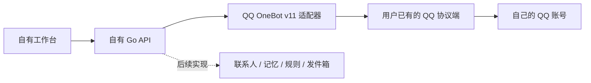

# ADR 0003：个人账号优先，Bot 适配方式服务于自有产品

- 日期：2026-11-12
- 任务：FEAT-T02 / CHG-T02-001
- 来源：用户要求 QQ 接入、参考 AstrBot 的个人账号适配，并明确以自己的产品服务为主。

## 产品与连接层

联系人、记忆、检索、权限、任务、审计和工作台由本项目实现。外部协议端仅承担既有 QQ 账号登录与协议通信，不承担本产品的决策，不接收模型密钥，也不替代本产品。

AstrBot 的 aiocqhttp 适配器使用 OneBot v11 **反向 WebSocket**：协议端拨入 AstrBot。我们借鉴其适配层与账号/消息分离原则，当前实现 **HTTP API 或正向 WebSocket**：本产品拨入用户已运行的协议端，不需要安装或依赖 AstrBot。两个方向需要对应配置，不能互换地址。

## 本轮真实能力

1. 通过本机配置访问 OneBot，执行 get_login_info 和 get_status；校验预期 QQ 账号和在线状态。
2. 提供本产品鉴权后的账号核验接口和工作台入口；记录的是最近一次核验，不冒充持续在线连接。
3. 提供 QQ 好友私聊纯文本事件的规范化函数，校验账号、稳定消息 ID、联系人与会话作用域。
4. 消息持久化和持续监听尚未接入，所以接收、发送、历史导入能力仍显示 false。群聊、混合媒体及陌生人临时会话明确不支持，避免静默丢失上下文。

## 账号与授权

优先评估用户自己授权的个人账号连接方式，具体以各平台可用能力为准。个人 QQ 的 OneBot 协议端不等同于腾讯官方 QQ Bot API；本轮使用现有服务，不自动下载安装、不操控客户端登录、不绕过验证码或平台访问限制。

微信 Clawbot 仍属于特定 Bot 通道，不能因“个人号优先”就宣称能够读取个人微信所有原有好友/群聊。后续平台需要逐项验证。

## 边界

- OneBot 令牌仅从后台环境读取，浏览器不提交地址、令牌或预期账号；禁止把令牌放 URL。
- 当前只允许本机 HTTP/WS 目标，不跟随重定向；本产品自己的 API 令牌和 OneBot 令牌分开。
- 验证成功不是“已接管 QQ”；发送仍默认关闭，且没有对外发送接口。
- 后续接收必须先建立持久化收件，发送必须经规则、审批与发件箱；OneBot echo 是回执关联值，不是消息幂等键。
- 上游协议端断线不保证历史补齐；不得以轮询/重连声称完整恢复聊天记录。

## 一手依据

- [AstrBot 官方 OneBot 文档](https://docs.astrbot.app/platform/aiocqhttp.html)
- [固定版本适配器源码](https://github.com/AstrBotDevs/AstrBot/blob/2c3ee62b15eb0d329f608481002bed5fc45e84e7/astrbot/core/platform/sources/aiocqhttp/aiocqhttp_platform_adapter.py)
- [OneBot 正向 WS](https://github.com/botuniverse/onebot-11/blob/master/communication/ws.md)、[反向 WS](https://github.com/botuniverse/onebot-11/blob/master/communication/ws-reverse.md)、[公共 API](https://github.com/botuniverse/onebot-11/blob/master/api/public.md)
- [NapCat 接入文档](https://doc.napneko.icu/use/integration)；核验时 [NapCatQQ 仓库](https://github.com/NapNeko/NapCatQQ) 默认分支已显示 Ending，因此本项目只对用户实际部署的协议版本做兼容验证，不宣称上游当前可正常下载安装。
