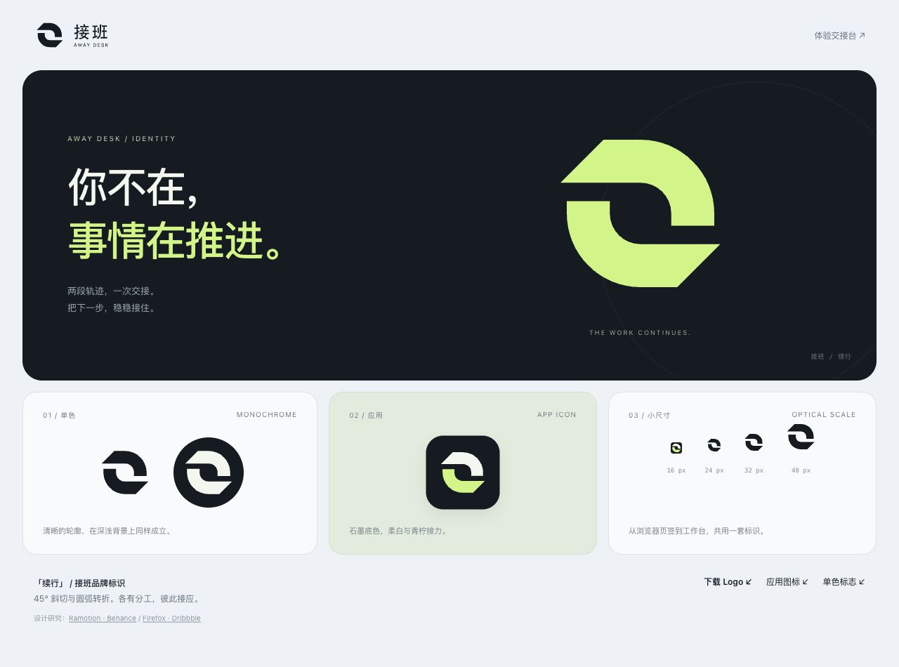

# 接班 / 续行标志

两段轨迹，一次交接。你不在，事情在推进。

[品牌展示与 SVG 下载](https://joeymilano.github.io/msg-manager/brand/) · [体验交接台](https://joeymilano.github.io/msg-manager/)

## 设计决定

从直端「接力」、斜切「续行」、闭合「同步」三种草案中选择续行。两段旋转对称的轨迹保留中间空隙，表达相互接应；45° 端点让静态图形带有方向。圆弧负责柔和，斜切负责利落。标志只用实心轮廓，缩小和单色显示时不依赖光效。

参考了以下设计师发布的案例，并查看实际画面；参考的是构形和系统设计方法，接班的图形由本项目独立绘制。

- [Ramotion / Startup Branding, vol. 1 · Behance](https://www.behance.net/gallery/178165675/Startup-Branding-vol-1)：观察 Descript 等标志如何用少量几何形构成识别性轮廓，以及图形和字标的比例。采用统一几何、清晰间距与单色可用的原则。
- [Ramotion / Firefox Branding & Design System · Dribbble](https://dribbble.com/shots/27120959--Case-Study-Branding-Design-system-for-Firefox)：观察主标志、产品图标与应用之间的共同形态。将接班标志用于侧栏、工作状态、网页图标、桌面图标和展示素材。

## 使用

| 场景 | 素材 |
| --- | --- |
| 浅色背景 | [深色组合字标](../apps/desktop/public/brand/lockup.svg) |
| 石墨背景 | [柔白与青柠组合字标](../apps/desktop/public/brand/lockup-reverse.svg) |
| 单色与印刷 | [深色符号](../apps/desktop/public/brand/symbol.svg)、[反白符号](../apps/desktop/public/brand/symbol-reverse.svg) |
| 展示主视觉 | [青柠符号](../apps/desktop/public/brand/symbol-accent.svg) |
| 桌面、演示封面 | [应用图标](../apps/desktop/public/brand/app-icon.svg) |
| 浏览器页签 | [小尺寸优化图标](../apps/desktop/public/brand/favicon.svg) |

- 石墨 `#141B21`、柔白 `#F3F7EE`、青柠 `#C9F578`，工作区延续冰蓝 `#EDF2F6`。
- 青柠图形放在深色底上；浅色底使用石墨版。不要给标志增加描边或压缩内部空隙。
- 普通符号建议至少 24 px；16 px 使用专门的 favicon。图形周围留出至少画布宽度 1/8 的空间。
- 组合字标按原比例缩放，文字已转为轮廓。UI 使用有可访问名称的 SVG，装饰图形隐藏于辅助技术。
- 工作状态的轻微呼吸只在接班运行时出现；系统要求减少动态效果时停止动画。

## 维护与验证

图形和字标的唯一几何源为 `apps/desktop/src/brand/identity.ts`，React 组件与导出脚本共用。修改后运行 `node scripts/build-brand-assets.mjs`，再构建前端。离线预览内嵌 favicon，品牌展示页可独立发布。

桌面所需 PNG、ICO、ICNS 由项目自带 Tauri 工具从 `app-icon.svg` 导出；仅更新既有五个资源文件，不新增未使用平台产物。安装包图标仍需在原生打包验收时核实。

2026-11-15：前端格式、类型与构建检查通过；1280 × 720、390 × 844 检查 Logo 和导航布局，16/24/32/48 px、深浅背景检查标志轮廓。原文和回信入口回归通过。公开页面与离线文件使用演示数据；品牌变更不代表真实 QQ 邮箱或桌面安装验收完成。CHG-T21-006 待 angjustinl 代码审查、kirinbao 产品验收。
