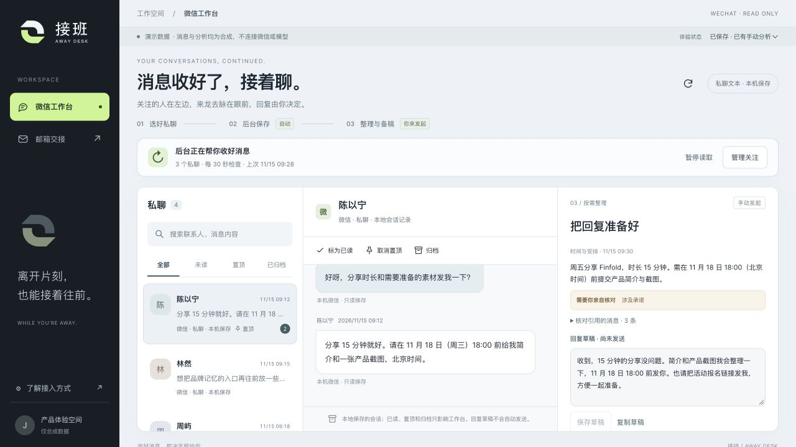
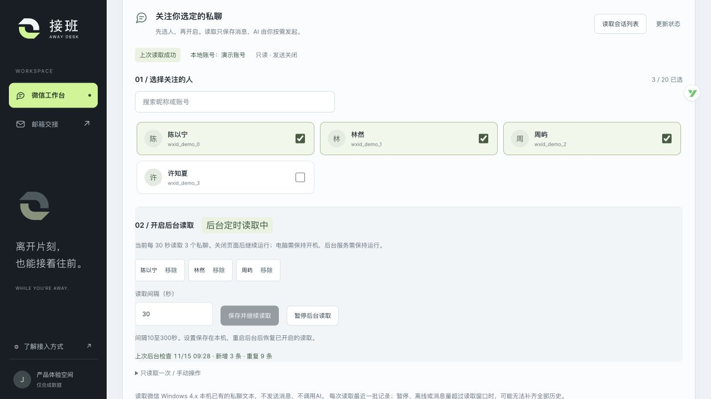

# 微信工作台：收好消息，把决定留给你

CHG-T08-005 · 2026-11-15 · joey 实现，angjustinl 正式代码审查待进行，kirinbao 交互/真实环境验收待进行。T08 整项仍为进行中，实际完成日期 —。

[在线体验](https://joeymilano.github.io/msg-manager/) · [PR #3](https://github.com/qilinbro/msg-manager/pull/3)

## 根据现有能力重新组织主入口

本轮检查上游 main 为 `92ac9fc`。已包含微信本地库初始化、私聊只读、选定私聊后台轮询、元数据读取优化与标签页连接恢复。原公开预览以邮箱离席交接为主，用户难以发现微信流程。

桌面主入口调整为「微信工作台」，保留「邮箱交接」「全部消息」「连接与设置」。连接设置把微信接入放在前面，QQ 账号核验收进次级展开区；更新旧的后台能力描述。不修改后台协议或自动化授权方式。网页预览与真实工作台复用 Inbox、WechatPanel 和 AIPanel；仅在演示入口注入不联网的合成客户端。

## 界面决定

- **三个区域，对应一段完整对话。** 私聊列表、聊天原文、整理/草稿并排。聊天保持自己的滚动位置，AI 编辑位于独立侧栏。
- **三个步骤，明确谁在行动。** 选好私聊 → 后台保存（自动）→ 整理与备稿（你来发起）。不把定时读取包装成微信自动回复或自动建任务。
- **把后台状态放在工作区上方。** 显示实际关注数量、周期、最近检查时间；暂停入口始终可达。失败时仍可查看已有消息。
- **关注设置按需展开。** 「管理关注」加载私聊名单，搜索后直接勾选，保存后生效；最多 20 人。手动单次读取保留在次级展开区。
- **已有草稿先呈现结果。** 720p 投屏收紧头部高度，让截止要求、原文、草稿和保存/复制操作尽量同时可见；重新整理仍需预览并确认范围。
- **视觉沿用接班品牌。** 石墨侧栏、冰蓝灰背景、白色面板和少量浅绿强调。保留已交付 Logo 的几何语言；设置收起后让正文与可编辑内容成为主角。
- **窄屏逐步阅读。** 手机先看会话，返回列表后切换联系人；草稿接在聊天下方。小屏仍有接入/连接设置入口。

## 评审可以这样试

1. 打开在线预览，看到「演示数据」。中间的 11 月 18 日 18:00 原句和右侧摘要可直接对照。
2. 打开「管理关注」，勾选另一人，保存。状态条的私聊数量跟着更新；暂停后状态也会改变。
3. 选择林然，点「整理这段对话」。先看到本次内容范围，确认后展示合成分析与草稿。
4. 修改草稿，切到另一位联系人，再切回来。修改保留；保存后显示反馈。
5. 切换「尚未接入微信」「后台读取失败」「模型尚未配置」，检查提示与不可用操作。
6. 点击「邮箱交接」继续体验离席自动处理，与微信的手动 AI 流程区分。

预览无真实账号、令牌或模型请求，不会连接访问者的本机后台。所有修改仅存在当前页面内存，刷新或切换演示场景会重置。初始已有分析也是明确标注的合成示例。

## 验证记录

2026-11-15，使用合成数据与本机开发构建走查：

- TypeScript / Vite 生产构建、前端格式检查通过。
- 微信客户端/组件既有回归通过：缓存状态轮询、旧后台兼容、不确定结果、设置保留、结果去重、暂停/卸载、保留正在阅读的历史和 AI 编辑。
- 新增回归通过：默认折叠关注设置、打开名单、复选选择和保存、快捷暂停、演示依赖隔离、侧栏草稿及演示保存。
- 标签页连接恢复与实际 App 导航回归通过，补充微信 → 邮箱 → 微信的令牌和草稿容器保持检查；消息导入回归通过。
- 浏览器点击验证：选择第 4 个私聊、保存、暂停、恢复；切换另一会话，确认范围后分析；编辑草稿、切换会话、返回、保存。
- 浏览器检查未接入空态、后台失败保留消息、模型未配置禁用分析；桌面 1280×720 与手机 390×844 检查。

截图来自合成预览。真实 Windows 微信数据库、关窗读取、Tauri 原生和指定人员正式验收仍待完成；本轮不改动真实授权设置。真实 QQ 邮箱三轮验收仍为 0/3。

## 实现位置

- `apps/desktop/src/WechatWorkspace.tsx`：真实微信入口与导航。
- `apps/desktop/src/Inbox.tsx`：微信范围、私聊/原文/草稿三栏。
- `apps/desktop/src/WechatPanel.tsx`：可折叠状态和复选关注。
- `apps/desktop/src/AIPanel.tsx`：嵌入式侧栏、既有确认与草稿流程。
- `apps/desktop/src/WorkspacePreview.tsx`、`wechat-demo.ts`：独立合成预览与异常场景。
- `scripts/test-wechat-monitor.mjs`、`test-service-session.mjs`：组件行为、预览隔离及导航回归。

后续真实验收按[微信接入说明](wechat-db-setup.md)在支持的 Windows 环境进行，保留只读、默认不开启、需明确选人和授权的边界。
