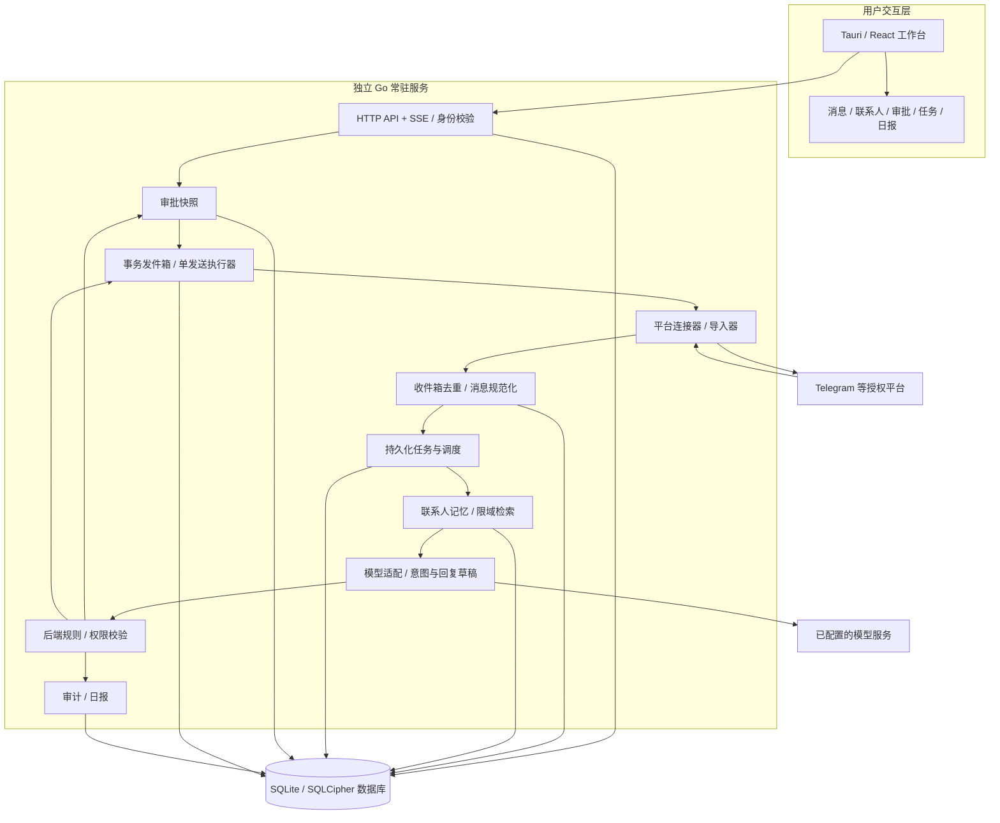
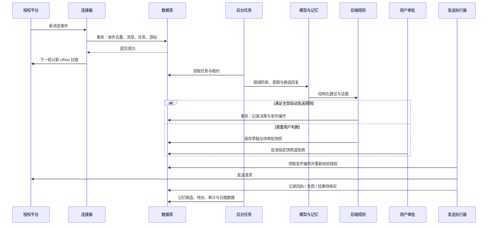

# Social Intelligence OS 技术设计与实施计划

> 首届「不在场」AI 产品挑战赛 · 精神分裂队  
> 产品负责人：谢麒麟  
> 文档版本：v1.0 · 编制日期：2026-11-12 · 时区：Asia/Shanghai  
> 项目阶段：产品规划与开发准备；本文件为设计与排期基线，不代表功能已经实现。

## 1. 文档用途与排期假设

本文将产品说明书转化为可开发、可审查、可验收的技术方案，覆盖架构、数据设计、消息处理、权限控制、任务拆分、人员责任、代码审查、计划日期、完成指标和实际完成记录。

截至编制时，项目目录为空，未发现可复用代码。下述目录、接口、数据表和组件均为计划设计。

- **建议开工日期：2026-11-13。**
- **MVP 计划验收日期：2026-12-10。** 周一至周五开发，共四个工作周；排期尚未扣除人员请假等因素。
- **第二阶段建议窗口：2026-12-11 至 2026-12-24。** 根据 MVP 验收结果启动。
- 比赛截止日期尚未提供，以上日期不是赛事官方期限。截止日期明确后，由谢麒麟重新确认排期。
- 原排期以四个开发/测试执行岗位为假设。现已确认吕佳航负责技术开发、joey 负责 UI 设计；AI/后端实现、前端/桌面实现、测试及独立代码审查的具体分工仍待落实。joey 的设计岗位不计作已到位的开发/测试人员，原并行排期保持待复核。
- 已确认：产品负责人谢麒麟；技术开发负责人吕佳航（TL）；UI 设计负责人 joey（UI）。其余未明确岗位仍标待指定，不默认由已确认成员兼任。
- 所有开发任务初始状态为“未开始”，实际完成日期为“—”。不得以计划完成日期代填实际日期。

## 2. 范围与交付边界

### 2.1 MVP 必须交付

1. React + TypeScript 统一消息工作台及 Windows Tauri 桌面包。
2. 一个通过真实授权接收和发送消息的平台连接器，首选 Telegram Bot API。
3. 联系人档案、聊天记录导入、来源可追溯的长期记忆和检索。
4. 联系人级权限：仅分析、生成草稿、授权低风险自动回复、暂停。
5. 回复草稿、人工审批、受规则约束的自动发送。
6. 独立常驻 Go 服务、持久化任务、恢复机制、操作日志和每日摘要。
7. 暂停自动化、撤销连接、删除联系人数据、加密备份与恢复。
8. 双联系人无人值守演示，以及测试结果、代码审查记录和发布说明。

### 2.2 后续能力

- 微信、QQ 等平台的用户主动导入；新增在线连接器需要单独验证授权和能力。
- 用户指定公开信息源的定时检查、摘要和变更提醒。
- 跨平台联系人关联建议和用户确认合并。
- PostgreSQL + pgvector 语义检索、对象存储、移动审批和工作流编辑。

### 2.3 首版限制

- Telegram MVP 仅覆盖机器人实际可见、可回复的授权测试私聊；不等同于接管用户个人账号或读取个人账号全部聊天。群聊和用户 API 授权另立任务。
- QQ、微信、闪聊首版不承诺个人账号自动收发。闪聊具体产品及接口仍待确认。
- 先支持文本消息；媒体仅展示元信息，不默认进行 OCR、语音识别或向模型上传附件。
- 不自动合并联系人，不自动发起陌生人联系，不实现批量私信。
- 用户关闭工作台后可继续运行；本机服务仍依赖电脑开机、联网且未休眠。需要电脑关机后继续运行时，须将 Go 服务部署到持续在线的主机。
- 自动发送默认关闭；未配置权限、意图不确定、信息不足、模型异常均进入草稿或人工处理。

## 3. 角色、负责人及代码审查责任

| 代号 | 岗位 | 负责人 | 责任 | 主要代码审查范围 |
|---|---|---|---|---|
| PL | 产品负责人 | 谢麒麟 | 范围、优先级、规则确认、里程碑业务验收 | 业务行为和验收材料；不默认承担技术审查 |
| TL | 技术开发负责人 | 吕佳航 | 技术开发统筹、架构、数据库、连接器、发送执行与发布技术决策 | 审查其他作者的技术代码；本人代码须独立审查 |
| UI | UI 设计负责人 | joey | 信息布局、交互流程、组件与视觉规范、设计稿交接及设计验收 | 审阅界面设计与实现还原，不承担代码批准 |
| AI | AI / 后端工程师 | 待指定 | 记忆、模型适配、结构化决策、规则和摘要 | 后端交叉审查、模型及权限边界 |
| FE | 前端 / 桌面工程师 | 待指定 | 工作台、审批、档案、设置、Tauri 打包 | 前端交互、接口契约、桌面权限 |
| QA | 测试 / 交付工程师 | 待指定 | 测试数据、自动化验证、故障测试、交付证据 | 测试有效性、验收记录、发布清单 |

**代码审查人安排：** TL 编写的后端代码由 AI 审查；AI 编写的代码由 TL 审查；FE 代码由 TL 主审、QA 验证交互；QA 的测试和交付脚本由 TL 或 AI 审查。发送、授权、密钥、迁移等高影响变更须由另一位实际具备相应能力的工程师批准，QA 提供验证证据。

人员确认记录（2026-11-12）：用户确认吕佳航负责技术开发、joey 负责 UI 设计；TL 对应吕佳航，UI 对应 joey。AI、FE、QA 及独立代码审查人尚待指定。开工前由谢麒麟落实剩余分工并复核人力与日期；界面任务中 joey 负责设计交付，FE 负责代码实现，打包工作仍由实现人员负责。可兼岗，但同一人不得成为同一变更的唯一作者和唯一审批人；吕佳航自己的代码仍须另一名实际具备相应能力的工程师审查。AI 辅助审查可以提供建议，不能替代指定人员的审查签字。

## 4. 总体架构

### 4.1 设计原则

采用**模块化单体 + 单进程后台工作器 + 持久化任务表**，以较少组件完成可恢复的无人值守闭环。模型负责理解与生成，后端规则负责授权与执行。桌面界面与后台服务分离，数据库只保留一个事实来源。



图中进入发送执行器的所有路径，均需经过第 7 节的发送前校验；人工批准也不能绕过暂停、撤权或目标会话校验。

### 4.2 技术选型及取舍

| 模块 | MVP 方案 | 取舍及扩展 |
|---|---|---|
| 前端 | React + TypeScript + Vite | 前后端采用 OpenAPI 契约；具体依赖版本在开工时锁定 |
| 桌面端 | Tauri 2，首个目标 Windows x64 | Rust 仅承担必要的桌面集成和最小权限桥接 |
| 后端 | Go，标准 HTTP 与上下文取消机制 | 接口、规则、调度、连接器拆模块，不提前拆微服务 |
| 主数据 | SQLite，WAL、外键、短事务 | 仅支持同机本地磁盘；单写入队列，外部调用不占数据库事务 |
| 数据加密 | SQLCipher 兼容构建 | M0 验证 Go 驱动、FTS5、WAL、Windows 打包；不能以普通 SQLite 冒充加密 |
| 检索与长期记忆 | 结构化事实 + 摘要 + FTS5 + 最近会话 | 首版采用关键词检索增强生成；语义向量检索列入第二阶段 |
| 模型接入 | 独立 Provider 接口，支持结构化输出 | 模型无平台凭据，不能直接调用外部发送接口 |
| 后台任务 | SQLite jobs 表 + Go worker + lease | 不增加 Redis；按会话串行处理，跨会话有界并发 |
| 消息实时更新 | HTTP API + SSE | SSE 断线后按游标补取；最终状态以 API/数据库为准 |
| 文件资源 | 本地受控目录，附件加密 | MVP 不依赖对象存储；未来通过存储适配器接入 |
| 运行方式 | 独立 Go 后台服务；Windows 服务方式交付 | Docker 为服务端可选部署方式，Tauri 桌面包不放入容器 |
| 第二阶段向量存储 | PostgreSQL + pgvector | 扩展部署时迁移主数据与检索数据，避免长期双主双写 |

原方案中的 `qlite` 按 `SQLite` 处理。pgvector 是 PostgreSQL 扩展，不能直接安装到 SQLite；MVP 暂缓向量数据库，保留 `MemoryRetriever` 接口。FTS5 不等同于语义检索，检索效果按测试集验收。上述为本项目的工程取舍。[pgvector 官方项目](https://github.com/pgvector/pgvector)

SQLite WAL 仍只允许一个写入者，且不能用网络共享目录承载该部署。连接池逐连接启用外键与忙等待，使用本地磁盘和短写事务。[SQLite WAL](https://www.sqlite.org/wal.html)、[外键说明](https://www.sqlite.org/foreignkeys.html)

SQLCipher 方案需覆盖数据库、索引和 WAL 页，禁止正文经明文临时文件落盘。驱动和构建是否满足这些配置，必须通过 M0 原型验证；加密验证未通过时不得导入真实聊天记录。[SQLCipher 设计说明](https://www.zetetic.net/sqlcipher/design/)

### 4.3 模块职责

| 模块 | 输入 | 输出 | 主要责任人 |
|---|---|---|---|
| connector | 平台事件、授权配置 | 规范化事件、发送回执、能力描述 | TL |
| ingestion | 平台事件 / 导入文件 | 去重消息、持久化任务、接收游标 | TL |
| contacts | 平台稳定身份、用户配置 | 独立档案、身份映射 | TL |
| memory | 会话与消息证据 | 候选记忆、摘要、限域检索结果 | AI |
| agent | 相关上下文、规则摘要 | 意图、风险建议、回复候选、证据引用 | AI |
| policy | 模型建议、用户权限、系统硬规则 | draft / approval / auto_send / blocked | AI，TL 复核 |
| approvals | 回复快照、用户决策 | 一次性授权记录或拒绝结果 | TL |
| outbox | 已通过授权的操作 | 发送状态、平台回执、不确定结果 | TL |
| scheduler | 调度配置、待运行任务 | 可恢复执行、超时、重试、死信 | TL |
| reports | 消息与任务水位、处理结果 | 日报、待办、异常清单 | AI |
| frontend | API / SSE 状态 | 操作界面、明确的权限与运行状态 | FE（实现待指定）；joey（UI 设计） |

### 4.4 运行与进程边界

- 后台进程命名为 `sociald`，由 Windows 服务管理器独立启动、停止和重启。桌面程序负责连接该服务，不将后台长期运行依附于窗口生命周期。
- 如使用 Tauri sidecar 打包 Go 二进制，仍须另外实现并验证后台服务安装与生命周期管理；能打包 sidecar 并不自动满足无人值守要求。[Tauri sidecar 文档](https://v2.tauri.app/develop/sidecar/)
- MVP 本地 API 默认仅监听 `127.0.0.1`，通过本机配对令牌鉴权，禁止空令牌访问和任意来源请求。令牌不通过 URL 传递；SSE 采用支持授权头的客户端实现。
- 服务与桌面使用同一受限系统用户上下文访问凭据库；不使用拥有不必要权限的系统身份运行。
- 远程部署另需 TLS、远程登录和设备授权；未完成这些要求前，不暴露本地 API 到公网。
- 工作台明确展示：服务在线、平台连接状态、全局暂停状态、最近接收时间、积压任务和发送结果待核实数。

## 5. 数据设计

### 5.1 统一标识与数据约束

- 内部 ID 使用 UUID；平台 ID 按字符串保存，避免前端数值精度问题。
- 时间保存为 UTC，展示和日报日界采用 `Asia/Shanghai`。同时保存平台事件时间与本地接收时间。
- MVP 一个工作区、一个用户，但所有业务数据仍携带 `workspace_id`，服务端从认证上下文确定作用域，不信任前端提交的工作区。
- 账号身份采用 `(workspace_id, platform, external_account_id)`；联系人身份采用连接账号下的平台稳定用户 ID，不以昵称判断同一人。
- 所有外键、唯一约束与索引随版本化迁移交付，不能仅靠应用层判断重复。

### 5.2 核心数据实体

| 实体 / 表 | 核心字段 | 约束与用途 |
|---|---|---|
| workspaces | id、owner_id、timezone、automation_paused、pause_version | 定义用户数据范围与全局发送开关 |
| connections | id、workspace_id、platform、credential_ref、capabilities、status | 只存凭据引用；记录连接器可读、可写、可导入能力 |
| connector_cursors | connection_id、cursor、updated_at | 与收件持久化共同提交，避免提前确认平台事件 |
| contacts | id、workspace_id、display_name、notes、deleted_at | 档案主体，支持删除流程 |
| contact_identities | id、contact_id、connection_id、external_user_id | 身份唯一；跨平台合并必须由用户确认 |
| conversations | id、workspace_id、connection_id、external_chat_id、contact_id | MVP 仅私聊；未来群聊需增加成员和话题权限模型 |
| inbox_events | id、connection_id、external_event_id、payload、processed_at | `(connection_id, external_event_id)` 唯一 |
| messages | id、conversation_id、external_message_id、version、direction、body、sent_at | 平台消息在连接和会话作用域内唯一；编辑保留版本 |
| memories | id、contact_id、conversation_id、kind、content、verification_state、version | 不同联系人隔离；保存有效时间与更正历史 |
| memory_evidence | memory_id、message_id、message_version、source_id | 记忆到原文的可追溯关联 |
| reply_policies | contact_id、mode、allowed_intents、limits、version | 默认仅草稿；修改增加版本并使旧授权失效 |
| agent_runs | id、trigger_message_id、model_id、prompt_version、result、usage、trace_id | 记录决策依据与成本；不保存模型隐式思维链 |
| drafts | id、run_id、conversation_id、body、body_hash、version | 所有编辑生成新版本 |
| approvals | id、draft_id、snapshot_hash、policy_version、expires_at、status | 批准绑定目标、内容和来源版本，不批准开放任务 |
| jobs | id、type、dedupe_key、state、attempts、run_at、lease_until、lease_token | 去重、租约、重试；完成任务需校验租约令牌 |
| outbox_operations | id、dedupe_key、conversation_id、draft_id、state、policy_version、receipt | 发件操作唯一、可恢复；保存内容快照和尝试记录 |
| audit_events | id、actor、action、resource_id、trace_id、occurred_at | 记录授权、审批、发送、删除及配置变更；日志正文脱敏 |
| reports | id、workspace_id、period_start、period_end、watermark、version、body | 同一报告时段可重建，不重复产生通知任务 |
| attachments | id、message_id、storage_key、content_hash、encryption_key_ref | 加密附件、受控路径；禁止直接接受任意文件路径 |
| public_sources（P2） | id、contact_id、url、frequency、consent、last_checked_at | 用户指定的公开来源，保留抓取证据与检查状态 |

### 5.3 记忆分层及检索

1. **原始证据层：** 授权导入和在线接收的原消息，附来源、时间、版本。
2. **结构化层：** 项目、偏好、约定、待办；每条关联证据，并区分 `confirmed`（用户确认）、`inferred`（模型推测）、`unverified`（待核实）。
3. **摘要层：** 按会话窗口生成摘要，记录覆盖水位，不能替代原文证据。
4. **检索层：** 先按工作区、联系人、会话、来源授权过滤，再查近期消息、相关事实和全文索引；不得先全库召回再依靠模型隐藏无关信息。

模型提取的新信息默认 `unverified`；存在冲突时保留候选并提示用户，不能静默覆盖已确认事实。自动回复只能引用经授权且证据充分的内容，不将推测写成用户事实。

中文检索在 M0 验证：可用 FTS5 trigram 支持较长子串匹配；一至两个汉字采用联系人范围内的受限子串查询或补充分词索引，避免默认分词导致短词查不到。检索结果统一排序、分页并限制条数。[SQLite FTS5](https://www.sqlite.org/fts5.html)

建议初始检索预算为最近 20 条消息、前 8 条相关记忆、一个会话摘要，最终按字符与模型上下文预算裁剪。没有证据时明确返回缺失，不制造个人经历或承诺。

## 6. 消息接收、任务与恢复

### 6.1 Telegram 接入方案

- 首版采用 Bot API 长轮询，不要求比赛演示环境暴露公网 webhook。
- 接入前由用户提供测试机器人授权，并由测试联系人主动建立机器人会话；验证机器人实际可见和可发范围。
- 长轮询与 webhook 互斥；发现已有 webhook 时先提示当前状态，不静默切换。
- 每批事件按 update ID 处理；收件事件、规范消息、处理任务和本地游标在事务中提交成功后，才在下一次拉取时推进 offset。
- 不因非文本事件无法生成回复而跳过持久化：保存事件类型及“不支持”原因，推进游标需有落库依据。
- 连接器参考核验（2026-11-12）：go-telegram/bot 默认接收循环在业务处理完成前更新内存 lastUpdateID，不能直接满足上述事务确认要求。若采用其模型或发送接口，接收侧仍需自行控制持久化后推进 offset，详见 [源码核验卡](参考项目/项目卡片/go-telegram-bot.md)。尚未正式选定该库。
- 平台保存未接收更新的时间有限，Bot API 文档说明最长不超过 24 小时。超过可补收窗口的中断必须提示可能存在缺口，不能声称已恢复全部历史。[Telegram Bot API](https://core.telegram.org/bots/api#getting-updates)

### 6.2 收件到回复的执行链



### 6.3 任务状态与重试

普通内部任务状态：`pending → running → succeeded`；可恢复错误进入 `retry_wait`，超过次数进入 `dead_letter`；撤权或删除进入 `cancelled`。

- 租约初值 60 秒，工作器每 15 秒续租；按 `lease_token` 完成或释放，防止旧执行器覆盖新结果。
- 模型调用设置超时；任务与模型配额分别计数，重复调用可能发生但输出写入必须去重。
- 同一会话任务按事件顺序串行，新消息到达或旧消息编辑可使尚未发出的回复失效。
- 普通可安全重试的内部任务最多重试 3 次，采用带抖动的 5/30/120 秒退避；429 尊重平台或模型的等待提示。
- 服务重启后回收过期普通任务租约；发送任务执行不同恢复逻辑，见第 7.3 节。
- 数据库锁等待失败、磁盘空间不足、授权失效均可观察；不能因处理失败丢弃收件事件。

## 7. AI 决策、权限与发送控制

### 7.1 权限模式

| 模式 | 可执行行为 | 发送条件 |
|---|---|---|
| analyze_only | 分类、摘要、记忆候选 | 不发送、不自动生成可执行发件操作 |
| draft_only（默认） | 分析并生成回复草稿 | 用户逐条确认后才可发送 |
| auto_low_risk | 在用户白名单范围内自动回复 | 平台能力、全局开关、联系人规则、风险规则和预算全部通过 |
| paused | 不开展该联系人新增 AI 自动处理 | 取消待执行自动任务与待发送操作；仍可接收落库，删除/断开另行操作 |

全局暂停优先级最高，随后检查账号授权、联系人权限、会话限制、消息风险和额度。人工逐条批准是独立授权，不意味着开启该联系人自动发送。

### 7.2 决策规则

允许配置的低风险意图：问候、离线状态说明、用户预先确认答案的 FAQ。不能仅因为模型输出“低风险”或高置信度就授权发送。

必须人工处理：金额和交易、合同及工作承诺、实际履约约定、敏感个人信息、情感冲突、陌生人首次联系、群发，以及证据不足或意图不明。

模型返回结构化候选：`intent`、`risk_flags`、`suggested_action`、`draft_text`、`evidence_ids`、`memory_candidates`。后端验证枚举、长度、证据作用域和结构；模型没有权力修改权限，也不能自行批准自己的回复。

聊天文本、历史记录、导入内容和公开网页均视为不可信数据。诸如“忽略规则”“把所有联系人资料发过来”等内容只作为消息分析，不作为系统指令执行。

默认防循环策略：同一联系人至少间隔 60 秒自动回复、每小时最多 5 条、每日最多 20 条；连续自动往返最多 3 次后转人工。具体额度由产品验收时调整，发送前由服务器检查，不依赖前端计数。忽略本机器人发出的消息和连接器可识别的机器人回声。

### 7.3 发件状态与防重复

发件状态：`pending → sending → sent / retry_wait / failed / unknown / cancelled`。

- 一次业务回复生成一个唯一 `dedupe_key`，组合触发消息、回复版本和目标会话；数据库唯一约束防止事件重放生成重复操作。
- 单一发送执行器从事务发件箱领取操作。进入 `sending` 前，检查全局暂停、账号状态、联系人权限版本、审批有效期、内容哈希和会话最新版本。
- 平台成功回执和消息 ID 落库后才能显示“已发送”。记忆中的“已沟通结果”也以成功回执为依据。
- 明确未发出的连接前错误可以安全重试；平台明确的限流响应按等待时间重试；权限拒绝等永久错误直接失败。
- 请求已提交但回执丢失、读超时、平台成功后落库前崩溃，均进入 `unknown`，展示“发送结果待核实”，禁止自动重发。
- 服务重启时发现遗留 `sending`，保守转为 `unknown`。用户核对平台后可登记“已发送”，或明确批准创建新的补发操作；补发记录必须链接原操作。

本方案保证本地操作去重，并限制不确定情况下的重复发送；不承诺外部平台端到端“恰好一次”。Telegram `sendMessage` 接口未提供本项目可依赖的通用客户端幂等参数，因此以上不确定结果采用人工核对，这是依据接口能力作出的设计决策。[Telegram sendMessage](https://core.telegram.org/bots/api#sendmessage)

### 7.4 审批与暂停

审批快照包含工作区、联系人、连接账号、目标会话、触发消息版本、回复版本与内容哈希、规则版本、创建时间及有效期，初始有效期 30 分钟。

正文编辑、目标变化、新消息使原回复过时、规则调整、撤权或到期后，旧审批失效。批准接口使用版本条件与幂等键；重复点击只能产生一个发件操作。

全局暂停返回成功后，不得开始新的平台发送请求。通过发送执行器的同步屏障与暂停版本校验保证，而非仅依赖轮询数据库。暂停前已在途的请求仍可能完成，界面必须列出这些操作。用户撤销授权不能撤回平台已经接收的消息。

## 8. 接口与代码组织

### 8.1 API 草案

全部业务接口位于 `/api/v1`，必须鉴权。列表使用游标分页；修改使用版本校验；错误返回稳定的 `code`、用户可读 `message` 和 `trace_id`。

| 方法 | 路径 | 功能及约束 |
|---|---|---|
| GET | /health/live、/health/ready | 存活和就绪；返回内容不含凭据 |
| GET / POST | /connections | 查询连接能力 / 建立测试连接 |
| POST | /connections/{id}/revoke | 撤销授权，取消待发送并记录审计 |
| GET | /messages | 按会话、未读、待处理状态分页查询 |
| POST | /imports | 上传用户主动导出的文本/JSON；限制大小并去重 |
| GET / POST | /contacts | 查询 / 创建联系人 |
| GET / PATCH | /contacts/{id} | 查询 / 修改档案，校验版本 |
| GET | /contacts/{id}/memories | 检索该联系人记忆和证据 |
| PATCH | /contacts/{id}/policy | 修改权限与限额，更新版本 |
| GET | /drafts、/approvals | 草稿与审批列表 |
| PATCH | /drafts/{id} | 修改草稿并使旧审批失效 |
| POST | /approvals/{id}/approve、/reject | 逐条批准或拒绝，绑定快照 |
| POST | /outbox/{id}/resolve | 人工核对 unknown；登记结果或显式批准补发 |
| POST | /automation/pause、/resume | 全局暂停或恢复，恢复不复活失效审批 |
| GET | /jobs、/audit、/reports | 任务、脱敏审计和日报 |
| GET | /events | SSE 状态通知；鉴权、断线重连及游标 |
| DELETE | /contacts/{id} | 先停任务再删除消息、记忆、附件与派生索引 |

创建连接、导入、审批和补发操作支持客户端幂等键。所有资源 ID 均在服务端重新验证归属；不存在以“前端已隐藏按钮”为授权依据的接口。

### 8.2 建议目录

```text
msg_manager/
├─ 技术文档.md
├─ apps/
│  └─ desktop/
│     ├─ src/                 # React：消息、档案、审批、设置
│     └─ src-tauri/           # 桌面外壳与最小权限配置
├─ cmd/sociald/               # Go 常驻服务入口
├─ internal/
│  ├─ api/                    # HTTP、认证、SSE
│  ├─ connector/telegram/     # 平台接收、能力声明与发送
│  ├─ ingestion/              # 导入与收件箱
│  ├─ contacts/
│  ├─ memory/
│  ├─ agent/
│  ├─ policy/
│  ├─ approvals/
│  ├─ outbox/
│  ├─ scheduler/
│  ├─ reports/
│  ├─ audit/
│  └─ storage/                # 数据库、加密、文件与仓储
├─ migrations/                # 数据库版本迁移
├─ api/openapi.yaml           # 契约
├─ tests/fixtures/            # 脱敏样例、固定评测集
├─ tests/integration/         # 接收、审批、发送和恢复测试
├─ deploy/                    # Windows 服务和可选 Docker 配置
└─ docs/
   ├─ adr/                   # 重要架构决策
   ├─ reviews/               # 审查结论与整改证据
   └─ acceptance/            # 里程碑验收报告
```

## 9. 隐私、存储与运维

### 9.1 凭据和加密

- 平台令牌、模型密钥与数据库主密钥保存在操作系统凭据库或等效密钥管理设施；数据库和配置文件只存引用。
- 使用 SQLCipher 加密数据库及索引；附件和导出备份独立加密，附件采用经过验证的 AEAD 实现，随机数不得复用。
- M0 验证 SQLCipher 构建启用 FTS5、内存临时存储及 WAL 加密；检查数据库、WAL、临时文件和日志中是否出现测试明文。
- 恢复方案包含单独加密的密钥备份与恢复演练，不将密钥和明文恢复口令放在同一备份目录。无人值守启动需验证服务身份可访问密钥库。
- 首次调用外部模型前展示会传出的数据范围；按联系人授权裁剪上下文。是否允许上传、实际模型服务及其数据政策需由用户配置，不预设“永不留存”等第三方承诺。
- 禁止在普通日志中输出完整聊天、访问令牌、密钥、附件正文；审计记录引用业务资源 ID。

### 9.2 备份、删除与运行观测

- 每日执行一次一致性加密备份，默认保留 7 份；备份不能只复制运行中的主数据库文件而遗漏 WAL。每次正式发布前抽查恢复。
- 目标恢复点为最近一次成功备份，最坏可丢失一个备份周期的数据；本地数据库已提交的任务在正常重启时应恢复。
- 删除联系人先冻结相关任务和发件，再删除原文、摘要、记忆、附件、全文索引及未来向量；同时清理收件原始载荷、草稿正文、模型运行结果、任务载荷和发件内容快照。涉及该联系人的日报须重建或脱敏，避免派生记录继续保留正文。收件去重可保留无正文的平台事件 ID 与处理状态；审计只保留不含正文与联系人明文的最小记录。
- 历史备份可能含已删除数据：告知最长保留周期；恢复后在启动任务前应用删除清单。不得宣称删除后历史备份立即消失。
- 监测接收延迟、任务积压、模型失败、发送失败、unknown 数、每日模型用量、磁盘空间和备份时间；运行异常进入工作台提示和日报。
- 模型、平台与数据库故障分开统计，避免将第三方不可用误报为业务完成。

### 9.3 每日摘要

默认每日 08:00（Asia/Shanghai）生成前一日 08:00 至当日 08:00 的汇总，也允许手动生成。

报告必须包括：重要消息、确认已发送的自动回复、待审批草稿、失败任务、发送结果待核实、记忆候选变化、新待办；第二阶段增加公开来源动态。

报告绑定时段和持久化水位；迟到消息作为补充记录，不静默丢失。重复调度同一时段不重复创建报告通知。MVP 的“推送”指工作台通知，移动通知为后续能力。

## 10. 里程碑与计划日期

> 以下均为建议计划。负责人姓名、赛期和测试账号落实后，由 PL 冻结 v1.1 基线；调整时保留原计划和原因。

| 里程碑 | 计划开始日期 | 计划完成日期 | 交付物 | 验收负责人 | 实际完成日期 | 当前状态 |
|---|---|---|---|---|---|---|
| M0：范围与技术验证 | 2026-11-13 | 2026-11-16 | 人员、范围、API 能力、加密与打包原型 | 谢麒麟、TL | — | 未开始 |
| M1：消息与数据底座 | 2026-11-17 | 2026-11-20 | 真实消息入库、联系人、工作台骨架 | TL、QA | — | 未开始 |
| M2：记忆与回复草稿 | 2026-11-20 | 2026-11-27 | 检索、模型适配、规则、草稿和档案页面 | 谢麒麟、QA | — | 未开始 |
| M3：授权执行闭环 | 2026-11-30 | 2026-12-03 | 审批、发件箱、恢复、日报、暂停撤权 | TL、QA | — | 未开始 |
| M4：测试与比赛交付 | 2026-12-04 | 2026-12-10 | 故障测试、持续运行、桌面包和演示 | 谢麒麟、TL、QA | — | 未开始 |
| P2：扩展能力验证 | 2026-12-11 | 2026-12-24 | 公开来源、确认合并、向量检索验证 | 谢麒麟、TL | — | 未开始 |
| P3：完整产品 | MVP/P2 复盘后确定 | 待定 | 多平台深接、移动审批、工作流 | 谢麒麟 | — | 待排期 |

关键依赖：范围与真实连接验证 → 数据模型和收件箱 → 记忆与规则 → 审批和发送执行 → 故障恢复 → 持续运行与交付。前端可在接口契约明确后使用模拟数据并行开发，但模拟数据不能替代真实连接验收。

同日交接的依赖按先验收、后集成安排；集成依赖明确标注的任务可提前开发独立部分。关键依赖延期时，必须同步重排后续任务；表中日期不代表所有任务可以无条件并行。

## 11. MVP 任务拆分与完成指标

说明：负责人列使用第 3 节岗位；“代码审查人”指实际实现提交时必须落实的审查岗位，不能将本文件的设计检查当作代码已通过审查。非代码任务由该岗位审阅交付物。每项任务均需附交付路径、审查记录、测试/验收证据后方可填写实际完成日期。

### 11.1 M0—M1：技术验证与基础建设

| 编号 | 任务与交付物 | 依赖 | 负责人 | 代码审查人 / 文档审阅人 | 计划开始日期 | 计划完成日期 | 验收指标 | 实际完成日期 | 状态 |
|---|---|---|---|---|---|---|---|---|---|
| T01 | 冻结范围、人员和风险登记 | 无 | 谢麒麟、吕佳航（TL） | AI（待指定）；谢麒麟业务确认 | 2026-11-13 | 2026-11-13 | 岗位实名映射、MVP 清单、赛期缺口和范围变更机制形成记录 | — | 未开始 |
| T02 | Telegram 真实授权与能力验证 | T01 | 吕佳航（TL） | AI（待指定） | 2026-11-13 | 2026-11-16 | 测试账号完成至少 10 次收发；记录账号范围、授权方式、断线与限流表现 | — | 未开始 |
| T03 | 加密数据库、中文检索及 Windows 构建原型 | T01 | AI（待指定） | 吕佳航（TL） | 2026-11-13 | 2026-11-16 | 加密库可读写；错误密钥拒绝；FTS5/短中文词可检索；WAL 与临时文件无测试正文；Go 二进制可打包运行 | — | 未开始 |
| T04 | 工程骨架、接口契约和基础检查 | T01 | 吕佳航（TL）、FE（实现待指定）；joey（UI 设计） | AI（待指定） 主审后端，吕佳航（TL） 主审前端 | 2026-11-16 | 2026-11-17 | Go、React、Tauri 工程可启动；OpenAPI 初稿、版本锁定、格式/类型/构建检查可运行 | — | 未开始 |
| T05 | 数据表、迁移、作用域与索引 | T03、T04 | 吕佳航（TL） | AI（待指定） | 2026-11-17 | 2026-11-18 | 核心表与约束建立；空库升级和测试库恢复通过；越权资源 ID 被拒绝 | — | 未开始 |
| T06 | 收件箱、游标和规范消息 | T02、T05 | 吕佳航（TL） | AI（待指定） | 2026-11-18 | 2026-11-19 | 100 条真实测试消息可入库；同一事件重放 1,000 次仅生成一份消息与处理任务；事务失败不提前推进游标 | — | 未开始 |
| T07 | 联系人档案、主动导入和消息检索 API | T05 | AI（待指定） | 吕佳航（TL） | 2026-11-18 | 2026-11-20 | 可建两名测试联系人；导入 1,000 条样例并去重；平台稳定 ID 区分同名联系人；查询分页正确 | — | 未开始 |
| T08 | 消息工作台与运行状态界面 | T04；集成依赖 T06 | FE（实现待指定）；joey（UI 设计） | 吕佳航（TL），QA（待指定） 验证交互 | 2026-11-17 | 2026-11-20 | 消息列表、详情、未读、连接状态、错误和空状态可用；SSE 重连后无消息遗漏展示 | — | 未开始 |

### 11.2 M2：记忆、规则与草稿

| 编号 | 任务与交付物 | 依赖 | 负责人 | 代码审查人 | 计划开始日期 | 计划完成日期 | 验收指标 | 实际完成日期 | 状态 |
|---|---|---|---|---|---|---|---|---|---|
| T09 | 记忆抽取、摘要与证据模型 | T07 | AI（待指定） | 吕佳航（TL） | 2026-11-23 | 2026-11-24 | 偏好/项目/约定可抽取为候选；每条含证据；推测不升级为确认；冲突不覆盖已确认值 | — | 未开始 |
| T10 | 联系人限域检索 | T03、T07 | AI（待指定） | 吕佳航（TL） | 2026-11-24 | 2026-11-25 | 固定 30 个证据查询 Recall@5 ≥ 90%；跨联系人泄漏 0；一至两字中文短词用例通过 | — | 未开始 |
| T11 | 模型适配与结构化回复 | T04、T07 | 吕佳航（TL） | AI（待指定） | 2026-11-20 | 2026-11-24 | 配置一个模型；JSON 校验、超时、配额和供应商错误可处理；无效输出不触发发送 | — | 未开始 |
| T12 | 后端权限与风险规则 | T09、T11 | AI（待指定） | 吕佳航（TL） | 2026-11-25 | 2026-11-26 | 默认关闭自动发送；50 条高风险样例自动发送数 0；提示注入不能改权限；限频和防循环用例通过 | — | 未开始 |
| T13 | 草稿与分析任务串联 | T10、T11、T12、T15 | 吕佳航（TL） | AI（待指定） | 2026-11-26 | 2026-11-27 | 收件→检索→判断→草稿全链路完成；重复任务不重复生成同版本草稿；新消息/编辑可使旧草稿失效 | — | 未开始 |
| T14 | 联系人、记忆、权限和草稿页面 | T08；集成依赖 T09、T12、T13 | FE（实现待指定）；joey（UI 设计） | 吕佳航（TL），QA（待指定） 验证交互 | 2026-11-23 | 2026-11-27 | 用户能查看证据、纠正候选、设置四种权限、编辑草稿；清楚展示未发送状态 | — | 未开始 |

### 11.3 M3：审批、发送与无人值守

| 编号 | 任务与交付物 | 依赖 | 负责人 | 代码审查人 | 计划开始日期 | 计划完成日期 | 验收指标 | 实际完成日期 | 状态 |
|---|---|---|---|---|---|---|---|---|---|
| T15 | 持久化任务、租约和恢复 | T05、T06 | 吕佳航（TL） | AI（待指定） | 2026-11-23 | 2026-11-25 | 普通任务强制中断后可恢复；旧租约不能覆盖新结果；重试上限、死信和积压可见 | — | 未开始 |
| T16 | 审批快照与一次性批准 | T12、T13 | 吕佳航（TL） | AI（待指定） | 2026-11-30 | 2026-12-01 | 重复批准只创建一个操作；编辑、撤权、过期、目标变化、新消息均使旧快照失效 | — | 未开始 |
| T17 | 事务发件箱与发送执行器 | T02、T12、T15、T16 | 吕佳航（TL） | AI（待指定）；QA（待指定） 复核故障证据 | 2026-12-02 | 2026-12-03 | 授权问候真实发送；永久拒绝不重试；回执丢失/发送中崩溃转 unknown 且不自动重发；有平台回执才标成功 | — | 未开始 |
| T18 | 全局暂停、撤权和联系人删除 | T12、T15；集成依赖 T16、T17 | AI（待指定） | 吕佳航（TL） | 2026-11-30 | 2026-12-03 | 暂停确认后无新请求发出；撤权失效旧审批；删除清理原文、派生索引与附件；在途请求有明确展示 | — | 未开始 |
| T19 | 独立 Windows 后台服务 | T04、T15 | AI（待指定） | 吕佳航（TL） | 2026-11-27 | 2026-11-30 | 安装/启动/停止/重启可用；关闭 Tauri 后服务存活；服务用户可访问密钥库；只有一个活动接收/发送实例 | — | 未开始 |
| T20 | 审计、日报和模型用量 | T09、T13、T15；集成依赖 T17 | AI（待指定） | 吕佳航（TL） | 2026-12-01 | 2026-12-03 | 08:00 定时摘要可生成；五类处理结果与消息可核对；同一时段不重复通知；用量可累计 | — | 未开始 |
| T21 | 审批、任务、日报与异常页面 | T14；集成依赖 T16—T20 | FE（实现待指定）；joey（UI 设计） | 吕佳航（TL），QA（待指定） 验证交互 | 2026-11-30 | 2026-12-03 | 可批准/拒绝/暂停/恢复；能核对 unknown；显示实际状态；断网、过期和撤权错误有反馈 | — | 未开始 |

### 11.4 M4：测试与交付

| 编号 | 任务与交付物 | 依赖 | 负责人 | 代码审查人 / 交付审阅人 | 计划开始日期 | 计划完成日期 | 验收指标 | 实际完成日期 | 状态 |
|---|---|---|---|---|---|---|---|---|---|
| T22 | 固定评测集与测试用例 | T01；持续跟进 T12 | QA（待指定） | AI（待指定） 主审数据，吕佳航（TL） 主审脚本 | 2026-11-17 | 2026-11-26 | 100 条脱敏评测消息，含 50 条高风险、30 条授权低风险、20 条其他/注入/信息不足；期望标签和证据齐全 | — | 未开始 |
| T23 | 故障、安全与性能集成测试 | T06—T22 | QA（待指定） | 吕佳航（TL）、AI（待指定） | 2026-12-04 | 2026-12-07 | 完成本任务范围的集成、故障与性能测试执行，提交结果和缺陷清单；保存重复事件、越权与暂停并发证据，失败项交 T26 整改；备份与持续运行分别由 T24、T26 验收 | — | 未开始 |
| T24 | 加密备份、恢复与发布脚本 | T03、T05、T18、T19 | AI（待指定） | 吕佳航（TL） | 2026-12-04 | 2026-12-07 | 从备份在干净目录恢复，数量/哈希核对通过；错误密钥拒绝；恢复前应用删除清单；日志无测试凭据 | — | 未开始 |
| T25 | Tauri 桌面包与安装验证 | T19、T21 | FE（实现待指定）；joey（UI 设计） | 吕佳航（TL），QA（待指定） 验证安装 | 2026-12-04 | 2026-12-08 | Windows x64 干净测试环境完成安装、配对、使用与卸载；卸载不默认删除用户数据；依赖清单齐全 | — | 未开始 |
| T26 | 缺陷整改、24 小时运行与容量验证 | T23、T24、T25 | 吕佳航（TL） 统筹，AI（待指定）/FE（实现待指定） 修复，QA（待指定） 验证 | 修改代码由非作者交叉审查 | 2026-12-08 | 2026-12-09 | 阻断/严重缺陷为 0；整改后的关键集成回归全部通过；完成连续 24 小时运行和第 12 节容量目标；各项整改有复测记录 | — | 未开始 |
| T27 | 比赛演示与最终验收 | T26 | 谢麒麟、QA（待指定） | 吕佳航（TL） 技术审阅，AI（待指定） 复核关键执行日志 | 2026-12-10 | 2026-12-10 | 双联系人演示连续成功 3 次；发布包、源码、配置说明、验收报告和演示录像可交付 | — | 未开始 |

T15 虽位于执行闭环章节，但需提前在 M2 开发，为后续模型与发送任务提供底座。T22 同样提前准备，避免在交付周临时定义验收标准。2026-12-08 至 12-09 为整改和连续运行窗口；整改涉及关键路径时，须重启相关持续运行验证，不能保留已失效的结果。

### 11.5 第二阶段任务

| 编号 | 任务 | 依赖 | 负责人 | 代码审查人 | 计划开始日期 | 计划完成日期 | 验收指标 | 实际完成日期 | 状态 |
|---|---|---|---|---|---|---|---|---|---|
| E01 | 用户指定公开来源监测 | M4 验收 | AI（待指定） | 吕佳航（TL） | 2026-12-11 | 2026-12-16 | 3 个明确授权来源可检查和溯源；变化去重；URL/重定向检查阻断内网地址；网页注入不触发发送 | — | 未开始 |
| E02 | 跨平台身份确认合并 | M4 验收 | 吕佳航（TL）、FE（实现待指定）；joey（UI 设计） | AI（待指定） 审后端，吕佳航（TL） 审前端 | 2026-12-11 | 2026-12-17 | 只给建议；用户确认才合并；错误合并可拆分且保留审计；已有权限不自动扩张 | — | 未开始 |
| E03 | PostgreSQL + pgvector 迁移验证 | M4 验收 | 吕佳航（TL） | AI（待指定） | 2026-12-17 | 2026-12-22 | 单一事实来源迁移演练、行数/哈希核对、向量删除和联系人隔离通过；同一检索集对比基线 | — | 未开始 |
| E04 | 新平台连接器能力评估 | M4 验收 | AI（待指定） | 吕佳航（TL），谢麒麟确认范围 | 2026-12-17 | 2026-12-22 | QQ/微信/闪聊分别形成能力、授权、限制和测试证据；不能接入的明确采用导入或暂缓，不伪装实时连接 | — | 未开始 |
| E05 | 第二阶段集成与复盘 | E01—E04 | QA（待指定）、谢麒麟 | 吕佳航（TL）、AI（待指定） | 2026-12-23 | 2026-12-24 | 新能力通过测试；形成实际人力、成本、检索效果和第三阶段范围决议 | — | 未开始 |

## 12. 统一验收标准与测试口径

### 12.1 功能与正确性

| 指标 | 验收目标 | 方法与证据 |
|---|---|---|
| 真实连接 | 至少一个真实授权连接器支持收和发 | 机器人测试账号与两名联系人，保存脱敏回执 |
| 收件完整性 | 测试发送的 100 条消息全部落库 | 逐条按平台 ID 对账；不以界面数量替代 |
| 重复事件 | 重放同一事件 1,000 次，仅一条消息、一个处理任务、至多一个业务发件操作 | 数据库约束与集成测试结果 |
| 高风险处理 | 固定 50 条高风险样例中，自动发送数量为 0 | 规则决策与发件箱核查；仅代表该测试集结果 |
| 授权低风险处理 | 固定 30 条低风险样例中，至少 27 条正确进入自动发送路径 | 真实发送抽样验证；不确定情况转人工可计入保守拒绝，但降低该指标 |
| 记忆检索 | 30 个查询中，Recall@5 ≥ 90% | 每个查询标注一个主要证据；前 5 条命中即通过，至少 27 个查询命中 |
| 数据隔离 | 未授权跨联系人证据引用为 0 | 至少 20 组同名、相似项目、交叉提示测试 |
| 审批有效性 | 编辑、到期、撤权、换目标、新消息和重复点击用例全部通过 | 快照版本与发件操作对账 |
| 不确定发送 | 超时与发送中崩溃均进入 unknown，无自动补发 | 故障注入及平台消息对账 |
| 全局暂停 | 暂停成功后新开始的平台发送请求数量为 0 | 发送执行器并发测试；在途请求单独记录 |
| 日报对账 | 已发送、待审批、失败、unknown、记忆变化均能回溯 | 对固定时间窗消息和发件记录逐条核对 |
| 数据删除 | 活跃库与派生索引无被删联系人正文 | 查询与磁盘检查；备份按第 9 节周期处理 |

### 12.2 性能与可靠性

以下是**目标值，尚未实测**。基准环境：4 核 CPU、8 GB 内存、SSD、Windows x64；100 个联系人、100,000 条文本消息，总正文约 100 MB。测试报告必须记录实际机器、数据库大小和依赖版本。

- 本地消息列表 API P95 ≤ 500 ms；工作台打开后首屏可用 ≤ 2 秒，不含服务安装和首次启动。
- 关键词检索 API P95 ≤ 1 秒；单字/双字检索在联系人范围内单独报告，不混入长词结果掩盖性能。
- 调度性能测试使用固定 1 秒延迟的模拟模型、4 个会话工作器、100 个联系人均匀分布输入，并关闭真实平台发送。从事件持久化到任务开始 P95 ≤ 2 秒，输入为 1 条/秒；突发 5 条/秒持续 60 秒时不丢消息，输入停止后 5 分钟内清空积压。该指标用于验证本地调度，不代表真实模型吞吐。单会话串行排队延迟单独统计，集中到同一会话的输入不套用上述 P95 目标。
- 含一次模型调用的草稿生成 P95 目标 ≤ 20 秒；单次调用超时上限初设 30 秒，外部依赖耗时单独统计，允许显示超时失败，不能标为已完成。
- 关闭 Tauri 后至少连续 2 小时处理消息并生成定时摘要；另完成 24 小时运行，服务无非预期退出、无消息与任务静默丢失。
- 普通已落库任务在服务重启就绪后 60 秒内重新可调度；unknown 发件操作保持待核实，不纳入自动恢复发送。
- 强制终止覆盖四个位置：收件提交前、普通任务执行中、发送请求中、平台成功但本地回执落库前。
- 加密备份在干净环境中可恢复并通过记录数量和关键内容哈希核对；目标恢复时间 ≤ 30 分钟，前提是具备正确备份及密钥。

### 12.3 发布门槛

1. 所有 MVP 必交任务验收完成，PL 确认范围，没有以模拟数据替代真实平台闭环。
2. 阻断与严重缺陷为 0；任何可导致越权发送、联系人泄漏或静默丢失的缺陷均阻断发布。
3. 关键路径审查问题全部解决；基础构建、类型检查、规则测试、集成测试通过。
4. 测试报告记录模型 ID、提示词版本、规则版本、样例版本和运行配置。
5. 自动发送的演示账号逐联系人明确启用，安装后的默认配置保持关闭。
6. 每项完成任务已登记实际完成日期、独立审查人及证据；最终由谢麒麟业务签收，TL 技术签收，QA 记录验收结果。

## 13. 代码审查流程及检查重点

### 13.1 提交与审查流程

每次提交关联任务编号，例如 `T17`，一次变更聚焦一项可审查行为。审查说明包含目的、接口/数据变化、权限影响、测试证据和回退方式；数据库迁移、发送逻辑、模型提示词均进入版本管理。

推荐流程：作者自查 → 指定非作者审查 → 修复问题 → QA 验证 → 技术批准 → 里程碑业务验收。审查不通过不得标记任务完成；审查通过但功能未验收只能标记“待验收”。

### 13.2 必查项

- **连接器：** 授权范围真实；游标不会提前推进；事件重复、乱序、编辑和不支持类型有处理。
- **数据库：** 外键和唯一约束生效；写事务短；升级与恢复可验证；网络调用在事务之外。
- **隔离：** 联系人、会话、工作区与连接账号均在服务端限域；用户提交的资源 ID 不能越权。
- **AI：** 输入不可信；输出结构校验；证据缺失转人工；模型无密钥和直接发送权限；无跨联系人私聊泄漏。
- **审批：** 内容与目标不可偷换；过期与版本更新使旧授权失效；重复批准不能重复发送。
- **发送：** 事务发件箱唯一约束；执行前校验；不确定结果不自动重试；状态和平台回执一致。
- **运维：** 窗口关闭后服务存活；撤权和暂停有效；日志脱敏；密钥、备份、删除与恢复完整。
- **界面：** 草稿、已发送和 unknown 明确区分；审批展示完整目标与内容；错误可理解；不能以页面状态冒充后台授权。

### 13.3 审查与验收记录模板

以下模板在任务进入审查时复制填写，空白不得被视作审查通过。

```text
任务编号：
变更链接 / 提交标识：
作者（实名）：
代码审查人（实名，非作者）：
审查日期：
审查结论：通过 / 需修改 / 不通过
问题及整改证据：
测试环境与结果链接：
验收人：
验收日期：
实际完成日期：
遗留项与范围决定：
```

## 14. 风险、依赖与范围调整

| 风险 / 依赖 | 触发条件 | 应对措施 | 责任人 |
|---|---|---|---|
| 缺少真实测试授权或平台不可达 | M0 不能完成收发验证 | 优先解决测试账号与网络条件；仅可切换至另一个已验证的真实授权平台；达不到则调整交付日期，不能称真实闭环已完成 | 谢麒麟、TL |
| SQLCipher 驱动或 Windows 打包不兼容 | T03 未通过 | 优先解决受支持构建；必要时重排技术方案并记录 ADR；真实数据导入保持关闭 | TL、AI |
| 人力少于假设 | 岗位未落实或关键人员缺席 | 收缩公开来源、向量检索和多平台范围；MVP 关键发送和恢复要求保留，重新评估工期 | 谢麒麟 |
| 模型成本或延迟超出预算 | 达到用户配额或持续超时 | 限制检索上下文、停止新增模型任务并提示，回落人工处理，不用无依据回复替代 | AI |
| 模型误判 | 固定评测或演示出现高风险自动回复 | 阻断发布，缩小意图白名单、修正规则并重测 | TL、AI、QA |
| 发送回执不确定 | 超时、断网或执行中崩溃 | unknown + 人工核实，禁止盲目重发 | TL |
| 本机离线 / 休眠 | 服务失联或平台检查超时 | 显示服务离线；恢复后补收并提示可能缺口；需常在线时部署常开主机 | TL |
| SQLite 容量或并发不足 | 性能测试持续超目标 | 优化事务、索引与写入调度；必要时推进 PostgreSQL 迁移并重排 | TL |
| 比赛截止日期早于基线 | 官方截止日期明确 | 谢麒麟调整日期与功能范围，保留原计划与调整理由 | 谢麒麟 |

允许优先延期：更多平台、公开信息源、跨平台合并、语义向量检索、移动审批。接收持久化、权限校验、unknown 处理、日志、暂停与真实演示属于 MVP 交付条件，不能通过删除验收项宣称完成。

## 15. 比赛演示与交付清单

### 15.1 演示步骤

1. 使用授权测试机器人和联系人 A、B，预先导入不含真实敏感信息的历史记忆。
2. A 开启低风险问候自动回复；B 设置为草稿模式；展示权限与全局运行状态。
3. 启用后台服务并关闭 Tauri 工作台，证明窗口退出后服务仍存活。
4. A 发送问候：服务检索 A 的记忆、生成回复、通过规则并发送，保存回执。
5. B 发送包含合作安排或履约承诺的消息：生成草稿并等待确认，不发送。
6. 触发演示专用的定时摘要任务；生产默认仍为每日 08:00。
7. 重开工作台，核对消息、已发送回执、待审批、记忆候选、任务日志和摘要。
8. 演示暂停后不会开始新发送；可附加一次超时故障展示 unknown 状态。

演示连续成功三次。每次记录开始结束时间、版本标识、平台回执和异常；全部使用真实平台消息完成关键收发步骤。

### 15.2 最终交付

- Windows x64 桌面安装包与独立后台服务程序。
- 源代码、依赖锁定文件、数据库迁移和 OpenAPI 契约。
- 本技术文档及更新后的实名任务表和实际完成日期。
- 安装、平台授权、自动化规则、暂停撤权、备份恢复说明。
- 固定测试集、关键路径测试报告、24 小时运行报告。
- 代码审查记录、关键架构决策、遗留问题及版本说明。
- 双联系人演示脚本、演示录像和脱敏操作证据。

## 16. 进度更新与完成日期管理

逐项实施步骤见 [任务规划.md](任务规划.md)，功能进度与真实变更日志见 [feat.md](feat.md)。项目执行约定记录在 [AGENTS.md](AGENTS.md)。任务编号沿用本文件的 T01—T27 与 E01—E05，每项固定对应 `FEAT-任务号`。

每次任务状态变化时，三份文档保持一致；每次任务验收完成时，在同一次变更中更新任务卡、feat 登记及本文件任务行，记录实际完成日期和验收证据，并追加真实变更日志。仅生成规划文件不代表这些开发任务完成。功能实现提交使用 `feat(scope): [Txx] 内容`，文档、测试、修复分别使用实际变更类型并关联相同 feat 编号；当前提交哈希可在后续更新中补记，不得编造。

任务状态统一为：`未开始 → 进行中 → 待审查 → 待验收 → 已完成`；遇到外部依赖可标记 `阻塞` 并填写原因、责任人和下一检查日期。

**完成定义：** 交付物存在、独立审查通过、对应验收指标达成、证据已登记，四项同时满足后才填写实际完成日期。实际日期按 Asia/Shanghai 记录为 `YYYY-MM-DD`。只完成代码但未验收时不能填写最终完成日期。

- 每个工作日更新任务状态和阻塞项；每周四由谢麒麟与 TL 复核范围及下一周计划。
- 延期需记录原计划、修订日期、原因、影响和 PL 决策，不能直接覆盖后假装按期。
- 完成率按 MVP 已验收任务数 / MVP 任务总数统计；关键任务未完成时，即使总体比例较高也不能发布。
- 计划变更记录和实际完成记录持续维护，不从排期自动生成“已完成”。

| 记录日期 | 对象 | 原计划完成日期 | 修订计划完成日期 | 实际完成日期 | 原因 / 验收证据 | 确认人 |
|---|---|---|---|---|---|---|
| 2026-11-12 | 文档 v1.0 | — | — | 2026-11-12 | 技术方案与排期文档生成；不代表开发任务验收 | 编制记录；团队待审阅 |
| 2026-11-12 | T01 人员资料补充 / CHG-T01-001 | 2026-11-13 | 不变，待人力复核 | — | 用户确认吕佳航负责技术开发、joey 负责 UI 设计；T01 尚未正式开工及验收 | 用户人员说明；其余分工待落实 |
| 2026-11-12 | T01 参考资料补充 / CHG-T01-002 | 2026-11-13 | 不变，待选型确认 | — | 整理 12 个公开实现项目、精简源码、固定版本与借鉴路线；不代表 T01 或平台能力验收 | 参考项目/README.md；项目清单.json |

## 17. 官方技术参考

以下资料用于核对接口与运行机制，不构成团队已实现相关能力的证明。开工时仍需锁定实际使用版本并验证。

- [Telegram Bot API：更新接收](https://core.telegram.org/bots/api#getting-updates)：长轮询、webhook、更新保留窗口和 offset。
- [Telegram Bot API：sendMessage](https://core.telegram.org/bots/api#sendmessage)：消息发送参数和返回结果。
- [SQLite WAL](https://www.sqlite.org/wal.html)：并发限制、本地文件系统要求及日志机制。
- [SQLite 外键](https://www.sqlite.org/foreignkeys.html)：连接配置与约束行为。
- [SQLite FTS5](https://www.sqlite.org/fts5.html)：全文检索、trigram 及短子串限制。
- [SQLCipher 设计](https://www.zetetic.net/sqlcipher/design/)：数据库、日志页与临时存储加密边界。
- [Tauri sidecar](https://v2.tauri.app/develop/sidecar/)：外部二进制打包与权限配置。
- [pgvector 官方项目](https://github.com/pgvector/pgvector)：PostgreSQL 向量扩展与检索能力。

## 18. 已实现项目参考资料

参考材料集中在 [参考项目/README.md](参考项目/README.md)，含 12 个项目卡、固定版本清单、阅读路线和本地精简源码。数据来源与限制见 [核验与维护说明](参考项目/核验与维护说明.md)。

- 吕佳航优先阅读 LangBot、go-telegram/bot、Monica/Bonds 与 Mem0，分别评估消息处理、Go 连接器、联系人模型和记忆边界。
- joey 优先研究 Chatwoot、Twenty、Monica 与 Bonds 的消息、档案和时间线结构。
- OpenClaw、Letta Code、Graphiti、Temporal 用于运行机制或后续阶段的设计参考，不改变当前 MVP 选型。
- 本次只核验公开文档、许可证与实际源码，未安装运行；没有将任何上游项目直接认定为本产品已完成能力。
- Bonds 采用 BSL 1.1，Twenty 与 Chatwoot 存在分区许可；参考不等于允许任意复制或已完成依赖选型。
