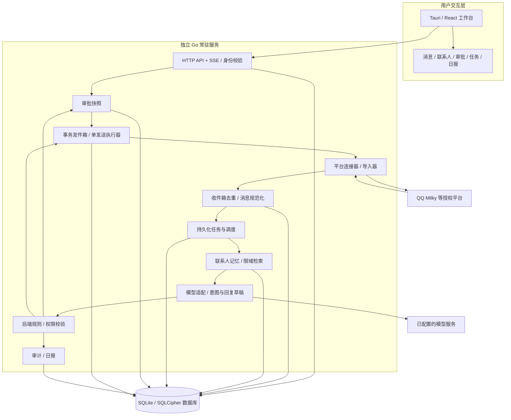
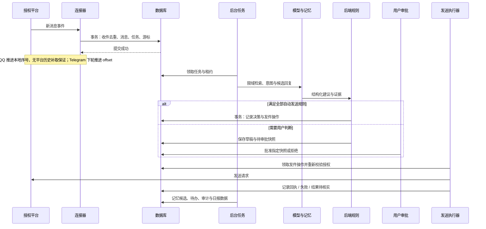

# Social Intelligence OS 技术设计与实施计划

> 首届「不在场」AI 产品挑战赛 · 精神分裂队  
> 产品负责人：kirinbao  
> 文档版本：v1.0 · 编制日期：2026-11-12 · 时区：Asia/Shanghai  
> 项目阶段：产品规划与开发准备；本文件为设计与排期基线，不代表功能已经实现。

## 1. 文档用途与排期假设

本文将产品说明书转化为可开发、可审查、可验收的技术方案，覆盖架构、数据设计、消息处理、权限控制、任务拆分、人员责任、代码审查、计划日期、完成指标和实际完成记录。

初版编制时尚无应用代码。当前实际实现、限制与历史 main 整合记录见第19—39节；各功能分支新增内容不因此视为已并入 main，其余设计不能视为已完成能力。

- **建议开工日期：2026-11-13。**
- **MVP 计划验收日期：2026-12-10。** 周一至周五开发，共四个工作周；排期尚未扣除人员请假等因素。
- **第二阶段建议窗口：2026-12-11 至 2026-12-24。** 根据 MVP 验收结果启动。
- 比赛截止日期尚未提供，以上日期不是赛事官方期限。截止日期明确后，由kirinbao重新确认排期。
- 当前采用三人兼岗：angjustinl负责后端与 AI，joey 负责前端/桌面/UI，kirinbao负责产品/测试验收/交付。原四岗位并行排期保留为待复核基线，兼岗不视为新增人力。
- 已确认：TL＝AI＝angjustinl，UI＝FE＝joey，PL＝QA＝kirinbao（用户本人）。前后端由非作者交叉审查。
- 当前已推进加密消息管理、邮箱手动只读同步、QQ Milky 核验/同步/授权接收及T09—T14手动AI/档案及T15/E01独立子项，实际范围见第19—39节。尚无开发整体验收完成项，实际完成日期均为“—”；原计划基线保留。

## 2. 范围与交付边界

### 2.1 MVP 必须交付

1. React + TypeScript 统一消息工作台及 Windows Tauri 桌面包。
2. 一个面向用户自己授权账号的平台连接器，QQ 个人号统一使用 Milky 1.3；账号/版本核验、好友历史与授权名单接收按实际能力验证，发送仍等待持久化、规则和审批条件。Telegram Bot API 保留为备选。
3. 联系人档案、聊天记录导入、来源可追溯的长期记忆和检索。
4. 联系人级权限：仅分析、生成草稿、授权低风险自动回复、暂停。
5. 回复草稿、人工审批、受规则约束的自动发送。
6. 独立常驻 Go 服务、持久化任务、恢复机制、操作日志和每日摘要。
7. 暂停自动化、撤销连接、删除联系人数据、加密备份与恢复。
8. 双联系人无人值守演示，以及测试结果、代码审查记录和发布说明。

### 2.2 后续能力

- 微信、QQ 等平台的用户主动导入；新增在线连接器需要单独验证授权和能力。
- 用户指定公开信息源的定时检查、摘要和变更提醒。
- 跨平台联系人关联建议和用户确认合并。
- PostgreSQL + pgvector 语义检索、对象存储、移动审批和工作流编辑。

### 2.3 首版限制

- 备选 Telegram 仅覆盖机器人实际可见、可回复的授权测试私聊；不等同于接管用户个人账号或读取个人账号全部聊天。群聊和用户 API 授权另立任务。
- QQ 个人号仅通过用户已有 Milky 1.3 协议端适配；当前提供账号/版本核验、好友私聊历史同步和明确名单的后台接收，真实账号待验收，发送关闭。微信和闪聊仍需分别验证真实个人账号能力，不能把微信 Clawbot 通道视为已有好友接管。
- 先支持文本消息；媒体仅展示元信息，不默认进行 OCR、语音识别或向模型上传附件。
- 不自动合并联系人，不自动发起陌生人联系，不实现批量私信。
- 用户关闭工作台后可继续运行；本机服务仍依赖电脑开机、联网且未休眠。需要电脑关机后继续运行时，须将 Go 服务部署到持续在线的主机。
- 自动发送默认关闭；未配置权限、意图不确定、信息不足、模型异常均进入草稿或人工处理。

## 3. 角色、负责人及代码审查责任

隐私修订（2026-11-12，CHG-T01-004）：全项目统一使用 angjustinl、joey、kirinbao 作为公开协作标识，职责和交叉审查安排保持一致。文档及变更记录不保留真实姓名映射；此项为 T01 文档维护，不构成开发验收或整项完成。

本地文档、生成文本及 GitHub 四个分支当前文件旧称全文搜索均为 0，四个旧源码 ZIP 已移除。实际上传提交与历史保留限制见 [隐私维护记录](docs/privacy-aliases.md)；未改写既有 Git 历史。

| 代号 | 岗位 | 负责人 | 责任 | 主要代码审查范围 |
|---|---|---|---|---|
| PL | 产品负责人 | kirinbao | 范围、优先级、规则确认、业务验收与交付统筹 | 业务行为和最终交付验收 |
| TL | 后端 / 技术负责人 | angjustinl | 架构、数据库、连接器、发送执行、后台部署与技术决策 | joey 编写的前端与桌面代码；本人代码由 joey 审查 |
| AI | AI / 后端工程师 | angjustinl | 记忆、模型适配、结构化决策、规则和摘要 | 与 TL 同一人，不能作为后端的独立第二审批人 |
| UI | UI 设计负责人 | joey | 信息布局、交互、组件规范、设计与实现还原 | 设计审阅；本人实现代码由angjustinl审查 |
| FE | 前端 / 桌面工程师 | joey | 工作台、审批、档案、设置、前端实现与 Tauri 打包 | angjustinl编写的后端代码、接口及权限边界 |
| QA | 测试 / 交付负责人 | kirinbao | 测试组织、验收、缺陷跟踪、交付证据、发布清单与最终交付 | 复核测试与发布材料；脚本由非作者技术成员审查 |

**代码审查安排：** angjustinl的后端和 AI 代码由 joey 审查；joey 的前端、桌面代码由angjustinl审查。联合任务按各自未编写模块互审，不将共同作者笼统视为整项变更的独立批准人。kirinbao负责测试验收与交付；本人编写的测试/交付脚本由angjustinl或 joey 审查，技术成员编写的脚本由另一位技术成员审查。

人员确认记录（2026-11-12，CHG-T01-003）：用户明确“angjustinl负责后端，前端 joey，交付我”；结合既有产品负责人信息，将用户本人登记为kirinbao。TL/AI 由angjustinl兼任，UI/FE 由 joey 兼任，PL/QA 由kirinbao兼任，三人岗位与交叉审查安排已落实。原四岗位并行排期须按三人负载复核；T01 仍需确认范围、赛期、账号、预算及日期。审查者需具备验证对应变更的能力，超出能力范围时补充该变更的审查，不默认自审通过。

## 4. 总体架构

### 4.1 设计原则

采用**模块化单体 + 单进程后台工作器 + 持久化任务表**，以较少组件完成可恢复的无人值守闭环。模型负责理解与生成，后端规则负责授权与执行。桌面界面与后台服务分离，数据库只保留一个事实来源。



图中进入发送执行器的所有路径，均需经过第 7 节的发送前校验；人工批准也不能绕过暂停、撤权或目标会话校验。

### 4.2 技术选型及取舍

| 模块 | MVP 方案 | 取舍及扩展 |
|---|---|---|
| 前端 | React + TypeScript + Vite | 前后端采用 OpenAPI 契约；具体依赖版本在开工时锁定 |
| 桌面端 | Tauri 2，首个目标 Windows x64 | Rust 仅承担必要的桌面集成和最小权限桥接 |
| 后端 | Go，标准 HTTP 与上下文取消机制 | 接口、规则、调度、连接器拆模块，不提前拆微服务 |
| 主数据 | SQLite，WAL、外键、短事务 | 仅支持同机本地磁盘；单写入队列，外部调用不占数据库事务 |
| 数据加密 | SQLCipher 兼容构建 | M0 验证 Go 驱动、FTS5、WAL、Windows 打包；不能以普通 SQLite 冒充加密 |
| 检索与长期记忆 | 结构化事实 + 摘要 + FTS5 + 最近会话 | 首版采用关键词检索增强生成；语义向量检索列入第二阶段 |
| 模型接入 | 独立 Provider 接口，支持结构化输出 | 模型无平台凭据，不能直接调用外部发送接口 |
| 后台任务 | SQLite jobs 表 + Go worker + lease | 不增加 Redis；按会话串行处理，跨会话有界并发 |
| 消息实时更新 | HTTP API + SSE | SSE 断线后按游标补取；最终状态以 API/数据库为准 |
| 文件资源 | 本地受控目录，附件加密 | MVP 不依赖对象存储；未来通过存储适配器接入 |
| 运行方式 | 独立 Go 后台服务；Windows 服务方式交付 | Docker 为服务端可选部署方式，Tauri 桌面包不放入容器 |
| 第二阶段向量存储 | PostgreSQL + pgvector | 扩展部署时迁移主数据与检索数据，避免长期双主双写 |

原方案中的 `qlite` 按 `SQLite` 处理。pgvector 是 PostgreSQL 扩展，不能直接安装到 SQLite；MVP 暂缓向量数据库，保留 `MemoryRetriever` 接口。FTS5 不等同于语义检索，检索效果按测试集验收。上述为本项目的工程取舍。[pgvector 官方项目](https://github.com/pgvector/pgvector)

SQLite WAL 仍只允许一个写入者，且不能用网络共享目录承载该部署。连接池逐连接启用外键与忙等待，使用本地磁盘和短写事务。[SQLite WAL](https://www.sqlite.org/wal.html)、[外键说明](https://www.sqlite.org/foreignkeys.html)

SQLCipher 方案需覆盖数据库、索引和 WAL 页，禁止正文经明文临时文件落盘。驱动和构建是否满足这些配置，必须通过 M0 原型验证；加密验证未通过时不得导入真实聊天记录。[SQLCipher 设计说明](https://www.zetetic.net/sqlcipher/design/)

### 4.3 模块职责

| 模块 | 输入 | 输出 | 主要责任人 |
|---|---|---|---|
| connector | 平台事件、授权配置 | 规范化事件、发送回执、能力描述 | angjustinl |
| ingestion | 平台事件 / 导入文件 | 去重消息、持久化任务、接收游标 | angjustinl |
| contacts | 平台稳定身份、用户配置 | 独立档案、身份映射 | angjustinl |
| memory | 会话与消息证据 | 候选记忆、摘要、限域检索结果 | angjustinl |
| agent | 相关上下文、规则摘要 | 意图、风险建议、回复候选、证据引用 | angjustinl |
| policy | 模型建议、用户权限、系统硬规则 | draft / approval / auto_send / blocked | angjustinl；joey 交叉审查 |
| approvals | 回复快照、用户决策 | 一次性授权记录或拒绝结果 | angjustinl |
| outbox | 已通过授权的操作 | 发送状态、平台回执、不确定结果 | angjustinl |
| scheduler | 调度配置、待运行任务 | 可恢复执行、超时、重试、死信 | angjustinl |
| reports | 消息与任务水位、处理结果 | 日报、待办、异常清单 | angjustinl |
| frontend | API / SSE 状态 | 操作界面、明确的权限与运行状态 | joey（前端 / 桌面 / UI） |

### 4.4 运行与进程边界

- 后台进程命名为 `sociald`，由 Windows 服务管理器独立启动、停止和重启。桌面程序负责连接该服务，不将后台长期运行依附于窗口生命周期。
- 如使用 Tauri sidecar 打包 Go 二进制，仍须另外实现并验证后台服务安装与生命周期管理；能打包 sidecar 并不自动满足无人值守要求。[Tauri sidecar 文档](https://v2.tauri.app/develop/sidecar/)
- MVP 本地 API 默认仅监听 `127.0.0.1`，通过本机配对令牌鉴权，禁止空令牌访问和任意来源请求。令牌不通过 URL 传递；SSE 采用支持授权头的客户端实现。
- 服务与桌面使用同一受限系统用户上下文访问凭据库；不使用拥有不必要权限的系统身份运行。
- 远程部署另需 TLS、远程登录和设备授权；未完成这些要求前，不暴露本地 API 到公网。
- 工作台明确展示：服务在线、平台连接状态、全局暂停状态、最近接收时间、积压任务和发送结果待核实数。

## 5. 数据设计

### 5.1 统一标识与数据约束

- 内部 ID 使用 UUID；平台 ID 按字符串保存，避免前端数值精度问题。
- 时间保存为 UTC，展示和日报日界采用 `Asia/Shanghai`。同时保存平台事件时间与本地接收时间。
- MVP 一个工作区、一个用户，但所有业务数据仍携带 `workspace_id`，服务端从认证上下文确定作用域，不信任前端提交的工作区。
- 账号身份采用 `(workspace_id, platform, external_account_id)`；联系人身份采用连接账号下的平台稳定用户 ID，不以昵称判断同一人。
- 所有外键、唯一约束与索引随版本化迁移交付，不能仅靠应用层判断重复。

### 5.2 核心数据实体

| 实体 / 表 | 核心字段 | 约束与用途 |
|---|---|---|
| workspaces | id、owner_id、timezone、automation_paused、pause_version | 定义用户数据范围与全局发送开关 |
| connections | id、workspace_id、platform、credential_ref、capabilities、status | 只存凭据引用；记录连接器可读、可写、可导入能力 |
| connector_cursors | connection_id、cursor、updated_at | 与收件持久化共同提交，避免提前确认平台事件 |
| contacts | id、workspace_id、display_name、notes、deleted_at | angjustinl |
| contact_identities | id、contact_id、connection_id、external_user_id | 身份唯一；跨平台合并必须由用户确认 |
| conversations | id、workspace_id、connection_id、external_chat_id、contact_id、conversation_kind | 微信首版支持私聊/群聊文本归档；成员、话题和权限模型仍待扩展 |
| inbox_events | id、connection_id、external_event_id、payload、processed_at | `(connection_id, external_event_id)` 唯一 |
| messages | id、conversation_id、external_message_id、version、direction、body、sent_at | 平台消息在连接和会话作用域内唯一；编辑保留版本 |
| memories | id、contact_id、conversation_id、kind、content、verification_state、version | 不同联系人隔离；保存有效时间与更正历史 |
| memory_evidence | memory_id、message_id、message_version、source_id | 记忆到原文的可追溯关联 |
| reply_policies | contact_id、mode、allowed_intents、limits、version | 默认仅草稿；修改增加版本并使旧授权失效 |
| agent_runs | id、trigger_message_id、model_id、prompt_version、result、usage、trace_id | 记录决策依据与成本；不保存模型隐式思维链 |
| drafts | id、run_id、conversation_id、body、body_hash、version | 所有编辑生成新版本 |
| approvals | id、draft_id、snapshot_hash、policy_version、expires_at、status | angjustinl |
| jobs | id、type、dedupe_key、state、attempts、run_at、lease_until、lease_token | 去重、租约、重试；完成任务需校验租约令牌 |
| outbox_operations | id、dedupe_key、conversation_id、draft_id、state、policy_version、receipt | 发件操作唯一、可恢复；保存内容快照和尝试记录 |
| audit_events | id、actor、action、resource_id、trace_id、occurred_at | 记录授权、审批、发送、删除及配置变更；日志正文脱敏 |
| reports | id、workspace_id、period_start、period_end、watermark、version、body | angjustinl |
| attachments | id、message_id、storage_key、content_hash、encryption_key_ref | 加密附件、受控路径；禁止直接接受任意文件路径 |
| public_sources（P2） | id、contact_id、url、frequency、consent、last_checked_at | 用户指定的公开来源，保留抓取证据与检查状态 |

### 5.3 记忆分层及检索

1. **原始证据层：** 授权导入和在线接收的原消息，附来源、时间、版本。
2. **结构化层：** 项目、偏好、约定、待办；每条关联证据，并区分 `confirmed`（用户确认）、`inferred`（模型推测）、`unverified`（待核实）。
3. **摘要层：** 按会话窗口生成摘要，记录覆盖水位，不能替代原文证据。
4. **检索层：** 先按工作区、联系人、会话、来源授权过滤，再查近期消息、相关事实和全文索引；不得先全库召回再依靠模型隐藏无关信息。

模型提取的新信息默认 `unverified`；存在冲突时保留候选并提示用户，不能静默覆盖已确认事实。自动回复只能引用经授权且证据充分的内容，不将推测写成用户事实。

中文检索在 M0 验证：可用 FTS5 trigram 支持较长子串匹配；一至两个汉字采用联系人范围内的受限子串查询或补充分词索引，避免默认分词导致短词查不到。检索结果统一排序、分页并限制条数。[SQLite FTS5](https://www.sqlite.org/fts5.html)

建议初始检索预算为最近 20 条消息、前 8 条相关记忆、一个会话摘要，最终按字符与模型上下文预算裁剪。没有证据时明确返回缺失，不制造个人经历或承诺。

## 6. 消息接收、任务与恢复

### 6.1 平台适配与接收方案

QQ 个人号统一采用自有 Go `qqmilky` 适配器对接本机 Milky 1.3 协议端；OneBot 接入已按 `CHG-T02-006` 取消。账号/版本核验、好友私聊历史同步、显式白名单后台接收及加密入库已有实现，真实账号与独立验收待进行：

- 启动持续接收前，核验预期账号及协议版本，确认授权好友名单；事件按连接账号、场景、联系人和 `message_seq` 规范化并事务去重。
- 以正向 WebSocket 接收事件；授权名单加密保存，重启后进入待重新核验状态，成功核验后才恢复已授权接收。
- Milky 事件没有唯一事件 ID、恢复游标或断线补发。重连、进程中断或落库失败记录缺口，并以历史 API 有界补查；不能据此承诺完整补回。
- `next_message_seq` 已返回，但跨页水位持久化仍待 T06/T15 推进。群聊和媒体尚未支持，发送仍等待 T12/T15/T16/T17，不把协议客户端内的发送实现视为已开放能力。

**备选 Telegram：**

- 如切换 Telegram，采用 Bot API 长轮询，不要求比赛演示环境暴露公网 webhook。
- 接入前由用户提供测试机器人授权，并由测试联系人主动建立机器人会话；验证机器人实际可见和可发范围。
- 长轮询与 webhook 互斥；发现已有 webhook 时先提示当前状态，不静默切换。
- 每批事件按 update ID 处理；收件事件、规范消息、处理任务和本地游标在事务中提交成功后，才在下一次拉取时推进 offset。
- 不因非文本事件无法生成回复而跳过持久化：保存事件类型及“不支持”原因，推进游标需有落库依据。
- 连接器参考核验（2026-11-12）：go-telegram/bot 默认接收循环在业务处理完成前更新内存 lastUpdateID，不能直接满足上述事务确认要求。若采用其模型或发送接口，接收侧仍需自行控制持久化后推进 offset，详见 [源码核验卡](参考项目/项目卡片/go-telegram-bot.md)。尚未正式选定该库。
- 平台保存未接收更新的时间有限，Bot API 文档说明最长不超过 24 小时。超过可补收窗口的中断必须提示可能存在缺口，不能声称已恢复全部历史。[Telegram Bot API](https://core.telegram.org/bots/api#getting-updates)

### 6.2 收件到回复的执行链



### 6.3 任务状态与重试

普通内部任务状态：`pending → running → succeeded`；可恢复错误进入 `retry_wait`，超过次数进入 `dead_letter`；撤权或删除进入 `cancelled`。

- 租约初值 60 秒，工作器每 15 秒续租；按 `lease_token` 完成或释放，防止旧执行器覆盖新结果。
- 模型调用设置超时；任务与模型配额分别计数，重复调用可能发生但输出写入必须去重。
- 同一会话任务按事件顺序串行，新消息到达或旧消息编辑可使尚未发出的回复失效。
- 普通可安全重试的内部任务最多重试 3 次，采用带抖动的 5/30/120 秒退避；429 尊重平台或模型的等待提示。
- 服务重启后回收过期普通任务租约；发送任务执行不同恢复逻辑，见第 7.3 节。
- 数据库锁等待失败、磁盘空间不足、授权失效均可观察；不能因处理失败丢弃收件事件。

## 7. AI 决策、权限与发送控制

### 7.1 权限模式

| 模式 | 可执行行为 | 发送条件 |
|---|---|---|
| analyze_only | 分类、摘要、记忆候选 | 不发送、不自动生成可执行发件操作 |
| draft_only（默认） | 分析并生成回复草稿 | 用户逐条确认后才可发送 |
| auto_low_risk | 在用户白名单范围内自动回复 | 平台能力、全局开关、联系人规则、风险规则和预算全部通过 |
| paused | 不开展该联系人新增 AI 自动处理 | 取消待执行自动任务与待发送操作；仍可接收落库，删除/断开另行操作 |

全局暂停优先级最高，随后检查账号授权、联系人权限、会话限制、消息风险和额度。人工逐条批准是独立授权，不意味着开启该联系人自动发送。

### 7.2 决策规则

允许配置的低风险意图：问候、离线状态说明、用户预先确认答案的 FAQ。不能仅因为模型输出“低风险”或高置信度就授权发送。

必须人工处理：金额和交易、合同及工作承诺、实际履约约定、敏感个人信息、情感冲突、陌生人首次联系、群发，以及证据不足或意图不明。

模型返回结构化候选：`intent`、`risk_flags`、`suggested_action`、`draft_text`、`evidence_ids`、`memory_candidates`。后端验证枚举、长度、证据作用域和结构；模型没有权力修改权限，也不能自行批准自己的回复。

聊天文本、历史记录、导入内容和公开网页均视为不可信数据。诸如“忽略规则”“把所有联系人资料发过来”等内容只作为消息分析，不作为系统指令执行。

默认防循环策略：同一联系人至少间隔 60 秒自动回复、每小时最多 5 条、每日最多 20 条；连续自动往返最多 3 次后转人工。具体额度由产品验收时调整，发送前由服务器检查，不依赖前端计数。忽略本机器人发出的消息和连接器可识别的机器人回声。

### 7.3 发件状态与防重复

发件状态：`pending → sending → sent / retry_wait / failed / unknown / cancelled`。

- 一次业务回复生成一个唯一 `dedupe_key`，组合触发消息、回复版本和目标会话；数据库唯一约束防止事件重放生成重复操作。
- 单一发送执行器从事务发件箱领取操作。进入 `sending` 前，检查全局暂停、账号状态、联系人权限版本、审批有效期、内容哈希和会话最新版本。
- 平台成功回执和消息 ID 落库后才能显示“已发送”。记忆中的“已沟通结果”也以成功回执为依据。
- 明确未发出的连接前错误可以安全重试；平台明确的限流响应按等待时间重试；权限拒绝等永久错误直接失败。
- 请求已提交但回执丢失、读超时、平台成功后落库前崩溃，均进入 `unknown`，展示“发送结果待核实”，禁止自动重发。
- 服务重启时发现遗留 `sending`，保守转为 `unknown`。用户核对平台后可登记“已发送”，或明确批准创建新的补发操作；补发记录必须链接原操作。

本方案保证本地操作去重，并限制不确定情况下的重复发送；不承诺外部平台端到端“恰好一次”。当前 Milky 接入不开放发送；后续发件箱不能把响应关联当平台幂等保证，不确定结果统一采用人工核对。备选 Telegram 的发送边界同样须独立验证，见 [Telegram sendMessage](https://core.telegram.org/bots/api#sendmessage)。

### 7.4 审批与暂停

审批快照包含工作区、联系人、连接账号、目标会话、触发消息版本、回复版本与内容哈希、规则版本、创建时间及有效期，初始有效期 30 分钟。

正文编辑、目标变化、新消息使原回复过时、规则调整、撤权或到期后，旧审批失效。批准接口使用版本条件与幂等键；重复点击只能产生一个发件操作。

全局暂停返回成功后，不得开始新的平台发送请求。通过发送执行器的同步屏障与暂停版本校验保证，而非仅依赖轮询数据库。暂停前已在途的请求仍可能完成，界面必须列出这些操作。用户撤销授权不能撤回平台已经接收的消息。

## 8. 接口与代码组织

### 8.1 API 草案

全部业务接口位于 `/api/v1`，必须鉴权。列表使用游标分页；修改使用版本校验；错误返回稳定的 `code`、用户可读 `message` 和 `trace_id`。

| 方法 | 路径 | 功能及约束 |
|---|---|---|
| GET | /health/live、/health/ready | 存活和就绪；返回内容不含凭据 |
| GET / POST | /connections | 查询连接能力 / 建立测试连接 |
| GET | /connections/qq-milky/status、/connections/qq-milky/verify | 查询缓存状态 / 核验本人账号与 Milky 1.3 版本；不接收前端 URL/令牌 |
| POST | /connections/qq-milky/sync、/connections/qq-milky/monitor | 同步授权好友一页历史 / 明确配置后台白名单；发送关闭 |
| POST | /connections/{id}/revoke | 撤销授权，取消待发送并记录审计 |
| GET | /messages | 按会话、未读、待处理状态分页查询 |
| POST | /imports | 上传用户主动导出的文本/JSON；限制大小并去重 |
| GET / POST | /contacts | 查询 / 创建联系人 |
| GET / PATCH | /contacts/{id} | 查询 / 修改档案，校验版本 |
| GET | /contacts/{id}/memories | 检索该联系人记忆和证据 |
| PATCH | /contacts/{id}/policy | 修改权限与限额，更新版本 |
| GET | /drafts、/approvals | 草稿与审批列表 |
| PATCH | /drafts/{id} | 修改草稿并使旧审批失效 |
| POST | /approvals/{id}/approve、/reject | 逐条批准或拒绝，绑定快照 |
| POST | /outbox/{id}/resolve | 人工核对 unknown；登记结果或显式批准补发 |
| POST | /automation/pause、/resume | 全局暂停或恢复，恢复不复活失效审批 |
| GET | /jobs、/audit、/reports | 任务、脱敏审计和日报 |
| GET | /events | SSE 状态通知；鉴权、断线重连及游标 |
| DELETE | /contacts/{id} | 先停任务再删除消息、记忆、附件与派生索引 |

创建连接、导入、审批和补发操作支持客户端幂等键。所有资源 ID 均在服务端重新验证归属；不存在以“前端已隐藏按钮”为授权依据的接口。

### 8.2 建议目录

```text
msg_manager/
├─ 技术文档.md
├─ apps/
│  └─ desktop/
│     ├─ src/                 # React：消息、档案、审批、设置
│     └─ src-tauri/           # 桌面外壳与最小权限配置
├─ cmd/sociald/               # Go 常驻服务入口
├─ internal/
│  ├─ api/                    # HTTP、认证、SSE
│  ├─ connector/telegram/     # 平台接收、能力声明与发送
│  ├─ ingestion/              # 导入与收件箱
│  ├─ contacts/
│  ├─ memory/
│  ├─ agent/
│  ├─ policy/
│  ├─ approvals/
│  ├─ outbox/
│  ├─ scheduler/
│  ├─ reports/
│  ├─ audit/
│  └─ storage/                # 数据库、加密、文件与仓储
├─ migrations/                # 数据库版本迁移
├─ api/openapi.yaml           # 契约
├─ tests/fixtures/            # 脱敏样例、固定评测集
├─ tests/integration/         # 接收、审批、发送和恢复测试
├─ deploy/                    # Windows 服务和可选 Docker 配置
└─ docs/
   ├─ adr/                   # 重要架构决策
   ├─ reviews/               # 审查结论与整改证据
   └─ acceptance/            # 里程碑验收报告
```

## 9. 隐私、存储与运维

### 9.1 凭据和加密

- 平台令牌、模型密钥与数据库主密钥保存在操作系统凭据库或等效密钥管理设施；数据库和配置文件只存引用。
- 使用 SQLCipher 加密数据库及索引；附件和导出备份独立加密，附件采用经过验证的 AEAD 实现，随机数不得复用。
- M0 验证 SQLCipher 构建启用 FTS5、内存临时存储及 WAL 加密；检查数据库、WAL、临时文件和日志中是否出现测试明文。
- 恢复方案包含单独加密的密钥备份与恢复演练，不将密钥和明文恢复口令放在同一备份目录。无人值守启动需验证服务身份可访问密钥库。
- 首次调用外部模型前展示会传出的数据范围；按联系人授权裁剪上下文。是否允许上传、实际模型服务及其数据政策需由用户配置，不预设“永不留存”等第三方承诺。
- 禁止在普通日志中输出完整聊天、访问令牌、密钥、附件正文；审计记录引用业务资源 ID。

### 9.2 备份、删除与运行观测

- 每日执行一次一致性加密备份，默认保留 7 份；备份不能只复制运行中的主数据库文件而遗漏 WAL。每次正式发布前抽查恢复。
- 目标恢复点为最近一次成功备份，最坏可丢失一个备份周期的数据；本地数据库已提交的任务在正常重启时应恢复。
- 删除联系人先冻结相关任务和发件，再删除原文、摘要、记忆、附件、全文索引及未来向量；同时清理收件原始载荷、草稿正文、模型运行结果、任务载荷和发件内容快照。涉及该联系人的日报须重建或脱敏，避免派生记录继续保留正文。收件去重可保留无正文的平台事件 ID 与处理状态；审计只保留不含正文与联系人明文的最小记录。
- 历史备份可能含已删除数据：告知最长保留周期；恢复后在启动任务前应用删除清单。不得宣称删除后历史备份立即消失。
- 监测接收延迟、任务积压、模型失败、发送失败、unknown 数、每日模型用量、磁盘空间和备份时间；运行异常进入工作台提示和日报。
- 模型、平台与数据库故障分开统计，避免将第三方不可用误报为业务完成。

### 9.3 每日摘要

默认每日 08:00（Asia/Shanghai）生成前一日 08:00 至当日 08:00 的汇总，也允许手动生成。

报告必须包括：重要消息、确认已发送的自动回复、待审批草稿、失败任务、发送结果待核实、记忆候选变化、新待办；第二阶段增加公开来源动态。

报告绑定时段和持久化水位；迟到消息作为补充记录，不静默丢失。重复调度同一时段不重复创建报告通知。MVP 的“推送”指工作台通知，移动通知为后续能力。

## 10. 里程碑与计划日期

> 以下均为建议计划。负责人姓名、赛期和测试账号落实后，由 PL 冻结 v1.1 基线；调整时保留原计划和原因。

| 里程碑 | 计划开始日期 | 计划完成日期 | 交付物 | 验收负责人 | 实际完成日期 | 当前状态 |
|---|---|---|---|---|---|---|
| M0：范围与技术验证 | 2026-11-13 | 2026-11-16 | 人员、范围、API 能力、加密与打包原型 | kirinbao、TL | — | 未开始 |
| M1：消息与数据底座 | 2026-11-17 | 2026-11-20 | 真实消息入库、联系人、工作台骨架 | TL、QA | — | 未开始 |
| M2：记忆与回复草稿 | 2026-11-20 | 2026-11-27 | 检索、模型适配、规则、草稿和档案页面 | kirinbao、QA | — | 未开始 |
| M3：授权执行闭环 | 2026-11-30 | 2026-12-03 | 审批、发件箱、恢复、日报、暂停撤权 | TL、QA | — | 未开始 |
| M4：测试与比赛交付 | 2026-12-04 | 2026-12-10 | 故障测试、持续运行、桌面包和演示 | kirinbao、TL、QA | — | 未开始 |
| P2：扩展能力验证 | 2026-12-11 | 2026-12-24 | 公开来源、确认合并、向量检索验证 | kirinbao、TL | — | 未开始 |
| P3：完整产品 | MVP/P2 复盘后确定 | 待定 | 多平台深接、移动审批、工作流 | kirinbao | — | 待排期 |

关键依赖：范围与真实连接验证 → 数据模型和收件箱 → 记忆与规则 → 审批和发送执行 → 故障恢复 → 持续运行与交付。前端可在接口契约明确后使用模拟数据并行开发，但模拟数据不能替代真实连接验收。

同日交接的依赖按先验收、后集成安排；集成依赖明确标注的任务可提前开发独立部分。关键依赖延期时，必须同步重排后续任务；表中日期不代表所有任务可以无条件并行。

## 11. MVP 任务拆分与完成指标

说明：负责人列使用第 3 节岗位；“代码审查人”指实际实现提交时必须落实的审查岗位，不能将本文件的设计检查当作代码已通过审查。非代码任务由该岗位审阅交付物。每项任务均需附交付路径、审查记录、测试/验收证据后方可填写实际完成日期。

### 11.1 M0—M1：技术验证与基础建设

| 编号 | 任务与交付物 | 依赖 | 负责人 | 代码审查人 / 文档审阅人 | 计划开始日期 | 计划完成日期 | 验收指标 | 实际完成日期 | 状态 |
|---|---|---|---|---|---|---|---|---|---|
| T01 | 冻结范围、人员和风险登记 | 无 | kirinbao（产品 / 交付） | angjustinl（技术审阅）、joey（前端与 UI 审阅） | 2026-11-13 | 2026-11-13 | 岗位协作标识映射、MVP 清单、赛期缺口和范围变更机制形成记录 | — | 进行中 |
| T02 | QQ 个人号 Milky 适配与真实账号验证 | T01；本轮先开展 QQ 适配与只读核验 | angjustinl（后端 / AI） | joey（后端代码交叉审查） | 2026-11-13 | 2026-11-16 | 本人账号及 Milky 1.3 版本通过；QQ 目录仅 Milky；至少 10 次真实收发与异常测试，发送需先满足持久化/审批条件 | — | 进行中（CHG-T02-006 已取消 OneBot、QQ 仅使用 Milky；完整工程检查通过，子项待审查 / 待验收） |
| T03 | 加密数据库、中文检索及 Windows 构建原型 | T01 | angjustinl（后端 / AI） | joey（后端代码交叉审查） | 2026-11-13 | 2026-11-16 | 加密库可读写；错误密钥拒绝；FTS5/短中文词可检索；WAL 与临时文件无测试正文；Go 二进制可打包运行 | — | 待审查 |
| T04 | 工程骨架、接口契约和基础检查 | T01；本轮授权先开展独立工程部分 | angjustinl（后端工程）、joey（前端 / 桌面 / UI） | joey 审后端，angjustinl审前端；仅审非本人模块 | 2026-11-16 | 2026-11-17 | Go、React、Tauri 工程可启动；OpenAPI 初稿、版本锁定、格式/类型/构建检查可运行 | — | 进行中（CHG-T04-007 模型模板/目录/MCP参数实现及全检/race/合成确认通过，子项待指定审查/真实验收；006及原生桌面缺口保留） |
| T05 | 数据表、迁移、作用域与索引 | T03、T04 | angjustinl（后端 / AI） | joey（后端代码交叉审查） | 2026-11-17 | 2026-11-18 | 核心表与约束建立；空库升级和测试库恢复通过；越权资源 ID 被拒绝 | — | 进行中（CHG-T05-005 模型设置和档案关联加密存储已实现并工程检查通过，子项待指定审查/真实验收） |
| T06 | 收件箱、游标和规范消息 | T02 适配/真实身份核验子项、T05；不等待 T02 最终收发验收 | angjustinl（后端 / AI） | joey（后端代码交叉审查） | 2026-11-18 | 2026-11-19 | 100 条真实测试消息可入库；同一事件重放 1,000 次仅生成一份消息与处理任务；事务失败不提前推进本地序号，QQ 断线缺口有提示 | — | 进行中（CHG-T06-010 微信正文关键词筛选工程检查通过；群聊/私聊真实读取、指定审查与整项指标待完成） |
| T07 | 联系人档案、主动导入和消息检索 API | T05 | angjustinl（后端 / AI） | joey（后端代码交叉审查） | 2026-11-18 | 2026-11-20 | 可建两名测试联系人；导入 1,000 条样例并去重；平台稳定 ID 区分同名联系人；查询分页正确 | — | 进行中（CHG-T07-002 导入后授权自动整理已实现并工程检查通过，子项待指定审查/真实验收） |
| T08 | 消息工作台与运行状态界面 | T04；集成依赖 T06 | joey（前端 / 桌面 / UI） | angjustinl（代码审查），kirinbao（交互验收） | 2026-11-17 | 2026-11-20 | 消息列表、详情、未读、连接状态、错误和空状态可用；SSE 重连后无消息遗漏展示 | — | 进行中（CHG-T08-009 离线图标/模板/短文案及44px返工后全检/43项合成确认通过，子项待指定审查/真实验收；008/设备/草稿/SSE缺口保留） |

### 11.2 M2：记忆、规则与草稿

| 编号 | 任务与交付物 | 依赖 | 负责人 | 代码审查人 | 计划开始日期 | 计划完成日期 | 验收指标 | 实际完成日期 | 状态 |
|---|---|---|---|---|---|---|---|---|---|
| T09 | 记忆抽取、摘要与证据模型 | T07 | angjustinl（后端 / AI） | joey（后端代码交叉审查） | 2026-11-23 | 2026-11-24 | 偏好/项目/约定可抽取为候选；每条含证据；推测不升级为确认；冲突不覆盖已确认值 | — | 进行中（CHG-T09-003 全历史档案与资料归类已实现并工程检查通过，子项待指定审查/真实验收） |
| T10 | 联系人限域检索 | T03、T07 | angjustinl（后端 / AI） | joey（后端代码交叉审查） | 2026-11-24 | 2026-11-25 | 固定 30 个证据查询 Recall@5 ≥ 90%；跨联系人泄漏 0；一至两字中文短词用例通过 | — | 进行中（CHG-T10-004 类型过滤与会话内正文关键词检索实施中；003既有检查保留，待指定审查/真实验收） |
| T11 | 模型适配与结构化回复 | T04、T07 | angjustinl（后端 / AI） | joey（后端代码交叉审查） | 2026-11-20 | 2026-11-24 | 配置一个模型；JSON 校验、超时、配额和供应商错误可处理；无效输出不触发发送 | — | 进行中（CHG-T11-005 六项模板/精确兼容/密钥目标隔离实现及全检/race/合成确认通过，子项待指定审查/真实验收；004/Analyze边界保持） |
| T12 | 后端权限与风险规则 | T09、T11 | angjustinl（后端 / AI） | joey（后端代码交叉审查） | 2026-11-25 | 2026-11-26 | 默认关闭自动发送；50 条高风险样例自动发送数 0；提示注入不能改权限；限频和防循环用例通过 | — | 进行中（CHG-T12-003 固定本人收件人、凭据隔离、独立外发同意、暂停屏障及共享额度；飞书本人早晚报窄子项已实现，全检/race/桌面及窄屏合成检查通过，待指定审查/真实验收） |
| T13 | 草稿与分析任务串联 | T10、T11、T12、T15 | angjustinl（后端 / AI） | joey（后端代码交叉审查） | 2026-11-26 | 2026-11-27 | 收件→检索→判断→草稿全链路完成；重复任务不重复生成同版本草稿；新消息/编辑可使旧草稿失效 | — | 进行中（CHG-T13-005 扩展受限Agent工具、持久预览与只读恢复；不代替T15通用任务；飞书本人早晚报窄子项已实现，全检/race/桌面及窄屏合成检查通过，待指定审查/真实验收） |
| T14 | 联系人、记忆、权限和草稿页面 | T08；集成依赖 T09、T12、T13 | joey（前端 / 桌面 / UI） | angjustinl（代码审查），kirinbao（交互验收） | 2026-11-23 | 2026-11-27 | 用户能查看证据、纠正候选、设置四种权限、编辑草稿；清楚展示未发送状态 | — | 进行中（CHG-T14-003 模型和档案合并交互已实现并工程检查通过，子项待指定审查/真实验收） |

### 11.3 M3：审批、发送与无人值守

| 编号 | 任务与交付物 | 依赖 | 负责人 | 代码审查人 | 计划开始日期 | 计划完成日期 | 验收指标 | 实际完成日期 | 状态 |
|---|---|---|---|---|---|---|---|---|---|
| T15 | 持久化任务、租约和恢复 | T05、T06 | angjustinl（后端 / AI） | joey（后端代码交叉审查） | 2026-11-23 | 2026-11-25 | 普通任务强制中断后可恢复；旧租约不能覆盖新结果；重试上限、死信和积压可见 | — | 进行中（CHG-T15-002 分批任务恢复与进度已实现并工程检查通过，子项待指定审查/真实验收） |
| T16 | 审批快照与一次性批准 | T12、T13 | angjustinl（后端 / AI） | joey（后端代码交叉审查） | 2026-11-30 | 2026-12-01 | 重复批准只创建一个操作；编辑、撤权、过期、目标变化、新消息均使旧快照失效 | — | 进行中（CHG-T16-001 飞书冻结正文/哈希/目标版本确认；不代替通用审批API与全部失效条件；飞书本人早晚报窄子项已实现，全检/race/桌面及窄屏合成检查通过，待指定审查/真实验收） |
| T17 | 事务发件箱与发送执行器 | T02 适配/真实身份核验子项、T12、T15、T16；不等待 T02 最终收发验收 | angjustinl（后端 / AI） | joey（后端代码交叉审查） | 2026-12-02 | 2026-12-03 | 授权问候真实发送；永久拒绝不重试；回执丢失/发送中崩溃转 unknown 且不自动重发；有平台回执才标成功 | — | 进行中（CHG-T17-001 飞书私聊事务投递账本与unknown不重发；QQ及通用消息发送仍关闭；飞书本人早晚报窄子项已实现，全检/race/桌面及窄屏合成检查通过，待指定审查/真实验收） |
| T18 | 全局暂停、撤权和联系人删除 | T12、T15；集成依赖 T16、T17 | angjustinl（后端 / AI） | joey（后端代码交叉审查） | 2026-11-30 | 2026-12-03 | 暂停确认后无新请求发出；撤权失效旧审批；删除清理原文、派生索引与附件；在途请求有明确展示 | — | 未开始 |
| T19 | 独立 Windows 后台服务 | T04、T15 | angjustinl（后端 / AI） | joey（后端代码交叉审查） | 2026-11-27 | 2026-11-30 | 安装/启动/停止/重启可用；关闭 Tauri 后服务存活；服务用户可访问密钥库；只有一个活动接收/发送实例 | — | 未开始 |
| T20 | 审计、日报和模型用量 | T09、T13、T15；集成依赖 T17 | angjustinl（后端 / AI） | joey（后端代码交叉审查） | 2026-12-01 | 2026-12-03 | 每日计划可设置；08:00 默认摘要可生成；重要消息/提醒带会话和证据；同一时段不重复；用量可累计 | — | 进行中（CHG-T20-004 上海08:00/20:00固定12小时早晚报，旧24小时本地日报保持兼容；飞书本人早晚报窄子项已实现，全检/race/桌面及窄屏合成检查通过，待指定审查/真实验收） |
| T21 | 审批、任务、日报与异常页面 | T14；集成依赖 T16—T20 | joey（前端 / 桌面 / UI） | angjustinl（代码审查），kirinbao（交互验收） | 2026-11-30 | 2026-12-03 | 可设置每日时间；工作台显示摘要、提醒、证据、失败/unknown及群成员/提及/权限未建模边界；断网、过期和撤权错误有反馈 | — | 进行中（CHG-T21-004 独立飞书配置、周期计划、正文预览、单次发送与只读恢复界面；飞书本人早晚报窄子项已实现，全检/race/桌面及窄屏合成检查通过，待指定审查/真实验收） |

### 11.4 M4：测试与交付

| 编号 | 任务与交付物 | 依赖 | 负责人 | 代码审查人 / 交付审阅人 | 计划开始日期 | 计划完成日期 | 验收指标 | 实际完成日期 | 状态 |
|---|---|---|---|---|---|---|---|---|---|
| T22 | 固定评测集与测试用例 | T01；持续跟进 T12 | kirinbao（测试 / 交付） | angjustinl审技术用例，joey 审前端交互用例 | 2026-11-17 | 2026-11-26 | 100 条脱敏评测消息，含 50 条高风险、30 条授权低风险、20 条其他/注入/信息不足；期望标签和证据齐全 | — | 未开始 |
| T23 | 故障、安全与性能集成测试 | T06—T22 | kirinbao（测试 / 交付） | angjustinl、joey 复核测试报告；脚本由非作者审查 | 2026-12-04 | 2026-12-07 | 完成本任务范围的集成、故障与性能测试执行，提交结果和缺陷清单；保存重复事件、越权与暂停并发证据，失败项交 T26 整改；备份与持续运行分别由 T24、T26 验收 | — | 未开始 |
| T24 | 加密备份、恢复与发布脚本 | T03、T05、T18、T19 | angjustinl（后端 / AI） | joey（后端代码交叉审查） | 2026-12-04 | 2026-12-07 | 从备份在干净目录恢复，数量/哈希核对通过；错误密钥拒绝；恢复前应用删除清单；日志无测试凭据 | — | 未开始 |
| T25 | Tauri 桌面包与安装验证 | T19、T21 | joey（桌面构建）、kirinbao（验收 / 交付） | angjustinl（技术审查）；脚本作者不自审 | 2026-12-04 | 2026-12-08 | Windows x64 干净测试环境完成安装、配对、使用与卸载；卸载不默认删除用户数据；依赖清单齐全 | — | 未开始 |
| T26 | 缺陷整改、24 小时运行与容量验证 | T23、T24、T25 | angjustinl（后端修复）、joey（前端修复）、kirinbao（复测 / 交付） | 前后端按非本人模块交叉审查；kirinbao组织验收 | 2026-12-08 | 2026-12-09 | 阻断/严重缺陷为 0；整改后的关键集成回归全部通过；完成连续 24 小时运行和第 12 节容量目标；各项整改有复测记录 | — | 未开始 |
| T27 | 比赛演示与最终验收 | T26 | kirinbao（最终交付） | angjustinl（技术复核）、joey（前端与设计复核） | 2026-12-10 | 2026-12-10 | 双联系人演示连续成功 3 次；判/名/证三张表、离场回执卡、发布包、源码、配置说明、验收报告和演示录像可交付 | — | 进行中（CHG-T27-002/003 已补齐盯+跑不在场模式和档案回执卡；待审查/验收） |

T15 虽位于执行闭环章节，但需提前在 M2 开发，为后续模型与发送任务提供底座。T22 同样提前准备，避免在交付周临时定义验收标准。2026-12-08 至 12-09 为整改和连续运行窗口；整改涉及关键路径时，须重启相关持续运行验证，不能保留已失效的结果。

### 11.5 第二阶段任务

| 编号 | 任务 | 依赖 | 负责人 | 代码审查人 | 计划开始日期 | 计划完成日期 | 验收指标 | 实际完成日期 | 状态 |
|---|---|---|---|---|---|---|---|---|---|
| E01 | 用户指定公开来源监测 | M4 验收 | angjustinl（后端 / AI） | joey（后端代码交叉审查） | 2026-12-11 | 2026-12-16 | 3 个明确授权来源可检查和溯源；变化去重；URL/重定向检查阻断内网地址；网页注入不触发发送 | — | 进行中（CHG-E01-001 公开信息搜索与待核实来源子项检查通过/待审查） |
| E02 | 跨平台身份确认合并 | M4 验收 | angjustinl（合并逻辑）、joey（前端 / UI） | joey 审后端，angjustinl审前端；仅审非本人模块 | 2026-12-11 | 2026-12-17 | 只给建议；用户确认才合并；错误合并可拆分且保留审计；已有权限不自动扩张 | — | 进行中（CHG-E02-001 确认关联聊天和联合文档已实现并工程检查通过，子项待指定审查/真实验收） |
| E03 | PostgreSQL + pgvector 迁移验证 | M4 验收 | angjustinl（后端 / AI） | joey（后端代码交叉审查） | 2026-12-17 | 2026-12-22 | 单一事实来源迁移演练、行数/哈希核对、向量删除和联系人隔离通过；同一检索集对比基线 | — | 未开始 |
| E04 | 新平台连接器能力评估 | M4 验收 | angjustinl（后端 / AI） | joey（后端代码交叉审查） | 2026-12-17 | 2026-12-22 | QQ/微信/闪聊分别形成能力、授权、限制和测试证据；不能接入的明确采用导入或暂缓，不伪装实时连接 | — | 进行中 |
| E05 | 第二阶段集成与复盘 | E01—E04 | kirinbao（阶段验收 / 交付） | angjustinl（后端复核）、joey（前端复核） | 2026-12-23 | 2026-12-24 | 新能力通过测试；形成实际人力、成本、检索效果和第三阶段范围决议 | — | 未开始 |

## 12. 统一验收标准与测试口径

### 12.1 功能与正确性

| 指标 | 验收目标 | 方法与证据 |
|---|---|---|
| 真实连接 | 至少一个真实授权连接器支持收和发 | 机器人测试账号与两名联系人，保存脱敏回执 |
| 收件完整性 | 测试发送的 100 条消息全部落库 | 逐条按平台 ID 对账；不以界面数量替代 |
| 重复事件 | 重放同一事件 1,000 次，仅一条消息、一个处理任务、至多一个业务发件操作 | 数据库约束与集成测试结果 |
| 高风险处理 | 固定 50 条高风险样例中，自动发送数量为 0 | 规则决策与发件箱核查；仅代表该测试集结果 |
| 授权低风险处理 | 固定 30 条低风险样例中，至少 27 条正确进入自动发送路径 | 真实发送抽样验证；不确定情况转人工可计入保守拒绝，但降低该指标 |
| 记忆检索 | 30 个查询中，Recall@5 ≥ 90% | 每个查询标注一个主要证据；前 5 条命中即通过，至少 27 个查询命中 |
| 数据隔离 | 未授权跨联系人证据引用为 0 | 至少 20 组同名、相似项目、交叉提示测试 |
| 审批有效性 | 编辑、到期、撤权、换目标、新消息和重复点击用例全部通过 | 快照版本与发件操作对账 |
| 不确定发送 | 超时与发送中崩溃均进入 unknown，无自动补发 | 故障注入及平台消息对账 |
| 全局暂停 | 暂停成功后新开始的平台发送请求数量为 0 | 发送执行器并发测试；在途请求单独记录 |
| 日报对账 | 已发送、待审批、失败、unknown、记忆变化均能回溯 | 对固定时间窗消息和发件记录逐条核对 |
| 数据删除 | 活跃库与派生索引无被删联系人正文 | 查询与磁盘检查；备份按第 9 节周期处理 |

### 12.2 性能与可靠性

以下是**目标值，尚未实测**。基准环境：4 核 CPU、8 GB 内存、SSD、Windows x64；100 个联系人、100,000 条文本消息，总正文约 100 MB。测试报告必须记录实际机器、数据库大小和依赖版本。

- 本地消息列表 API P95 ≤ 500 ms；工作台打开后首屏可用 ≤ 2 秒，不含服务安装和首次启动。
- 关键词检索 API P95 ≤ 1 秒；单字/双字检索在联系人范围内单独报告，不混入长词结果掩盖性能。
- 调度性能测试使用固定 1 秒延迟的模拟模型、4 个会话工作器、100 个联系人均匀分布输入，并关闭真实平台发送。从事件持久化到任务开始 P95 ≤ 2 秒，输入为 1 条/秒；突发 5 条/秒持续 60 秒时不丢消息，输入停止后 5 分钟内清空积压。该指标用于验证本地调度，不代表真实模型吞吐。单会话串行排队延迟单独统计，集中到同一会话的输入不套用上述 P95 目标。
- 含一次模型调用的草稿生成 P95 目标 ≤ 20 秒；单次调用超时上限初设 30 秒，外部依赖耗时单独统计，允许显示超时失败，不能标为已完成。
- 关闭 Tauri 后至少连续 2 小时处理消息并生成定时摘要；另完成 24 小时运行，服务无非预期退出、无消息与任务静默丢失。
- 普通已落库任务在服务重启就绪后 60 秒内重新可调度；unknown 发件操作保持待核实，不纳入自动恢复发送。
- 强制终止覆盖四个位置：收件提交前、普通任务执行中、发送请求中、平台成功但本地回执落库前。
- 加密备份在干净环境中可恢复并通过记录数量和关键内容哈希核对；目标恢复时间 ≤ 30 分钟，前提是具备正确备份及密钥。

### 12.3 发布门槛

1. 所有 MVP 必交任务验收完成，PL 确认范围，没有以模拟数据替代真实平台闭环。
2. 阻断与严重缺陷为 0；任何可导致越权发送、联系人泄漏或静默丢失的缺陷均阻断发布。
3. 关键路径审查问题全部解决；基础构建、类型检查、规则测试、集成测试通过。
4. 测试报告记录模型 ID、提示词版本、规则版本、样例版本和运行配置。
5. 自动发送的演示账号逐联系人明确启用，安装后的默认配置保持关闭。
6. 每项完成任务已登记实际完成日期、独立审查人及证据；最终由kirinbao业务签收，TL 技术签收，QA 记录验收结果。

## 13. 代码审查流程及检查重点

### 13.1 提交与审查流程

每次提交关联任务编号，例如 `T17`，一次变更聚焦一项可审查行为。审查说明包含目的、接口/数据变化、权限影响、测试证据和回退方式；数据库迁移、发送逻辑、模型提示词均进入版本管理。

推荐流程：作者自查 → 指定非作者审查 → 修复问题 → QA 验证 → 技术批准 → 里程碑业务验收。审查不通过不得标记任务完成；审查通过但功能未验收只能标记“待验收”。

### 13.2 必查项

- **连接器：** 授权范围真实；游标不会提前推进；事件重复、乱序、编辑和不支持类型有处理。
- **数据库：** 外键和唯一约束生效；写事务短；升级与恢复可验证；网络调用在事务之外。
- **隔离：** 联系人、会话、工作区与连接账号均在服务端限域；用户提交的资源 ID 不能越权。
- **AI：** 输入不可信；输出结构校验；证据缺失转人工；模型无密钥和直接发送权限；无跨联系人私聊泄漏。
- **审批：** 内容与目标不可偷换；过期与版本更新使旧授权失效；重复批准不能重复发送。
- **发送：** 事务发件箱唯一约束；执行前校验；不确定结果不自动重试；状态和平台回执一致。
- **运维：** 窗口关闭后服务存活；撤权和暂停有效；日志脱敏；密钥、备份、删除与恢复完整。
- **界面：** 草稿、已发送和 unknown 明确区分；审批展示完整目标与内容；错误可理解；不能以页面状态冒充后台授权。

### 13.3 审查与验收记录模板

以下模板在任务进入审查时复制填写，空白不得被视作审查通过。

```text
任务编号：
变更链接 / 提交标识：
作者（实名）：
代码审查人（实名，非作者）：
审查日期：
审查结论：通过 / 需修改 / 不通过
问题及整改证据：
测试环境与结果链接：
验收人：
验收日期：
实际完成日期：
遗留项与范围决定：
```

## 14. 风险、依赖与范围调整

| 风险 / 依赖 | 触发条件 | 应对措施 | 责任人 |
|---|---|---|---|
| 缺少真实测试授权或平台不可达 | M0 不能完成收发验证 | 优先解决测试账号与网络条件；仅可切换至另一个已验证的真实授权平台；达不到则调整交付日期，不能称真实闭环已完成 | kirinbao、TL |
| SQLCipher 驱动或 Windows 打包不兼容 | T03 未通过 | 优先解决受支持构建；必要时重排技术方案并记录 ADR；真实数据导入保持关闭 | TL、AI |
| 人力少于假设 | 岗位未落实或关键人员缺席 | 收缩公开来源、向量检索和多平台范围；MVP 关键发送和恢复要求保留，重新评估工期 | kirinbao |
| 模型成本或延迟超出预算 | 达到用户配额或持续超时 | 限制检索上下文、停止新增模型任务并提示，回落人工处理，不用无依据回复替代 | AI |
| 模型误判 | 固定评测或演示出现高风险自动回复 | 阻断发布，缩小意图白名单、修正规则并重测 | TL、AI、QA |
| 发送回执不确定 | 超时、断网或执行中崩溃 | unknown + 人工核实，禁止盲目重发 | TL |
| 本机离线 / 休眠 | 服务失联或平台检查超时 | 显示服务离线；恢复后补收并提示可能缺口；需常在线时部署常开主机 | TL |
| SQLite 容量或并发不足 | 性能测试持续超目标 | 优化事务、索引与写入调度；必要时推进 PostgreSQL 迁移并重排 | TL |
| 比赛截止日期早于基线 | 官方截止日期明确 | kirinbao调整日期与功能范围，保留原计划与调整理由 | kirinbao |

允许优先延期：更多平台、公开信息源、跨平台合并、语义向量检索、移动审批。接收持久化、权限校验、unknown 处理、日志、暂停与真实演示属于 MVP 交付条件，不能通过删除验收项宣称完成。

## 15. 比赛演示与交付清单

### 15.1 演示步骤

1. 使用授权测试机器人和联系人 A、B，预先导入不含真实敏感信息的历史记忆。
2. A 开启低风险问候自动回复；B 设置为草稿模式；展示权限与全局运行状态。
3. 启用后台服务并关闭 Tauri 工作台，证明窗口退出后服务仍存活。
4. A 发送问候：服务检索 A 的记忆、生成回复、通过规则并发送，保存回执。
5. B 发送包含合作安排或履约承诺的消息：生成草稿并等待确认，不发送。
6. 触发演示专用的定时摘要任务；生产默认仍为每日 08:00。
7. 重开工作台，核对消息、已发送回执、待审批、记忆候选、任务日志和摘要。
8. 演示暂停后不会开始新发送；可附加一次超时故障展示 unknown 状态。

演示连续成功三次。每次记录开始结束时间、版本标识、平台回执和异常；全部使用真实平台消息完成关键收发步骤。

### 15.2 最终交付

- Windows x64 桌面安装包与独立后台服务程序。
- 源代码、依赖锁定文件、数据库迁移和 OpenAPI 契约。
- 本技术文档及更新后的实名任务表和实际完成日期。
- 安装、平台授权、自动化规则、暂停撤权、备份恢复说明。
- 固定测试集、关键路径测试报告、24 小时运行报告。
- 代码审查记录、关键架构决策、遗留问题及版本说明。
- 双联系人演示脚本、演示录像和脱敏操作证据。

### 15.3 不在场工作模式（CHG-T27-002）

开赛会的核心问题是“用户不在的时候，它在做什么，谁在管它”。本项目参赛叙事固定为 **盯 + 跑**：后台在授权范围内持续监看消息和指定来源，按持久作业分批整理导入历史；重要、敏感、不确定和发送动作停在待确认。关闭 Tauri 工作台后后台仍可运行，但电脑关机、休眠或后台停止时不承诺继续执行。

说明书必须同时交付三张表：**判（动作清单）**写清触发、动作、最坏后果、默认处理和撤回方式；**名（身份卡）**写清账号、权限、额度、上限、责任人和出错时谁看到；**证（回执）**写清发生了什么、做到哪一步、证据、剩余待办和是否可撤回。`200 OK`、模型自称完成或最近一次核验成功都不能直接显示业务完成。

五分钟演示采用两个合成联系人：A 明确授权导入后自动整理，B 保持未授权并制造一条重要安排。启动后台后关闭工作台，后台处理 A 的分批任务；回来查看已处理/总条数、滚动摘要、事实候选和证据，B 进入待确认。再展示模型断开、旧租约或同名候选时的失败/unknown、暂停和可撤销关联。该路径证明的是窗口关闭后仍有持续工作和可解释回执，不把连续点击页面包装成无人值守。

动作清单、身份卡、回执字段、假完成反例、两周/500元可证伪验证和完整演示脚本见[不在场工作模式说明](docs/competition/不在场工作模式.md)。赛事附件内的活动时间仅作参考，T01—T27/E01—E05 仍以本文件和任务规划为准。

## 16. 进度更新与完成日期管理

逐项实施步骤见 [任务规划.md](任务规划.md)，功能进度与真实变更日志见 [feat.md](feat.md)。项目执行约定记录在 [AGENTS.md](AGENTS.md)。任务编号沿用本文件的 T01—T27 与 E01—E05，每项固定对应 `FEAT-任务号`。

每次任务状态变化时，三份文档保持一致；每次任务验收完成时，在同一次变更中更新任务卡、feat 登记及本文件任务行，记录实际完成日期和验收证据，并追加真实变更日志。仅生成规划文件不代表这些开发任务完成。功能实现提交使用 `feat(scope): [Txx] 内容`，文档、测试、修复分别使用实际变更类型并关联相同 feat 编号；当前提交哈希可在后续更新中补记，不得编造。

任务状态统一为：`未开始 → 进行中 → 待审查 → 待验收 → 已完成`；遇到外部依赖可标记 `阻塞` 并填写原因、责任人和下一检查日期。

**完成定义：** 交付物存在、独立审查通过、对应验收指标达成、证据已登记，四项同时满足后才填写实际完成日期。实际日期按 Asia/Shanghai 记录为 `YYYY-MM-DD`。只完成代码但未验收时不能填写最终完成日期。

- 每个工作日更新任务状态和阻塞项；每周四由kirinbao与 TL 复核范围及下一周计划。
- 延期需记录原计划、修订日期、原因、影响和 PL 决策，不能直接覆盖后假装按期。
- 完成率按 MVP 已验收任务数 / MVP 任务总数统计；关键任务未完成时，即使总体比例较高也不能发布。
- 计划变更记录和实际完成记录持续维护，不从排期自动生成“已完成”。

| 记录日期 | 对象 | 原计划完成日期 | 修订计划完成日期 | 实际完成日期 | 原因 / 验收证据 | 确认人 |
|---|---|---|---|---|---|---|
| 2026-11-12 | 文档 v1.0 | — | — | 2026-11-12 | 技术方案与排期文档生成；不代表开发任务验收 | 编制记录；团队待审阅 |
| 2026-11-12 | T01 人员资料补充 / CHG-T01-001 | 2026-11-13 | 不变，待人力复核 | — | 用户确认angjustinl负责技术开发、joey 负责 UI 设计；T01 尚未正式开工及验收 | 用户人员说明；其余分工待落实 |
| 2026-11-12 | T01 参考资料补充 / CHG-T01-002 | 2026-11-13 | 不变，待选型确认 | — | 整理 12 个公开实现项目、精简源码、固定版本与借鉴路线；不代表 T01 或平台能力验收 | 参考项目/README.md；项目清单.json |

人员更新补充（CHG-T01-003，2026-11-12）：三人职责及 32 项任务责任已同步；T01 提前开始人员准备，尚未验收，后续日期按实际负载复核。

## 17. 官方技术参考

以下资料用于核对接口与运行机制，不构成团队已实现相关能力的证明。开工时仍需锁定实际使用版本并验证。

- [Telegram Bot API：更新接收](https://core.telegram.org/bots/api#getting-updates)：长轮询、webhook、更新保留窗口和 offset。
- [Telegram Bot API：sendMessage](https://core.telegram.org/bots/api#sendmessage)：消息发送参数和返回结果。
- [SQLite WAL](https://www.sqlite.org/wal.html)：并发限制、本地文件系统要求及日志机制。
- [SQLite 外键](https://www.sqlite.org/foreignkeys.html)：连接配置与约束行为。
- [SQLite FTS5](https://www.sqlite.org/fts5.html)：全文检索、trigram 及短子串限制。
- [SQLCipher 设计](https://www.zetetic.net/sqlcipher/design/)：数据库、日志页与临时存储加密边界。
- [Tauri sidecar](https://v2.tauri.app/develop/sidecar/)：外部二进制打包与权限配置。
- [pgvector 官方项目](https://github.com/pgvector/pgvector)：PostgreSQL 向量扩展与检索能力。

## 18. 已实现项目参考资料

参考材料集中在 [参考项目/README.md](参考项目/README.md)，含 12 个项目卡、固定版本清单、阅读路线和本地精简源码。数据来源与限制见 [核验与维护说明](参考项目/核验与维护说明.md)。

- angjustinl优先阅读 LangBot、go-telegram/bot、Monica/Bonds 与 Mem0，分别评估消息处理、Go 连接器、联系人模型和记忆边界。
- joey 优先研究 Chatwoot、Twenty、Monica 与 Bonds 的消息、档案和时间线结构。
- OpenClaw、Letta Code、Graphiti、Temporal 用于运行机制或后续阶段的设计参考，不改变当前 MVP 选型。
- 本次只核验公开文档、许可证与实际源码，未安装运行；没有将任何上游项目直接认定为本产品已完成能力。
- Bonds 采用 BSL 1.1，Twenty 与 Chatwoot 存在分区许可；参考不等于允许任意复制或已完成依赖选型。

## 19. T04 首轮实现记录

- 最新变更：CHG-T04-002（首轮骨架为 001）；实际开始：2026-11-12；状态：进行中；实际完成日期：—。
- 用户“开始架构”授权先搭建独立工程，T01 的账号、预算和赛期确认仍保留；不提前验收平台或数据能力。
- 后端：Go 1.26 模块，使用 Go 1.27.4 验证；独立 sociald、loopback、Bearer、来源/Host 校验、只读状态与列表、默认拒绝发送及领域接口。
- 前端：React 19.3.1 / TypeScript 7.0.2 / Vite 8.3.8，五页中文工作台；初版令牌仅内存，CHG-T08-004增加当前标签页会话恢复；服务 URL 与 CSP 均限制在本机 HTTP 17890。
- 桌面：Tauri 外壳、最小权限、图标和固定直接依赖；尚缺 Rust/Cargo/MSVC，未完成原生编译和 Cargo.lock。
- API 初稿：[api/openapi.yaml](api/openapi.yaml)。写操作 501、持久化未就绪 503，平台能力均 false。
- 验证：[T04 验证记录](docs/acceptance/T04-validation.md)；辅助检查：[审查记录](docs/reviews/T04-initial-review.md)；架构决定：[ADR 0001](docs/adr/0001-initial-architecture.md)。
- Go 格式、测试、vet、构建及前端格式、类型、构建、真实浏览器联调通过；这些结果不替代angjustinl/joey 正式交叉审查及kirinbao验收。
- 无 SQLite/SQLCipher、真实模型或平台连接；没有消息发送、Windows 服务注册或后台任务持久化。

### 19.1 续作：事件契约与交付记录

- 变更：CHG-T04-002，2026-11-12；状态与实际完成日期不变。
- `GET /api/v1/events` 已预留：通过业务鉴权后返回 JSON 501，未授权 401，来源/主机拒绝仍 403；没有 SSE、心跳、持久化游标或事件补取。
- 未来事件仅携带资源引用，设计见 [ADR 0002](docs/adr/0002-event-contract.md)，OpenAPI 只声明当前真实响应。
- 本地源码交付支持逐文件 SHA256 与整体 ZIP 校验，说明见 [本地交付记录](docs/acceptance/T04-handoff.md)。
- GitHub 分支创建未执行：自动审批检查因工作区额度不足中断；没有本轮提交或 PR 链接，不能把已创建的 Git 对象视为已发布。恢复额度与工具连接后重新核对远端再提交。

### 19.2 GitHub 同步（CHG-T04-003）

- 日期：2026-11-12；用户再次明确授权上传，重新读取远端 main 为 ff10ea483ba190e6448b368892b6938ab188f2c3。
- 本次范围同时包含 T04 工程与 T02 QQ 适配、最新任务记录及验证证据；候选排除凭据、上游源码、工具、缓存与构建产物。
- scripts/check.ps1 已重新通过；独立分支 [feat/t02-qq-adapter](https://github.com/qilinbro/msg-manager/tree/feat/t02-qq-adapter) 已推送，远端核对为 [35ecade](https://github.com/qilinbro/msg-manager/commit/35ecadef2e52b6cbf4471d88338d8f600cf75f4f)。本次没有合并 main 或创建 PR。
- T02/T04 保持进行中，实际完成日期仍为“—”；正式人员审查、原生桌面验证与真实平台验收没有被上传替代。

## 20. 个人 QQ 适配（CHG-T02-001）

> 历史实现记录：本节描述 2026-11-12 的 OneBot 交付，已由 2026-11-17 `CHG-T02-006` 取代；不代表当前代码仍提供此入口。当前 QQ 仅使用 Milky，见第 39 节及 [Milky 接入](docs/qq-milky-setup.md)。

- 用户方向：以自己的产品服务为核心，参考 Bot 的适配方式，尽量优先个人账号。产品不依赖安装 AstrBot；QQ 登录留在用户已有协议端。
- 实际开始：2026-11-12；T02 进行中；实际完成日期：—。原计划日期保留，平台范围已按用户要求调整为 QQ 个人号优先。
- 分段依赖：T02 的适配与真实身份核验子项经非作者审查后才可作为 T06/T17 前置；最终至少 10 次真实收发验收在收发链路就绪后回补。T02 原计划 2026-11-16 保留为基线，完整联测最早随 T17 计划于 2026-12-03 开展，修订完成日期待kirinbao按三人负载确认；不能用子项通过替代任务完成。
- 已实现：OneBot v11 HTTP / 正向 WebSocket 只读检测、预期账号与 online/good 双校验、私聊纯文本规范化、工作台 QQ 核验入口、脱敏错误分类与相应测试。
- AstrBot 使用反向 WS，本轮客户端采用 HTTP/正向 WS；若现有服务只有反向 WS 客户端，需开启对应服务端模式，不能互换地址。
- URL、访问令牌和预期 QQ 仅从本机后台环境读取，前端只持有本产品令牌；当前限制本机目标，禁止代理和重定向。
- 核验只说明最近一次账号检测成功，capabilities 中接收/发送/历史导入仍 false；没有持续收件、数据库入库或代发接口。
- 文本转换仅支持已绑定账号的好友私聊纯文本，群聊、临时会话与混合媒体返回不支持；ID 按精确字符串处理，保留账号作用域，数据库内部 ID 后续由持久化层分配。
- 已有服务由用户说明确认，尚待提供地址与连接模式；没有使用真人账号、发出真实测试消息或完成 10 次收发验收。
- [架构决定](docs/adr/0003-personal-account-adapters.md)、[接入配置](docs/qq-onebot-setup.md)、[验证记录](docs/acceptance/T02-onebot-validation.md)。


## 21. 统一消息管理优先（2026-11-12）

按用户要求先落地跨平台消息整理，关联T03/T05/T07/T08（CHG-T03-001、CHG-T05-001、CHG-T07-001、CHG-T08-001），实际开始2026-11-12；T03原型待审查，T05/T07/T08进行中；实际完成日期—。保留原计划日期为基线，修订排期待kirinbao确认。

- 已验证SQLCipher Go驱动v4.4.2在Windows/GCC的加密、WAL、FTS5、错误密钥拒绝；依次实现迁移、单工作区/四平台多账号隔离与统一导入，后接界面，不跳过存储验证。正式非作者审查和验收仍待进行。
- 四平台（qq/weixin/telegram/shanliao）统一保存文本历史，按稳定ID去重、冲突整批回滚；只管理已导入记录，不冒称实时接收。
- 对外能力：统一会话列表、平台/未读/置顶/归档筛选、联系人与正文搜索、历史分页、本地已读/置顶/归档。新API仅开放本地导入POST与会话状态PATCH，平台发送仍不可用。
- 加密库路径限制本机固定磁盘且拒绝reparse祖先；密钥为32随机字节。启动脚本以当前Windows用户DPAPI保护密钥，环境变量仅供后台使用，浏览器不接收数据库密钥。跨设备密钥备份/恢复尚待T24。
- 搜索当前使用账号/平台范围内字面子串，支持短中文词；FTS5索引已建并验证，未宣称使用trigram或FTS排序。
- 页游标绑定筛选与全库版本；导入和管理后刷新，旧游标失效返回明确错误；默认不会因打开会话而改原平台或本地未读。
- Telegram Desktop只支持单personal_chat，附件与服务消息跳过并计数；其他导出工具需先转统一JSON，闪聊产品/实时接口待确认。
- 限制：无真实在线消息/SSE、模型、审批或发送；运行和测试用合成数据，不能代替真实授权、正式审查与产品验收。
- 使用与字段定义见[统一消息中心说明](docs/unified-inbox.md)，工程与独立进程HTTP证据见[统一消息验证](docs/acceptance/T08-unified-inbox-validation.md)。浏览器因无法确认当前URL停止，本轮没有界面点击或截图验收。
- 交付同步：已上传独立分支 [feat/unified-inbox](https://github.com/qilinbro/msg-manager/tree/feat/unified-inbox)，远端核对为 [6c32c78](https://github.com/qilinbro/msg-manager/commit/6c32c78204de835fcdc9530034ccdbf41da65993)；源码包清单列出本次实际关联的全部任务，不再将统一消息实现误标为仅T04。上传不改变任务验收状态。


## 22. 邮箱接入（2026-11-12）

用户新增邮箱，已确认QQ/163/支持授权码的企业邮箱优先。关联E04/T06/T05/T08（CHG-E04-001、CHG-T06-001、CHG-T05-002、CHG-T08-002）；原编号与计划基线保留，修订排期待kirinbao确认；T06/E04实际开始2026-11-12，任务进行中，实际完成日期—。

- 自有后台新增IMAP implicit TLS只读适配，配置仅来自本机环境；工作台只发起手动同步，不提交邮箱主机、账号或授权码。
- 使用只读EXAMINE和BODY.PEEK，收取最近N封，不修改原邮箱已读或删除邮件；不提供SMTP发信。只读状态不符时拒绝写入。
- 邮件主题、发件人、收件人与文本正文进入加密库。HTML仅转换文本，不执行脚本或加载远程图；附件不提取、保存或打开，但原始邮件传输可能包含附件字节。
- 稳定身份包含服务器、端口、本人账号、文件夹、UIDVALIDITY和UID；不以发送者昵称或Message-ID自动合并线程，一封邮件一条会话。重复同步保留本地读/置顶/归档状态。
- v2迁移事务重建旧CHECK约束表并保留旧资源ID、序号、状态及全文索引；失败回滚，不用writable_schema改约束。
- 状态GET不触发网络；POST同步通过鉴权与单并发门控，TLS验证、目标范围与输入大小受限，错误固定脱敏。前端等待超时不假称后台撤销。
- 首版仅一个已配置账号/文件夹、手动最近邮件同步；后台轮询、OAuth、附件与发信尚未实现。原有聊天平台仍按各自实际能力显示。
- 真实邮箱账号和授权码由用户留本机，尚未提供；本轮测试使用合成协议数据，不能代替真实授权和独立验收。

- 邮箱子项工程检查已通过：Go测试/vet、契约、前端导入回归/格式/类型/构建，合成TLS协议/MIME与旧库v2迁移，独立程序状态/鉴权/预检/发送关闭验证。
- 复核修正跨literal累计嵌套限制、邮件元数据/read保留、状态请求代际与列表刷新、小屏显式返回焦点；静态辅助复核不作视觉或正式批准。
- [邮箱配置说明](docs/email-setup.md)、[设计决定](docs/adr/0005-readonly-email.md)、[工程验证](docs/acceptance/E04-email-validation.md)。邮箱子项待正式审查，四任务整项仍进行中、实际完成日期—。
- 本轮实现和进度已上传独立分支 [feat/email-imap](https://github.com/qilinbro/msg-manager/tree/feat/email-imap)，远端核对为 [151765b](https://github.com/qilinbro/msg-manager/commit/151765b5f01a74e182fce7bae478a391aabd4776)；未合并main，未创建PR。上传不代表正式审查或功能验收完成。


## 23. 手动AI管理首版（2026-11-12）

用户要求开始AI管理并选择DeepSeek/兼容接口。关联T09—T14及各自CHG-Txx-001，实际开始2026-11-12，任务进行中，实际完成日期—；保留原计划日期与正式前置验收，修订排期待kirinbao确认。

先实现用户主动发起的会话分析：加密长期记忆与来源证据、限域上下文预览、结构化模型、后端风险和暂停规则、摘要/草稿持久化及人工确认界面。模型只获当前会话数据及已确认记忆，密钥后台配置，外传需明确确认；发送仍默认拒绝。独立部分并行，集成按记忆/检索→模型→规则→处理→界面顺序验证。自动任务队列、长时自主处理、审批及发送属于后续条件，不把手动功能写成完整社交Agent。

### 23.1 实现与工程检查

- 实现与同次进度已上传独立分支 [feat/ai-management / 6b8825c](https://github.com/qilinbro/msg-manager/commit/6b8825c579e299a484c9e231f8de59ff7da73594)，远端核对一致；未合并main或创建PR。发送保持关闭，上传不替代正式审查与验收。
- T09 / CHG-T09-001：会话摘要、带来源消息ID的记忆候选、unverified/confirmed分离、确认/删除和稳定候选去重；已确认记忆不被模型覆盖。 整项状态进行中，手动子项待正式审查，实际完成日期—。剩余：记忆类型、用户纠正与更正历史及真实数据评测尚未完成。
- T10 / CHG-T10-001：工作区/连接/联系人/会话精确限域，近期20条/20KB消息与8条/4KB已确认记忆预算，以及消息水位和偏好绑定的上下文版本。 整项状态进行中，手动子项待正式审查，实际完成日期—。剩余：尚未组合全文/向量排序、摘要召回，30条查询Recall@5与短词AI召回评测未完成。
- T11 / CHG-T11-001：DeepSeek/兼容Chat Completions Provider、JSON/证据校验、取消/超时/错误分类、公网TLS目标约束和请求尝试额度。 整项状态进行中，手动子项待正式审查，实际完成日期—。剩余：真实模型密钥尚未配置，真实DeepSeek/兼容服务验收待进行。
- T12 / CHG-T12-001：当前仅draft_only/paused及三种语气；单并发、上海自然日持久化尝试数、固定风险提示和全部发送拒绝。 整项状态进行中，手动子项待正式审查，实际完成日期—。剩余：四种完整权限、自动发送白名单、50条高风险评测、往返限频及机器人防循环未完成。
- T13 / CHG-T13-001：手动预览→明确确认→限域模型→JSON/证据验证→摘要/草稿/候选事务保存；人工编辑与模型原稿区分。 整项状态进行中，手动子项待正式审查，实际完成日期—。剩余：T15持久化任务未完成，后台自动分析、任务级幂等和恢复不以本轮手动流程替代。
- T14 / CHG-T14-001：当前会话AI面板、内容外传预览和确认、摘要/风险/证据、草稿编辑/复制、记忆确认/删除、分析与暂停/语气设置。 整项状态进行中，手动子项待正式审查，实际完成日期—。剩余：完整联系人档案、候选纠正、四模式、浏览器/键盘/响应式与交互验收待进行。

- 验证：Go格式/全包测试/vet、OpenAPI引用及写路由白名单、前端邮箱导入回归/格式/类型/构建通过；Provider合成HTTP/TLS专项覆盖85.3%，仓储隔离/预算/迁移/重开/额度与API完整合成模型链路通过。
- 新增模型配置指纹，目标地址或模型变化不能复用旧确认和编辑旧草稿；模型调用中收到新消息、暂停或取消不保存过时结果。记忆默认待核实，确认后才进输入，模型不能批准事实或发送。
- 辅助复核已修复草稿卸载丢失及编辑期间变更上下文问题；内存编辑缓冲按会话保留，断开/401/重新配对清除；没有真实浏览器或模型验收。
- 本轮没有后台自动分析/重试/任务租约/审批/发送；手动重新分析可产生新调用和新记录，不作为T13完整任务幂等验收。
- [AI配置](docs/ai-setup.md)、[ADR0006](docs/adr/0006-manual-ai-management.md)、[工程验证](docs/acceptance/T13-ai-validation.md)。joey审后端、angjustinl审前端、kirinbao组织验收均待进行；不把辅助审查记为实名批准。


## 24. 全部已实现功能整合main（CHG-T04-004）

- 日期：2026-11-12；关联FEAT-T04及已有T02/T03/T05—T14/E04。用户明确授权把现有功能合并main并直接push，不创建新PR。
- 以AI分支c3d54ee为功能基线，包含QQ只读适配、加密统一消息、只读邮箱和手动AI；其他分支剩余的独立变更是隐私文档修订，采用较新的AI文档内容并纳入其提交历史。
- 当前main5504172与全部功能分支head已核对，源提交清单见[main整合记录](docs/acceptance/main-integration.md)。不删除分支、不改写历史。
- 根工作区与AI分支159份文件逐一比较，功能源码一致；仅补充直接push约定和整合说明/进度。scripts/check.ps1完整通过（Go格式/测试/vet、契约、前端回归/格式/类型/构建）。
- T04仍进行中、实际完成日期—；其余任务原状态不变，joey/angjustinl正式审查及kirinbao验收未被合并替代，完成统计不增加。真实服务/模型、原生桌面和未实现的后台自动任务/发送仍按原记录推进。
- 已直接更新远端main至整合提交[d3615f3](https://github.com/qilinbro/msg-manager/commit/d3615f3acb92fbcabe55c30ca32c7c1e61484e9d)，重新获取后四个功能分支head均为main祖先。GitHub原PR #2自动标记已合并，没有新建PR；功能源码与通过检查的AI基线一致，仅补充说明及进度。

## 24.1 本地 MCP stdio 桥接（CHG-T04-005）

2026-11-17 从 `main` 创建分支 `feat/mcp-service`，新增本地 MCP 服务。负责人 angjustinl；后端正式审查人 joey；kirinbao 负责真实 MCP 客户端/本人微信验收与最终交付。子项工程实现、完整检查和合成联调通过，状态为待审查/待验收；T04 整项仍进行中，实际完成日期 —。

- 架构为 MCP 客户端 → 官方 Go MCP SDK v1.8.0 stdio 桥接 → 已鉴权本机 HTTP API → 既有连接器/加密存储。SDK 负责版本协商、初始化、通知与取消；后台独立于 Tauri。stdout 仅逐行 JSON-RPC，诊断写 stderr，不新增远程 MCP 服务。
- 工具固定为五个查询（状态、会话搜索、消息分页、微信会话列表、最近日报）和一个显式微信导入。微信源库只读，但产品库会写入联系人、消息与未读；已有授权的整理/日报可能将新消息发送给配置模型，可能外部传输并产生费用。导入 `ReadOnlyHint=false`、`OpenWorldHint=true`，其他工具只读；不新增 AI 授权或聊天发送。
- `SOCIALD_URL` 只允许显式端口 loopback HTTP，localhost 规范为字面量 `127.0.0.1`；禁 DNS、环境代理与重定向。`SOCIALD_API_TOKEN` 仅从环境读取；参数拒绝任意路径/URL、SQL、微信密钥、额外/重复/null 字段。没有发送、审批、监控/模型配置或公开搜索工具。
- token 授权整个本地工作区，不是联系人 allowlist。空搜索、微信会话和整份日报可能跨会话；模型须遵守用户授权范围，不能把 Instructions/annotations 冒充硬性隔离。客户端也可能将任何工具结果转交外部模型，必须事先确认数据策略。
- 每个后台响应体上限 1 MiB、最多 4 个 HTTP 并发、总超时 40 秒；微信关键词仅限最近默认 100 / 最大 500 条源记录窗口。MCP 请求取消、EOF 和服务 lifetime 取消会中止桥 HTTP，但不回滚已提交导入，也不保证既有 GET 后端 SQL/锁等待即时停止。
- 验证：[单元/HTTP 边界](internal/mcp/server_test.go)、[SDK/生命周期](internal/mcp/transport_test.go)、[真实命令入口/stdio 子进程](cmd/sociald-mcp/main_test.go)、[实际 API/临时 SQLCipher 联调](tests/integration/mcp_test.go)通过。完整 [scripts/check.ps1](scripts/check.ps1)、上述 MCP/命令/integration 包 `-race`、`go mod verify`、无 CGO 独立构建/EOF 冒烟及命令测试乱序 10 轮通过；均为合成数据，不代替正式审查、真实客户端/微信或原生 Tauri 验收。
- 交付：[MCP 接入说明](docs/mcp-setup.md)、[ADR 0012](docs/adr/0012-mcp-local-bridge.md)、[验证与待验收记录](docs/acceptance/T04-mcp-validation.md)。本轮按当前 feature 分支提交推送，不创建 PR；不以工程交付或历史 main 整合授权冒充当前任务验收。


## 25. 自动获取聊天记录选型（CHG-T06-002）

用户要求减少导出、编辑JSON和上传步骤，本轮完成项目/源码核验，交付见[自动同步参考](参考项目/自动同步/README.md)。主任务T06，关联T02/T05/T07/E04；状态进行中，实际完成日期—，原计划日期与正式依赖保留。

- QQ历史优先独立QCE HTTP只读适配，先正向核验plugin/在线/本人QQ及UID，再选择联系人、固定时间窗分页和事务落库。QCE与OneBot地址/令牌不同，不能将只有OneBot核验当历史同步就绪。
- 新消息使用现有OneBot，持久化水位/任务、幂等及缺口补查由自有Go/SQLCipher实现。raw msgId与OneBot短ID不能混为同一去重键；来源准确登记，不伪装成import。只有记录来源已经明确的私聊进入首版范围。
- QCE定时导出不是可靠增量游标；fetch毫秒、漫游接口秒、定时相对范围秒偏移分别处理。上游不可见的历史不保证可取，不盲目补齐全账号。
- Telegram个人账号评估gotd/td官方MTProto授权与历史/更新机制；微信分别记录UIA许可/版本边界和官方ClawBot通道范围。ChatLab不采集微信，Chatlog原仓已撤下；当前NapCat主仓仅剩Ending，不能按搜索缓存承诺最新版可构建。
- 本轮仅调研与计划，没有自动同步代码、真实账号或模型调用；QCE参考代码保留本地且不复制进产品。后续按T02身份→T05事务→T06收件/T15持久化→T08工作台逐步验证，发送仍关闭，数据采集不自动授权模型外传。
- 负责人angjustinl/joey，后端由joey审、前端由angjustinl审、kirinbao组织验收；正式审批及实际完成日期均不虚构。

- 实际检查：QCE固定HEAD及13份文件SHA256一致，工作树干净；专题JSON与本地链接检查通过；PowerShell解析及源码包实际生成通过，166份包内文件逐一校验，6份专题资料入包、上游源码克隆及凭据被排除。只有资料/打包目录变更，本轮未重跑无变化的Go/前端功能测试，也未宣称真实同步通过。

- 已核对上传：资料、打包目录调整及同次进度已直接push到main，[e692ff4](https://github.com/qilinbro/msg-manager/commit/e692ff42eb2034611df5700b0a7c9895d8829411)。未创建PR，未上传上游源码或凭据；T06仍进行中、自动同步适配尚未实现。

## 26. 微信本地数据库只读接入（CHG-T06-003）

2026-11-14 用户授权开始自己的微信数据库读取。主任务 T06，影响 T05 来源模型与 T08 接入面板；原整项计划 2026-11-18 至 2026-11-19 保留，本子项实施日期 2026-11-14。T06 仍进行中，本子项工程检查通过、待指定审查和真实账号验收，实际完成日期 —，完成统计不变。

- 自有 Go 适配器直接只读打开明确配置的 Windows 微信4.x加密库；不引入许可不明的第三方读取组件，不扫描磁盘或提取进程密钥。路径、wxid和密钥仅本机后台；DPAPI配置脚本隐藏输入并保护整个配置，前端不接触微信密钥。
- 私聊或群聊手动读取默认最近100/最大500个源记录窗口；支持多分片、Name2Id方向映射、文本zstd和server_id精确字符串去重。群会话使用 `@@...` 标识并写入 `conversation_kind=group`，群内其他成员 wxid 可作为入站发送者，本人消息仍按出站处理。账号归属以操作员选择为边界，参与者映射不能单独证明库拥有者，不表示微信在线授权。
- SQLCipher4独立只读连接，不调用产品库迁移、不写源DB/WAL、不生成明文副本；SQLite自身SHM协调保留。读前后DB/WAL变化拒绝该批，无全库原子快照、持续水位或断线补漏保证。
- 产品库v4仅添加来源元数据，对外wechatdb/import/mixed如实区分；保持旧ID、seq、FTS、AI证据图、记忆及额度。上下文取消覆盖存储锁等待和入库事务，避免后台脱离请求继续保存。
- API包含缓存状态、手动会话列表及单私聊/群聊读取；界面明确选择后保存到原工作台并显示群聊标记。无微信发送、媒体本体、全历史迁移或后台自动读取，读取不自动调用模型。
- 检查：完整scripts/check.ps1通过；最小schema可选排序列兼容修复及专项复核通过；真实加密合成DB/WAL哈希不变。Windows符号链接用例因建链权限跳过；PowerShell解析及合成DPAPI往返通过。
- 交付：[接入说明](docs/wechat-db-setup.md)、[ADR 0007](docs/adr/0007-local-wechat-database.md)、[验证记录](docs/acceptance/T06-wechat-db-validation.md)。后端责任angjustinl、joey审，前端责任joey、angjustinl审，kirinbao验收；实际审查及验收仍待进行。
- 用户已回传本机初始化成功日志；项目不接收、不记录其密钥或路径，也不把初始化成功视为消息读取验收。下一步仍需在本机选择真实私聊或群聊完成只读读取和后台周期验收，不能用合成测试或上传代替实际完成。

## 26.1 微信群聊文本扩展（CHG-T06-009）

2026-11-17 在 T06 内增加微信群聊只读文本能力。负责人 angjustinl；后端代码审查人 joey；前端负责人 joey、审查人 angjustinl；kirinbao 负责产品、测试与交付验收。子项工程实现和合成检查完成，正式审查、真实群聊读取和实际完成日期仍为 —。

- 读取器将 `@@` 开头且符合边界的会话 ID识别为群聊，私聊仍沿用原有 wxid 限域；会话列表、手动读取和后台名单都携带 `conversation_kind`，避免用昵称猜测会话类型。
- 产品库迁移 `0011` 为 conversations 增加 `conversation_kind`，导入时默认旧消息为 `private`，同一 conversation ID 发生私聊/群聊类型冲突时整批回滚。查询、统一消息页和每日摘要保留类型，便于按群聊筛选与提醒。
- 群聊只读取可解码文本；允许群成员 wxid 作为入站发送者，未知发送者仍拒绝。未实现成员目录、@提及结构化、群权限/管理、媒体本体、历史补齐或发送，不通过写微信库、进程注入或客户端自动化绕过权限。
- 工程检查：群聊身份/方向、存储导入冲突、API/store针对性测试，客户端合成回归和 OpenAPI 契约通过；真实 Windows 微信群聊库与后台周期读取仍需 kirinbao 按验收记录执行。
- 交付：[群聊验收记录](docs/acceptance/T06-wechat-group-validation.md)、[微信接入说明](docs/wechat-db-setup.md)、[统一消息说明](docs/unified-inbox.md)。

## 26.2 微信正文关键词筛选（CHG-T06-010）

2026-11-17 在 T06 的本机微信读取链路增加可选正文关键词。负责人 angjustinl；后端审查人 joey；前端负责人 joey、审查人 angjustinl；kirinbao 负责产品、测试和交付验收。工程实现和合成检查完成，正式审查、真实微信读取与实际完成日期仍为 —。

- `POST /api/v1/connections/wechat-db/read` 接受可选 `keyword`。读取器在原有最近100/最大500条源记录窗口内，对可解码文本做 Unicode 不区分大小写的子串筛选；空值保持原行为，结果仍以 `wechatdb` 来源原子入库。
- 关键词最多128个字符，控制字符拒绝；请求不接受路径、账号、密钥或任意源库参数。过滤不会写微信 SQLite/SQLCipher，不改变后台定时读取默认关闭和发送关闭边界。
- 微信面板新增“正文关键词（可选）”输入和结果提示；统一消息中心已有的会话/正文搜索继续适用于已经保存的微信消息。关键词读取不是全历史搜索，T10 的完整限域检索继续按原计划推进。
- 工程检查：读取器关键词匹配/非法输入、API 过滤入库、客户端请求和组件回归通过；真实微信私聊/群聊的中文、英文、有命中/无命中验收待 kirinbao 执行。
- 交付：[关键词验收记录](docs/acceptance/T06-wechat-keyword-validation.md)、[微信接入说明](docs/wechat-db-setup.md)、[OpenAPI 契约](api/openapi.yaml)。

## 27. 微信4.1.15.56一次性本机初始化（CHG-T06-004）

2026-11-14用户提供真实客户端版本4.1.15.56，开始FEAT-T06独立初始化子项；原计划基线不变，本子项计划实施2026-11-14、实际完成日期—。CHG-T06-003读取首版已上传[2629de5](https://github.com/qilinbro/msg-manager/commit/2629de5a31b540411295df54b3a8e9e91b2216d9)，正式审查和验收保留。

本轮工具由用户在本机手动启动，明确临时挂钩客户端进程、重新登录的影响；固定单PID/创建时间/当前SID/客户端版本及用户选定账号的数据库。它不是后台读取器的一部分，不默认执行、无自动提权，不越过访问或组件授权限制。密钥仅本机内存验证后DPAPI保护，第三方来源/许可和依赖固定，mock/合成检查与真实验证分别登记。后端和脚本由joey审，kirinbao验收；实际审查人尚未产生。

### 27.1 初始化交付与检查

- 已实现scripts/initialize-wechat.ps1及独立Python worker；正常后台读取仍为纯Go/SQLCipher，Frida仅一次性初始化使用。默认只处理当前用户选定进程，真实运行需本机输入INIT账号，ready后才提示重新登录；PID/版本/账号不匹配退出，不自动提权、不启停微信。
- 初始化密文与正式配置分离；限定文件身份/salt，用候选验证登录后最新第一页HMAC，允许正常checkpoint更新而拒绝换库/换盐。Go探针在内存stdin接收密钥，验证指定库后才重封装正式DPAPI配置，失败保留旧配置。
- 第三方仅复用固定MIT离线辅助子集，来源、修改及许可证在third_party/flandora_wxkey；Frida17.26.3来自官方PyPI x64轮子，固定SHA256与独立许可，安装于项目.tools，不随源码包分发解释器/轮子或完整上游KeyTool。
- 完整scripts/check.ps1 -IncludeWechatInit通过；后续兼容与导入修复的17项Python专项通过；Go探针测试/vet及94.3%覆盖，PowerShell合成跨语言DPAPI/ACL/路径/账号/旧配置保护通过。仅测试Python自身PID元数据，未连接真实微信或取得实际密钥。
- 子项待joey正式审查、kirinbao真实执行和验收；T06整项进行中、实际完成日期—。用户报告版本已知，实际账号目录及客户端挂钩兼容仍待本机确认。

## 28. Windows PowerShell5.1启动兼容返工（CHG-T06-005）

2026-11-14用户报告初始化入口在Windows PowerShell5.1.26100.9818因#requires7.2失败。独立修复启动链，不降低业务运行时要求；7.2+ x64核心仍执行原初始化/加密/只读逻辑，外层兼容入口负责选择已有主机并转发。

本轮计划及实际开始2026-11-14，状态进行中、实际完成日期—；原T06基线保持。修复与参数/退出码stub测试关联FEAT-T06，后端/脚本审查由joey，kirinbao组织使用复核。真实微信初始化仍未执行，不以版本启动测试替代实际取钥或业务验收。

### 28.1 修复结果

- 5.1兼容入口与7.2业务主体分离，版本/位数验证后自动调用已有pwsh；支持PATH、常规目录和当前用户Codex runtime。不安装程序或修改策略；找不到7.2+ x64时给出明确提示。
- 保留参数和退出码，true开关单独传flag、false/默认空值不通过5.1 native传递；不用命令拼接。真实5.1/7宿主的9个stub子进程及参数/候选检查通过，父宿主不会被关闭；未运行真实初始化。
- 四个core与已发布main原业务脚本规范化Git哈希一致，语法检查通过；check.ps1在Windows纳入回归。脚本修复子项待joey正式审查和kirinbao实际使用复核，T06实际完成日期—。

## 29. 后台私有目录权限返工（CHG-T06-006）

2026-11-14用户回传4.1.15.56初始化成功：程序报告真实选定库校验和本机加密配置保存成功；后续重复初始化防覆盖拒绝，属于预期保护。仅登记用户报告，不读取、复制或上传实际账号、目录和密钥，也不据此宣称工作台私聊读取通过。

后台启动在start-inbox-core.ps1的Set-Acl因SeSecurityPrivilege失败。本子项计划及实际开始2026-11-14，修复启动器权限操作：先复用私有目录保护再读写产品密钥；正确ACL不重写，需收紧时仅持久化DACL，不触Owner/SACL、不自动提权。负责人angjustinl，指定正式审查joey，kirinbao组织真实后台和私聊验收；工程检查通过、子项待审查/真实复核，实际完成日期—，原T06基线/完成统计保持。

### 29.1 权限边界与验证依据

[PowerShell文件系统权限实现](https://github.com/PowerShell/PowerShell/blob/master/src/System.Management.Automation/namespaces/FileSystemSecurity.cs)的Set-Acl路径可能尝试持久化含审计段的描述符；本轮避免该路径。读取Access/Owner用于当前SID所有权和DACL核验，需要变更时使用新DirectorySecurity仅标记Access修改；[.NET实现](https://github.com/dotnet/runtime/blob/main/src/libraries/System.IO.FileSystem.AccessControl/src/System/Security/AccessControl/FileSystemSecurity.cs)只持久化被修改的段。Owner、Group、Audit均不设置，保留原目录所有权/审核语义。

WechatInit.psm1变更后的既有合成DPAPI/账号路径/防覆盖/显式其他用户ACL清理/跨语言测试通过。受限执行身份不能写测试ACL，改用当前Windows用户正常权限后通过；测试仅在项目.runtime的独立临时目录，不访问实际data或微信库。新增test-inbox-launcher.ps1六项真实DPAPI/文件权限合成用例通过，后端/剪贴板使用替身且禁止Set-Acl；覆盖保护先于写钥、已有密文和ACL不变、配置载入、显式他人权限清理且Owner/Group不变、三种异常拒绝。9个5.1/7入口兼容用例通过；check.ps1纳入后台回归。辅助审查确认仅Access被标记修改，不替代joey正式批准；真实后台重启和工作台私聊验收仍待用户进行。

## 30. 微信后台受控读取（CHG-T05-003 / CHG-T06-007 / CHG-T08-003）

2026-11-14用户明确“后台持续读取消息，聊天页展示结果”。独立子项计划/实际开始同日，整项原计划与实际完成日期—保留；后端/存储angjustinl负责、joey审，前端joey负责、angjustinl审，kirinbao组织验收。指定审查及真实私聊验收未完成。

后台服务拥有定时读取生命周期；默认关闭，最多20个用户明确选定的私聊、10—300秒周期（默认30秒）持久化到产品加密库并按配置账号隔离。页面仅查询缓存状态和展示已存消息，不承担采集定时器；关闭页面不暂停授权读取，电脑休眠/关机/后台退出则停止。后台重启仅恢复同账号已保存的授权设置，不扫描/自动授权其他联系人。

每轮与手动操作共用单并发门闩，每私聊30秒限时、验证账号/只读/会话后原子导入和稳定ID去重；暂停/修改配置要取消并等待旧轮结束。保留最近N/最大500源记录窗口和limited提示，不宣称全历史、掉线补齐或强制结束进程后的任务恢复。T15通用持久任务/租约、T19系统服务安装仍按既有任务推进。自动发送、模型自动调用保持关闭。

新POST /api/v1/connections/wechat-db/monitor控制完整设置；GET status新增monitor缓存快照，仅查看页面不打开微信库。接口及状态均沿用本机Bearer鉴权、Origin/Host及作用域边界；不接受/返回目录或密钥。具体设计见ADR0008，工程检查与交付后按真实结果补记。

### 30.1 实现与检查结果

加密v5设置按账号恢复，后台worker与HTTP/页面独立；POST控制、单并发读取与逐私聊原子去重、暂停/关闭取消等待和部分成功聚合已实现。界面可选择私聊/周期、开启/暂停；5秒只GET缓存状态，新消息柔性刷新，历史/分页/AI编辑保留，恢复可见补读产品消息库。旧后台缺monitor字段时保持手动功能并提示重启。

scripts/check.ps1 -SkipFrontend通过Go格式/全仓测试/vet、OpenAPI契约、9个入口与6个后台启动合成用例；新增8项监控测试通过，此前7项race专项通过。存储专项发现导入等锁取消延迟，已提取lockContext并以锁仍持有时取消返回/无延迟写入验证。客户端/真实组件合成、既有导入回归、前端格式/类型及最终构建通过（JS328.77kB、CSS40.53kB）。检查使用合成数据库/假读取器，不访问真实微信；未做真人界面/真实私聊验收。

交付及详情见[docs/acceptance/T06-wechat-monitor-validation.md](docs/acceptance/T06-wechat-monitor-validation.md)、[ADR0008](docs/adr/0008-wechat-background-read.md)。辅助复核不作为joey/angjustinl正式审查；三个子项待审查/真实验收、整项进行中，实际完成日期—。T15/T19及可靠补漏边界保持，更新后需用户重启后台并明确开启选定私聊。

## 31. 真实会话读取性能返工（CHG-T06-008）

2026-11-14用户报告WECHAT_UNAVAILABLE，计划及实际开始同日，负责人angjustinl、joey正式审查、kirinbao验收；整项实际完成日期—。已在正常Windows用户权限下核验保护配置格式及所选目录/数据库只读可访问，不输出身份、路径或密钥。当前只读探针18.18秒后返回changed，未输出聊天；源变化与界面超时的全部因果仍须进一步复核。

代码存在两个可验证冗余：API在同一30秒context下调用Probe和Sessions，而真实Probe已完整调用Sessions；联系人名称逐会话查询导致大量重复查询。独立修复为单次SessionsWithInfo返回已校验身份与会话，旧reader接口保留兼容fallback；名称使用有界参数化批量查询，重复/大小写/NULL等语义保留。不能通过关闭源变化检测、immutable忽略活跃WAL、写源库或打印原生错误来绕过故障。实现及验证结果按实际补记。

### 31.1 修复及实际结果

SessionsWithInfo一次返回完成校验的身份与会话；API会话列表/监控启用不再重复完整读取，旧reader仍兼容且保留身份/只读/取消复核。联系人按最多500个参数化ID批量查询，重复/大小写歧义拒绝，空会话仍验证联系人schema，姓名NULL/超长回退不变。源上下文超时优先保留，接口/界面用WECHAT_TIMEOUT区分，状态枚举保持兼容。

读取器及API各4组新增回归、完整scripts/check.ps1均通过，包括全仓Go/vet/格式、契约、启动合成、客户端/组件/导入及前端格式/类型/构建。更新后的只读探针在当前Windows用户正常权限实际1.39秒成功验证会话元数据（Exit0）；配置密钥经内存stdin，不输出身份、目录、密钥、联系人名或聊天。未选择具体私聊读取消息、未开启后台名单，原始18.18秒changed及本次耗时不作为同负载基准。

详情见[docs/acceptance/T06-wechat-read-fix-validation.md](docs/acceptance/T06-wechat-read-fix-validation.md)。后端angjustinl负责/joey审，界面文案joey负责/angjustinl审，kirinbao组织真实验收；辅助复核不代替指定人员批准。子项待审查/页面真实复核，整项进行中、实际完成日期—；部署后需重启旧后台并重新连接，不要求重新初始化账号。

## 32. 标签页连接保持与恢复（CHG-T08-004）

2026-11-14用户报告切换标签页后需重复连接。原实现仅在React内存保存访问令牌，页面重建会丢失；全局身份失败回调及重复检查需防止误清新的有效连接。该独立子项计划/实际开始同日，joey负责、angjustinl正式审查、kirinbao验收；T08整项进行中、实际完成日期—。

当前标签页使用sessionStorage保存已验证、本机固定服务地址绑定的访问令牌，页面刷新/恢复只GET /api/v1/system重新确认后开放数据。应用内切页保持连接，focus/visibility恢复后台复核而不清当前有效界面或AI草稿；临时网络/服务错误不删除凭据，仅401或用户明确清除失效。异步连接/清除/旧401要按请求及令牌身份限域，禁止过期响应回写。存储被禁时降级内存并如实提示，不用localStorage、URL、日志或保存微信密钥，不自动重放消息读取/发送/模型调用。实现及检查结果按实际补记。

[sessionStorage浏览器规范行为说明](https://developer.mozilla.org/en-US/docs/Web/API/Window/sessionStorage)：以来源和标签页划分，支持同标签页刷新/恢复；新独立标签页有独立会话，本子项不承诺跨新窗口共享令牌。

## 33. 微信配置后工作台白屏修复（CHG-T08-005）

2026-11-17 用户反馈完成微信配置后工作台白屏。Vite 客户端日志显示 `MilkyPanel` 在渲染“跳过 / 缺口”时直接读取 `status.gaps.length`，而 QQ Milky 状态接口在没有缺口时返回了 `gaps:null`。微信配置完成后工作台会并行刷新各平台状态，因此该跨平台状态契约问题表现为微信配置后的白屏。

- 后端 `milkyStatus` 复制状态切片时保证 `gaps` 与 `monitor.peer_ids` 为空数组而不是 null；前端 `milky-api.ts` 和 `MilkyPanel.tsx` 对旧后台的 null 值做兼容降级，避免单个平台状态异常卸载整个 React 工作台。
- 合成客户端测试将 `gaps`、`peer_ids` 设为 null，确认 API 归一化为空数组、面板仍能编译渲染；前端 TypeScript 检查通过。真实微信配置后的浏览器/Tauri 页面复核仍待 kirinbao 执行。
- 负责人 joey（前端 / UI）；后端状态代码审查 joey，前端代码审查 angjustinl；实际审查人、实际完成日期和整项 T08 验收仍为 —。

### 32.1 实现与验证

App使用隔离useServiceSession管理验证/恢复，service-session限定version1、本机固定地址、ASCII有界令牌，只在成功验证后写入sessionStorage。元数据复核与连接替换区分，普通focus/同token健康检查不重置认证代次或AI草稿；clear/401/新授权更换代次，旧响应/旧child回调及卸载实例不能覆盖新会话。存储异常降级内存并显示实际提示。会话存储受同源JavaScript和浏览器策略边界约束，不是加密凭据库，不保存平台凭据，也不承诺跨独立新窗口长期记住连接。

11组实际App/hooks/API合成回归通过，发现的同token旧回调覆盖与卸载回写均修复复测。既有微信客户端/组件、导入、前端格式/类型/构建通过（JS332.00kB/CSS40.53kB），check.ps1语法通过并纳入新回归；App机械检测[]。未读取真实会话存储或令牌，真人浏览器/Tauri仍待验收。

交付及证据见[docs/acceptance/T08-service-session-validation.md](docs/acceptance/T08-service-session-validation.md)。joey负责、angjustinl正式审查、kirinbao组织验收，指定审批尚待进行；子项待审查，整项进行中、实际完成日期—。

## 33. AI分类、专属档案与公开信息补充

2026-11-14用户明确新增AI自动归类、每联系人个人文档，并确认按姓名/公司等公开信息搜索，匹配结果待核实后合入。关联CHG-T05-004 / CHG-T09-002 / CHG-T10-002 / CHG-T11-002 / CHG-T13-002 / CHG-T14-002 / CHG-T15-001 / CHG-E01-001；计划/实际开始同日、原整项基线保留、实际完成日期—，T15/E01提前实施独立子项，不跳过其最终验收。

按SQLCipher身份链保存档案、分类、证据和持久作业；后台有租约/fence、预算与取消，在Listen成功后才启动收费AI。DeepSeek/兼容模型新增严格档案协议，Tavily单独检索公开姓名公司，不发送原始聊天；所有公开候选保留来源且不自动确认。前端展示人工/AI/待核实分区、分类过滤和按需Markdown导出，不将真人档案写入仓库。详细范围与契约见[ADR0009](docs/adr/0009-ai-contact-profiles.md)。

后端/存储/模型angjustinl负责、joey审；界面joey负责、angjustinl审；kirinbao组织验收。实现及全仓工程检查通过，子项待指定审查/真实验收；未使用真实模型密钥、搜索或聊天，不把开发代理结果冒充指定人员审批。

### 33.1 集成交付与检查（2026-11-15）

SQLCipher v6、结构化ProfileAnalyzer、Tavily安全搜索、独立持久作业/配额、鉴权CAS接口和档案界面均已交付。完整scripts/check.ps1通过，API/Store档案专项race通过。分类手工优先；公开匹配仍是待核实候选，页面GET不触发收费调用。具体路径、测试和边界见[验证记录](docs/acceptance/T09-ai-profiles-validation.md)，操作见[配置说明](docs/ai-profiles-setup.md)。

八个关联任务的独立子项待指定人员审查/真实验收，整项保持进行中、实际完成日期—。T15通用任务/发送恢复、E01完整来源定时监测及原T10召回评测仍未完成；自动发送保持关闭。未调用真实模型/搜索、读取真人聊天或自动开启用户权限。

## 34. QQ Milky 主线与统一 adapter（CHG-T02-002）

> 本节保留 2026-11-15 的决策与实现历史。2026-11-17 已由 `CHG-T02-006` 取消其中保留 OneBot 的条款，当前 QQ 个人号仅使用 Milky，见第 39 节。

2026-11-15 用户明确两项决策：新增 `qq-milky` 作为 QQ 主线；接受 GPL-3.0 协议端作为外部独立进程依赖；并要求通过「基类继承」把 adapter 协议端实现统一。本节记录范围与设计决定，不代表功能已实现。

### 34.1 Go 中的等价统一形态

Go 无基类继承。现有 `internal/connector/connector.go` 已用 `Capabilities`、`Descriptor`、`Event`、`Batch`、`OutgoingMessage`、`SendResult` 及 `Receiver`/`Sender` 接口构成契约层，`onebot`、`mailbox`、`wechatdb` 是各自独立的实现包。因此「统一」不等于再定义一套接口，而是补一层共享实现底座：

- **契约层**：沿用既有 `connector` 接口，不改动。
- **共享底座**（拟 `internal/connector/adapter`）：本机目标校验（仅回环字面地址、不解析 DNS）、禁重定向与代理、令牌仅置于 `Authorization` 头、`POST /api/{action}` 请求、`{status,retcode,data}` 响应信封解码、严格 JSON（拒绝重复键与超深嵌套）、响应大小上限、正向 WebSocket 拨号与读限制、脱敏错误分类。
- **协议实现**：`qq-milky` 嵌入底座，实现 `Probe`（`get_login_info` + `get_impl_info` 双校验）、历史拉取、事件规范化与后续发送；`qq-onebot` 保留已交付的只读核验，待其正式审查后再迁移，避免一次改动已验证代码。

`qq-milky` 面向 Milky 协议规范（当前 1.3）而非绑定单一实现，只对用户实际部署的 `Lagrange.Milky` 固定版本做能力核验。协议端默认 `127.0.0.1:3000`，`POST /api/{action}`、`GET /event`（WS/SSE），`Bearer <access_token>`；事件流没有唯一 ID、游标或断线补发，缺口须显式记录并用 `get_history_messages` 有界补查，去重键为 `(connection_id, message_scene, peer_id, message_seq)`。

### 34.2 GPL-3.0 外部进程依赖

协议端作为用户自行安装的独立进程运行，本产品不分发其二进制、不链接、不复制上游源码，只经本机 HTTP/WS 调用公开协议接口。发布说明与交付清单须声明协议端名称、许可证 GPL-3.0 及固定版本仓库链接；`参考项目/` 的固定版本源码仍只作静态阅读，不进入交付包。以上为工程边界口径，不代指法律结论，最终由产品负责人确认；本产品自身许可不因此改变。

### 34.3 受影响范围与未决项

受影响：T02 交付物扩展为自有 Milky 适配器与统一 adapter 底座；T06 的 QQ 持续收件与历史来源改由 Milky 承担，原「QCE 历史 + OneBot 新消息」双源方案降为备选参考；T17 的发送实现仍须等待 T15/T16 就绪。T04 契约与 E04 能力评估的 QQ 条目按实际实现后更新。原 T01—T27、E01—E05 编号及计划基线保留，修订排期待 kirinbao 按三人负载确认。

未决默认假设（待用户确认）：正向 WebSocket（SSE 备选、不采用 WebHook）；锁定 Milky 1.3 且版本不匹配明确拒绝；首版只读，`SendText` 保持 `false`；协议端部署账号、扫码/密码登录与第三方签名服务授权由用户确认。产品边界不变：自动发送默认关闭、模型不接触 `access_token`、不确定结果转 `unknown` 且不自动重发、身份核验不等于持续在线或已开启收发。

负责人 angjustinl（后端 / AI），joey 审后端、angjustinl 审前端，kirinbao 组织验收。34.3 为范围与设计决策登记；实现与检查结果见 34.4，实际完成日期仍为 —，MVP 完成 0/27、扩展 0/5 不变。

### 34.4 实现与检查（2026-11-15，CHG-T02-003）

用户要求完整实施。按 34.1 的分层交付：共享底座 `internal/connector/adapter`（回环字面地址校验且不做 DNS 解析、禁重定向/代理、令牌仅 `Authorization` 头、`POST /api/{action}` 与 `{status,retcode,data}` 信封解码、严格 JSON、响应上限、正向 WS `/event` 拨号、脱敏错误分类）；协议实现 `internal/connector/qqmilky`（`Probe` 双校验账号与 `milky_version=1.3`、好友列表、历史分页、事件流订阅与重连缺口上报、私聊文本规范化、`SendPrivate` 但**未接入路由**）；API 层 `internal/api/qq_milky.go`（状态、核验、历史同步、显式开启的后台接收、缺口有界补查、cancel/join 生命周期）；存储 `store.ImportMilkyContext`（服务端生成 `milky:friend:` 前缀、事务入库与去重）；配置、OpenAPI 契约、工作台 `MilkyPanel`、接入说明与单元/集成测试。

事件采用正向 WebSocket（本产品拨出），不采用 WebHook 入站；版本锁定 1.3，不匹配明确拒绝；首版只读，`SendText` 保持 `false`，所有状态与契约的 `sending_enabled` 固定为 `false`。去重键为 `(connection_id, message_scene, peer_id, message_seq)`，大整数 ID 全程以字符串/RawMessage 处理，不经 float64。

**检查：** `gofmt -l` 无输出；`CGO_ENABLED=1 go test -tags sqlite_fts5 ./...` 全包通过；`go vet -tags sqlite_fts5 ./...` 无输出；`node scripts/check-contract.mjs` 通过；四组前端机械回归脚本通过；前端 `format:check`、`tsc --noEmit`、`vite build` 通过（JS 368.84 kB、CSS 44.63 kB）；改动文件 lint 诊断 0。集成测试使用真实 SQLCipher 临时库验证「核验→同步→入库→重复去重→消息中心可见」，以及鉴权/来源边界、发送 501、后台接收启停。以上全部为合成协议端与合成数据。

**已知限制：** schema v7 已增加加密的 Milky 授权名单表，协议同步来源仍由服务端生成的 `milky:friend:` 前缀与连接显示名保证可追溯；`next_message_seq` 已返回但首版每次从最新一页同步，逐页水位持久化未实现；后台授权重启后须重新核验账号才恢复，事件流无补发，缺口显式记录并用历史接口有界补查，不承诺全量；`Lagrange.Milky` 的 `friend` 场景 `start_message_seq` 为空的行为与规范存在出入，待真实协议端验证；群聊、媒体正文、消息编辑/撤回、模型自动分析与审批不在首版。

**未完成：** 未连接真实 `Lagrange.Milky` 协议端、未使用真实 QQ 账号授权、未做浏览器/原生桌面界面验收、未获得 joey 后端与 angjustinl 前端正式审查、kirinbao 未组织验收。QCE 方案按默认假设降为备选参考，仍待用户确认；协议端账号与签名服务授权待用户确认。因此 T02/T06 保持进行中、实际完成日期 —，完成统计不变。真实接入验收清单见 [QQ Milky 接入说明](docs/qq-milky-setup.md)。

## 35. QQ Milky 后台授权持久化与事件限域（CHG-T02-004，2026-11-16）

SQLCipher v7 新增 `qq_milky_monitor_settings`，仅保存配置账号、启用状态和明确选择的私聊 QQ 白名单，不保存协议端地址、访问令牌或账号登录凭据。服务启动只恢复加密名单并显示 `pending_verification`；成功完成新的 `get_login_info`/`get_impl_info` 核验后才启动后台接收，核验失败会停止当前 worker，授权仍保留待下一次核验。

实时 `message_receive` 事件先按白名单过滤，未选联系人记录脱敏缺口原因后忽略；配置保存失败会等待并恢复旧 worker/授权。Store、API、集成目标 `-race` 覆盖重开、账号隔离、重启恢复、未授权事件过滤及关闭；未使用真实协议端、QQ 账号或密钥。

状态：工程子项检查通过，待 joey 后端正式审查及 kirinbao 真实协议端/本人账号/界面验收；T02 整体及 T06 仍进行中，实际完成日期—，MVP 0/27、扩展 0/5 不变。

## 36. QQ Milky 客户端恢复授权状态（CHG-T02-005，2026-11-16）

MilkyPanel 从状态接口恢复加密保存的 peer_ids，明确显示运行中、已保存待重新核验和默认关闭；待核验状态允许清除授权，重新核验后提示是否恢复后台接收。用户编辑中的名单由 dirty 标记保护，不被轮询覆盖，开启/停止后以服务端返回名单更新。

新增 scripts/test-milky-client.mjs，验证待核验状态、授权名单展示、清除请求和组件编译；前端格式与 TypeScript 检查通过。子项待 angjustinl 前端正式审查和 kirinbao 浏览器/Tauri 真人验收，T02 整体进行中、实际完成日期—。

## 37. 模型配置、全历史整理和档案关联（2026-11-16）

用户要求可保存的模型配置、导入后全历史分批分析与目标档案归类、确认关联聊天。关联CHG-T05-005 / CHG-T07-002 / CHG-T09-003 / CHG-T10-003 / CHG-T11-003 / CHG-T13-003 / CHG-T14-003 / CHG-T15-002 / CHG-E02-001；设计见docs/adr/0010-import-analysis-and-profile-links.md。子项已实现并工程检查通过，待指定人员审查/真实验收，实际完成日期—，0/27、0/5完成统计不变。

### 本轮交付与验证（2026-11-16）

- 关联CHG-T05-005 / CHG-T07-002 / CHG-T09-003 / CHG-T10-003 / CHG-T11-003 / CHG-T13-003 / CHG-T14-003 / CHG-T15-002 / CHG-E02-001。模型设置可在本机鉴权界面保存；导入可显式授权整段历史，按序分批整理到原联系人档案；合并采用可撤销的身份关联与联合Markdown文档，原聊天及AI权限独立。
- 完整scripts/check.ps1通过：Go格式/全仓test/vet、接口契约、PowerShell启动合成、新旧客户端/组件回归及前端格式/类型/构建；新增导入授权交互脚本另行通过并纳入同一检查入口。Store/API模型、分批导入和档案关联专项race通过。仅合成数据；详情见docs/acceptance/T13-import-profile-validation.md。
- 模型/搜索/平台真实费用与效果未测试；正式审查joey（后端）/angjustinl（前端）及kirinbao验收待进行。子项待审查，整项进行中、实际完成日期—；已验收统计0/27、0/5保持。下一项：使用本人授权的小批聊天，在设置保存目标模型，核对完整进度、事实证据及可逆关联；真实验收后再登记日期。

### CHG-T27-002 / FEAT-T27 变更记录（2026-11-16）

根据开赛会 PPT 将“不在场”从宣传语改成可验收的工作模式：本项目选择盯+跑，补齐判/名/证三张表、运行条件、五分钟离场演示、假完成反例及两周/500元可证伪验证。实现文档见[不在场工作模式说明](docs/competition/不在场工作模式.md)；T27 已进入进行中，指定审查、真实账号/模型演示和kirinbao验收待进行，实际完成日期—。

## 38. 工作台与 MCP 持久本机连接（CHG-T04-006 / CHG-T08-006，2026-11-17）

用户选择两处都要长期连接，不以关闭认证或浏览器保存主令牌实现。Windows 启动器写入/复用 CurrentUser DPAPI 的稳定服务凭据；MCP 在显式 token env 不存在时原生只读加载，存在但空/非法必须失败。Known Folder 解析、私有 owner/DACL、本机绝对非 reparse 路径与规范 URL 绑定共同校验，坏文件或权限不符不修复/覆盖。默认不操作剪贴板，只有 `-CopyApiToken` 在启动时显式复制；正常停后台后才能 `-RotateApiToken`，独占端口保护且不接管现有进程。

浏览器使用 IndexedDB 不可导出的 P-256 私钥和非秘密设备 descriptor，默认 90 天授权；SQLCipher v12 保存最多 32 项公钥 grant。主令牌只用于一次明确配对，60 秒单次挑战以 ECDSA-SHA256 / P1363 证明持钥，获取最多 15 分钟的内存 bearer。秘密哈希派生、domain-separated HMAC 不使用公开 issuer 指纹作密钥；每请求检查 grant 即时撤销。真实监听地址（包括同端口换 IP）纳入 issuer，启动即物理 prune，A→B→A 不复活；仅规范 `127.0.0.1:<port>` 支持设备鉴权，其他已有 loopback listener 保留主令牌 API。

十个业务 fetch 域统一 transport，公开 React 句柄不等于 bearer；短令牌刷新不重挂业务页面。单飞刷新和认证代次隔离迟到请求，GET/HEAD 至多重试一次；mutation 401 可以刷新身份，但返回 409 `AUTH_RETRY_REQUIRED` 由用户确认重试，不自动重放。忘记先取消在途认证、CAS 删除旧 descriptor 并尽力远端撤销，跨标签页通知不得清掉新 grant；离线明确远端未确认。

历史 CHG-T08-004 主令牌 sessionStorage 方案不再使用：模块启动即尝试 remove 旧键，不读取/解析/迁移；root/access/handle 不写 sessionStorage、localStorage、IndexedDB、URL 或日志。手动、不支持或旧后台时仅当前页面内存，刷新需再输入；受限清理如实提示。未知 enrollment 响应可留下到期前 orphan grant，无列表界面，达到上限须清理已知授权或正常停后台后显式轮换全部，不静默绕过。

设计与证据：[ADR 0013](<docs/adr/0013-persistent-local-connections.md>)、[设备验证](<docs/acceptance/T08-persistent-device-validation.md>)、[MCP 验证](<docs/acceptance/T04-mcp-validation.md>)、[工作台说明](<docs/unified-inbox.md>)、[MCP 接入](<docs/mcp-setup.md>)。3 项辅助复核 P2（重复启动先 prune 后 bind、短 proof 401 误删长期密钥、hook 重配失败误删旧 descriptor）及先前 listener IP 绑定缺口均已修复；另补唯一业务 read retry 401 不删长期密钥。最终完整检查 38.34s/退出 0，设备 31 组、内存会话 11 组、7 个业务脚本、DPAPI/53 次隔离启动通过；mod verify、非缓存扩大 race、CGO0 MCP 构建/EOF 通过。最终构建的隔离 Chromium 桌面/窄屏 6 项通过，2 次合成注册/3 次签名会话/1 次撤销，无业务写入；一次采集等待确认后 5 张截图已查看。全部使用合成数据，未连接真实后台/凭据/聊天或调用模型；辅助复核不代表指定审批。

边界：DPAPI 仅保护落盘，无法抵抗同用户恶意进程；不可导出密钥不抗同源 XSS。既有 loopback HTTP 不提供服务端身份/多 OS 用户隔离，端口被不可信进程接管仍有风险，应限可信个人机。持久连接不等于后台服务安装、开机自启或休眠/关机持续在线，MCP 仍为五个只读查询和一个有产品库/已授权 AI 副作用的微信导入工具，自动发送关闭。

状态：子项实现与最终工程检查通过，待审查 / 待验收。joey 审后端/脚本、angjustinl 审前端及 kirinbao 真实浏览器/MCP/原生 Tauri 验收待进行；T04/T08 整项进行中、实际完成日期 —，MVP 0/27、扩展 0/5 不变。仅提交推送 `feat/mcp-service`，不建 PR、不更新 main；新提交生成前不预填哈希。

## 39. QQ 个人号仅保留 Milky（CHG-T02-006，2026-11-17）

用户明确取消 OneBot，QQ 个人号统一通过 Milky 1.3 接入。该决定取代第 20 节以及第 34 节中保留 OneBot 的历史条款；旧文档与验证记录仅为历史证据，不再引导创建 OneBot 连接。`FEAT-T02` 和原计划基线保留，计划实施 / 实际开始 2026-11-17，实际完成日期 —。

- 移除 OneBot 适配器、环境配置、后台状态与核验路由、前端设置和专用 API 类型；系统目录仅保留 `qq-milky` 这一 QQ 个人号连接器。
- 保留 Milky 账号/1.3 版本核验、好友私聊历史同步、加密白名单和显式后台接收，继续采用本机目标、禁代理/重定向和后端保管令牌的边界。首版不开放发送、群聊与媒体正文。
- 旧 OneBot 配置不会自动转换，也不自动尝试连接；用户按 [Milky 接入](docs/qq-milky-setup.md)在本机重新配置协议端并核验账号。取消接入不删除已导入聊天、联系人或加密数据库，不新增数据迁移。
- 交付分支为 `feat/qq-milky-only`，以已有 `e16fbc5` 为基线，与其他工作区未提交功能隔离。完整 scripts/check.ps1（Go test/vet、Milky 集成、OpenAPI、PowerShell、全部客户端、前端格式/类型/构建）及后端定向 race 通过；JS 406.67 kB / CSS 47.93 kB。根运行目录选择性同步后专项及构建通过（JS 391.14 kB / CSS 47.30 kB），保留该目录较早鉴权基线；不把两份构建视为同一包。证据见 [验证记录](docs/acceptance/T02-milky-only-validation.md)。

负责人 angjustinl（后端）/joey（前端），指定非作者审查 joey（后端）/angjustinl（前端），kirinbao 组织本人 QQ 与界面验收。移除实现与完整工程检查通过，子项待审查 / 待验收；根运行目录重启后元数据已核对（QQ 仅 Milky、旧接口 404、工作台 HTTP 200），正式审查及真实验收尚未进行。T02 整项进行中、实际完成日期 —，MVP 0/27、扩展 0/5 不变。工程提交不代替验收，不因本次移除自动合并其他功能到 main。

## 40. 白色简约与原生 Agent（2026-11-17）

关联CHG-T08-007 / CHG-T11-004 / CHG-T12-002 / CHG-T13-004，以及日报CHG-T20-003 / CHG-T21-003。实现及整合工程检查通过，子项待指定非作者审查/真实验收；实际完成日期—。本轮整合第39节Milky-only改动，保留其历史验证记录，**没有再次部署、重启/替换现有后台或更新main**。

### 40.1 界面与开发指导

用户指定白色简约，不添加多余修饰；现有工作台采用白底/近白层次、深灰正文、细分隔线和紧凑文字按钮，不新增渐变、玻璃、植物装饰、夸张阴影或虚构统计。保留原业务入口、不可导出设备密钥/会话刷新及跨页面未保存AI草稿，不以换肤重写认证。Agent界面显示固定API目录、模型目标/额度、未默认勾选的数据同意、完整确认参数、真实工具回执及unknown；HTTP 202、模型文字或本地停止等待均不冒充业务成功。

官方modern-web-guidance按固定提交手工安装为项目级技能，来源、Apache-2.0许可与安装范围见[来源记录](<.agents/skills/modern-web-guidance/PROVENANCE.md>)；未运行缺失的上游CLI，不是DSH全局插件或运行时依赖。

### 40.2 原生工具与权限边界

- 在既有Analyze之外新增ChatTools，使用Chat Completions原生 `tools/tool_calls`、匹配 `tool_call_id`、`tool_choice:auto` 与 `parallel_tool_calls:false`；后端有界编排，不是关键词路由或模拟聊天。
- 原有62项method/path逐项登记：44项可执行（42业务+2健康）、5项仅人工、13项未实现；新增5项Assistant控制接口不递归提供给模型。QQ仅Milky 1.3。固定业务处理器仍校验认证、作用域、参数及当前配置，不提供任意地址/命令/文件/SQL工具。
- 数据外发同意绑定模型ID与revision；每次模型保存都使旧同意失效，环境模型revision 0合法。每轮/确认重新同意；所有变更和Milky核验GET另有5分钟、主体/目标/版本绑定、一次性的不可变确认，拒绝不调用模型。
- 稳定设备主体绑定运行，不以轮换bearer作为所有者；只读GET可恢复已知运行，不重放模型或业务变更。未知首次POST且没有run_id不可恢复；unknown需人工核实，不承诺回滚或安全重发。运行/历史仅进程内有界TTL，不等于T15持久任务。
- 暂停来源过滤及每次外呼前复检、凭据双向拦截、有限输出记录、严格JSON与共享单并发/持久上海自然日额度均在后端实施。默认50次/日，失败尝试也计数；模型供应商认证失败返回503，不误删设备授权。

详细接口、限制与使用边界见[ADR 0014](<docs/adr/0014-native-assistant-and-confirmed-business-tools.md>)、[助手说明](<docs/assistant.md>)和[API契约](<api/openapi.yaml>)。

### 40.3 日报联动与验证

立即生成和周期计划采用独立同意；周期同意绑定目标ID/revision，旧未绑定计划迁移后关闭，每次模型保存撤销周期同意并更新CAS，未配置模型仍能关闭计划。过去24小时、未暂停、已入库的私聊/群聊文本可参与；最多500候选、20条/会话，使用明确的未读/固定标记/入站启发式，不宣称语义重要性或高频联系人排序。群成员、提及和权限未建模。

单个自然日已有running/succeeded/failed/unknown任一记录都禁止重发，不支持force覆盖、失败当天重试或自动补跑。日报只在工作台展示，不向平台发送。准确算法与同意/失败边界见[ADR 0011](<docs/adr/0011-daily-digest-and-relevance.md>)。

整合全检47.53s退出0，覆盖Go测试/vet、契约、Windows引导/launcher、全部客户端及前端格式/类型/生产构建；扩大后端race退出0。最终构建隔离Chromium唯一确认轮退出0：23条检查记录、5张桌面/窄屏截图已逐一查看，覆盖设备重连、未存草稿、固定确认、丢响应GET恢复、unknown及日报独立同意。首轮fixture失败和本轮范围均如实见[本轮验证](<docs/acceptance/T13-native-assistant-validation.md>)；截图与脱敏manifest证据已随记录保存，合成结果不等于真人/原生Tauri验收。实际样式与组件规范见[DESIGN](<DESIGN.md>)和[设计扩展](<.impeccable/design.json>)，没有借文档提取改动已验证构建。

交付仅当前 `feat/mcp-service`，不建PR、不更新main、不部署或连接实际模型/平台。joey审后端、angjustinl审前端/检查脚本、kirinbao真实验收仍待进行；MVP 0/27、扩展0/5不变。

## 41. 飞书本人私聊早晚报与 Agent 扩展（2026-11-17—2026-11-18，已实现并返工复检，待指定审查/真实验收）

2026-11-17 最终复核发现计划停用的取消快照/写屏障竞态，提交因此暂停并返工：取得派发写锁后再次取消任务；每次模型额度预留/Analyze 及最终正文落库前持读租约复核 enabled、计划 revision、完整绑定与 LastWindowEnd，不误用已被领取推进的 NextWindowEnd。确定性反例在修复前四组 epoch 撤销及晚注册场景失败、两组未变更正对照通过；修复后专项 race 连续20轮通过（33.298s），全检83.853s与扩大race43.972s退出0。2026-11-18 续办证据归档与分支交付；原72.315s / 40.951s日志和浏览器批次保留为历史，不冒充覆盖后端返工。

关联 CHG-T12-003 / T13-005 / T16-001 / T17-001 / T20-004 / T21-004。已实现自建应用机器人向本人飞书私聊发送相关摘要与候选待办，每天 Asia/Shanghai 08:00、20:00；相邻固定时点 `[start,end)` 的12小时窗口，保留旧24小时本地日报兼容。默认禁用，应用凭据与同应用本人 Open ID 仅在本机人工配置，不在对话中索取；本人归属只记录用户声明，平台身份验证仍待进行。

后端采用固定官方地址、最小 `im:message:send_as_bot` 权限、SQLCipher加密配置、目标/配置版本/模型四绑定同意，schema14持久报告及投递账本按工作区+窗口唯一。每次模型/飞书配置保存原子撤销周期授权，来源设置revision保留全部模型输入并复核；暂停再恢复或删除来源也不复活旧报告。关闭计划仅需三键CAS确认，无需模型或凭据；默认只从未来固定时点开始，启动/离线不追补，任何报告/投递状态均不能force重算/重发。

共享单并发模型gate及持久上海日额度；初始候选≤500，筛选相关性≥3，再取最多4会话×20消息。Analyze草稿不变成待办，候选必须有来源且标待核对。隐私/配置变更取消并等待外呼屏障，确认后不再发起新请求；已在途或平台接受不可承诺撤回。后台显式StartBackground且Close取消/排空，再关闭Store，构造不产生外部I/O；恢复running→unknown。

10个飞书方法/18个schema纳入契约，总方法77；Agent新增8个受限可执行工具及2个人工专用配置方法。预览/单次发送为异步202，平台接受只在严格成功回执后记录；pending/unknown不伪称成功，不重放mutation。Agent不能取得凭据或选择任意收件人/内容/URL，只能提出服务器冻结报告。白色简约[配置/预览/只读恢复面板](<apps/desktop/src/FeishuPanel.tsx>)将模型处理、周期外发与实际单次发送分别确认；原始密钥/OpenID不进状态/缓存/存储/URL，保存finally及离开均清理，页面恢复仅缓存元数据，正文每次向后端复核。

首批全检72.315s、扩大race40.951s、fresh build与单批桌面1440×1000/窄屏390×844合成浏览器检查通过（45条记录、6张截图已查看，批次内源与dist指纹不变）。后续后端停用竞态修复后的全检83.853s、扩大race43.972s及专项race×20另附新日志；52项历史输入中50项内容未变（含全部40项前端），只有两个后端生产文件变化，新增测试不在原manifest内；重建的3份dist内容仍与首批一致、mtime不声称一致，不重新执行无关浏览器批次。详见[工程验证及边界](<docs/acceptance/T21-feishu-private-digests-validation.md>)、[后端返工与指纹核对](<docs/acceptance/artifacts/2026-11-17-feishu-private-digests/post-revocation-verification.json>)、[ADR0015](<docs/adr/0015-feishu-private-digests.md>)与[本机接入说明](<docs/feishu-setup.md>)。joey后端、angjustinl前端/非本人脚本指定审查及kirinbao真实应用/模型/手机验收待进行，实际完成日期—。只交付当前功能分支，不读取实际凭据/聊天、不执行真实发送、不启用计划、不部署/重启或替换现有后台、不更新main。后台依赖主机运行与联网；平台接受不等于手机通知或已读，群成员/提及/权限仍未建模。MVP 0/27、扩展0/5及通用审批/任务/发送剩余指标不变。

## 42. 私聊群聊发现、字面正文检索与上下文 Agent（2026-11-18）

关联 FEAT-T08 / CHG-T08-008、FEAT-T10 / CHG-T10-004。按用户“完全找不到”的反馈，以白色简约工作台的可发现性为范围：列表内部滚动区外的独立私聊/群聊标签、可见关键词输入、真实命中片段与会话详情正文搜索；微信来源另有类型和名称/ID本地筛选。切换后清除隐藏选择，防止对不可见对象读取或加入监测。未入库历史仍需显式来源读取/导入，来源正文条件只限本次读取窗口，不承诺历史补齐。

### 42.1 检索契约

会话列表可选`conversation_kind=private|group`，省略仍全部类型；列表/消息`q`要求有效UTF-8、原始至多256字节、无NUL/重复参数，空白视为无条件。参数化`instr(lower(...),lower(?))`字面匹配，仅ASCII大小写不敏感，中文、`%`、`_`按字面处理，不是语义搜索。平台/类型/分类/视图与工作区约束相交；消息只匹配正文，最新匹配页正序返回，更早匹配由游标继续取。类型/关键词与既有身份/版本绑定游标，无新参数时保留旧指纹兼容。

`matched_message`为同会话实际命中的原文片段、至多376码点，不覆盖`last_message`，元数据单独命中不伪造正文。Agent实际检索工具使用相同参数与固定业务分派；人工阅读与额外AI暂停屏障区分，不开放任意URL/SQL。详见[OpenAPI](<api/openapi.yaml>)、[工作台使用说明](<docs/unified-inbox.md>)和[本轮验证](<docs/acceptance/T08-chat-discovery-validation.md>)。

### 42.2 Agent 入口、草稿与权限

顶栏/侧栏显式Agent工作区，以及消息/来源页面的一键求助，打开原生模态dialog而不卸载业务页。页面只带入白名单最小条件，先展示供核对，再由用户确认填入空草稿或显式追加；不含自动正文/标题/账号/凭据/其他草稿，不自动调用模型。已知未决/unknown阻止带入新任务，GET-only恢复与mutation不重放保持。关闭/Escape保留业务筛选、选择与页面内存草稿。原生dialog按指南允许Tab到浏览器chrome，不额外增加focus trap；最终浏览器记录18次Tab及首尾双向导航的真实焦点，验证底层控件不可聚焦，而非把文档容器/浏览器焦点误判为业务泄漏。过强断言失败与临时补强撤销过程如实留存。

求助合并、输入UI、当前草稿提交handler和真实transport统一8000 UTF-8字节/NUL校验，中文/emoji不会因UTF-16计数而静默截断；超限保留供手动修改，提示与ARIA关联。每轮模型外发、固定写入及平台发送各自独立确认，模型目标/revision、共享额度/单并发、来源暂停与设备认证不因求助扩大权限。目录现为72项=52可执行（50业务+2健康）/7人工专用/13未实现；另5个助手控制不递归提供。通用/QQ发送仍关闭，飞书本人早晚报是独立默认关闭的窄授权，详见[助手说明](<docs/assistant.md>)。

### 42.3 验证、审查与运行边界

新增Store六项、人工API三项、Agent四项检索回归；实际前端模块的发现/求助9组、UTF-8/NUL、迟到响应/游标、隐藏选择、草稿不覆盖和零自动外呼断言通过，既有飞书/设备31组/内存会话11组保持。最终全检32.192s、Store/API非缓存race32.338s、最后独立构建1.210s均退出0。冻结构建桌面1440×1000/390×844隔离Chromium唯一确认40项、74个拦截API、0 mutation/真实外呼；9次原生鼠标、6次触控、23次键盘及20条焦点轨迹，四图逐一查看，43源/3构建文件及harness指纹不变。4条BODY且page_focused=false记录符合原生失焦预期，不表示底页业务控件获焦。[完整证据](<docs/acceptance/T08-chat-discovery-validation.md>)与[归档](<docs/acceptance/artifacts/2026-11-18-chat-discovery/README.md>)保存报告/脚本/日志/四图/指纹及失败历史；JS501.98kB超Vite500kB仅为既有构建提示，未额外拆包或继续视觉微调。

joey正式审后端、angjustinl正式审前端，脚本由非作者审，kirinbao组织真实来源/模型/浏览器/原生Tauri验收；辅助代理不算人员批准。实际完成日期—，MVP0/27、扩展0/5不变，原T08 SSE/断点重连、T10 Recall@5与其余整项指标保留。仅当前`feat/mcp-service`提交推送，不建PR、不更新main、不部署/重启/替换现有后台或客户端，不读实际凭据/聊天、不接实际模型/平台、不启用计划；当前运行实例不会自动出现这些新控件。

## 43. 模型配置发现、MCP参数对齐与图标优先界面（2026-11-18）

关联FEAT-T04 / CHG-T04-007、FEAT-T08 / CHG-T08-009、FEAT-T11 / CHG-T11-005。用户明确优先模型API与Agent业务API；计划实施/实际开始2026-11-18，实现和合成工程验证通过，子项待指定审查 / 真实验收，实际完成日期—。保留所有原计划与历史证据，MVP0/27、扩展0/5不变。

参考[官方GitHub固定提交与许可](<docs/model-provider-presets.md>)，新增鉴权只读6项模型模板GET及Assistant无参数读取工具；不取密钥、不外呼、不枚举账号模型。OpenAI、DeepSeek、Gemini、DashScope、自定义和数字loopback模板均需本人核对模型ID；仅在官方固定HTTPS主机/精确路径增加Gemini与DashScope的Chat Completions兼容，不冒称Anthropic原生Messages、Responses或原生Gemini。现有root或/v1、自定义公网TLS/DNS固定拨号/无代理无重定向边界保持，本地合成TLS验证Host/SNI/Authorization及两轮tool linkage。配置保留CAS/加密/旧同意撤销：空密钥仅在原始base_url逐字相同时保留；不同公网目标必须提供新密钥；完整合法的显式端口数字HTTP loopback可留空并清除旧云端密钥，绝不继承。

当前Assistant目录73项业务API：53可执行（51业务+2健康）/7仅人工/13未实现，另5项助手控制；不开放凭据写入、任意HTTP/SQL/文件/操作系统能力。外部MCP仍6工具，补齐严格可选private/group与正文q、256 UTF-8字节边界和实际SDK转发，复用REST限域/暂停/查询版本绑定游标，MCP额外拒绝控制字符。上述计数仅本轮新快照，不回写前轮§42的72/52。

Web保持白底/细边框、无装饰；Lucide1.75.0固定提交49原始SVG/50别名，静态回归覆盖31个字面量图标用名（动态导航/状态别名另计），完整ISC及Feather来源MIT许可与哈希来源离线随构建输出。主操作图标+短标签，熟悉次操作准确aria-label/title/焦点/≥44px目标；装饰SVG隐藏于辅助技术。模板选择只填地址、清模型/临时密钥/同意，不保存/探测/调用；元数据失败/迟到/刷新不覆盖人工配置。必要来源/不发送/模型目标/费用/额度/独立同意/unknown说明保留，设备认证、8000 UTF-8字节草稿及原生dialog不变。

返工历史：首轮旧profile按钮39.5px早停，随后metadata刷新测试把OPTIONS误算为GET导致早停（harness缺陷）；完整初始inspection39项/50请求最终因18条39.5–42px局部尺寸违规失败。仅一个CSS/selector guard修复批次后，最终全检50.2039992s和四模块非缓存race通过；同一完整harness仅一次最终浏览器确认，1440/860/390px共43项/52拦截API（含预检）/0 mutation或真实模型平台调用、0图标违规，7图逐一查看。50源文件/5构建文件内容与mtime及harness指纹不变，归档前复校验；16次原生Tab、Escape和2次touch保持modal与草稿，允许浏览器chrome/文档容器但不允许背景业务控件。系统select键盘操作未覆盖。Node24.12旧DOMException名兼容仅限设备回归；最终构建52模块/188ms，保留517.06KB chunk与实验性类型擦除非阻断警告。

[完整验证与原始证据](<docs/acceptance/T04-T08-T11-model-api-icons-validation.md>)包含44个归档文件、失败/harness快照/日志/7张最终截图/校验和，不含浏览器profile；不重跑或改写前轮证据。两名普通AI只读复核未报剩余具体阻断，不等于指定人员批准。后端由angjustinl负责/joey指定审查，前端joey负责/angjustinl指定审查，kirinbao验收，脚本由非作者审，实际批准与日期仍待定。

仅当前feat/mcp-service检查后提交推送，不建PR、不更新main、不部署/重启/替换现有后台或客户端、不读真实凭据/聊天、不调用真实模型/平台、不启用计划。下一步完成指定非作者审查，再由kirinbao另行授权更新实例及真实模型tools/费用/撤权、MCP/微信/邮箱/QQ/飞书/原生Tauri验收。T08 SSE/断点恢复、T10 Recall@5及通用任务/审批/发送等缺口保持。
